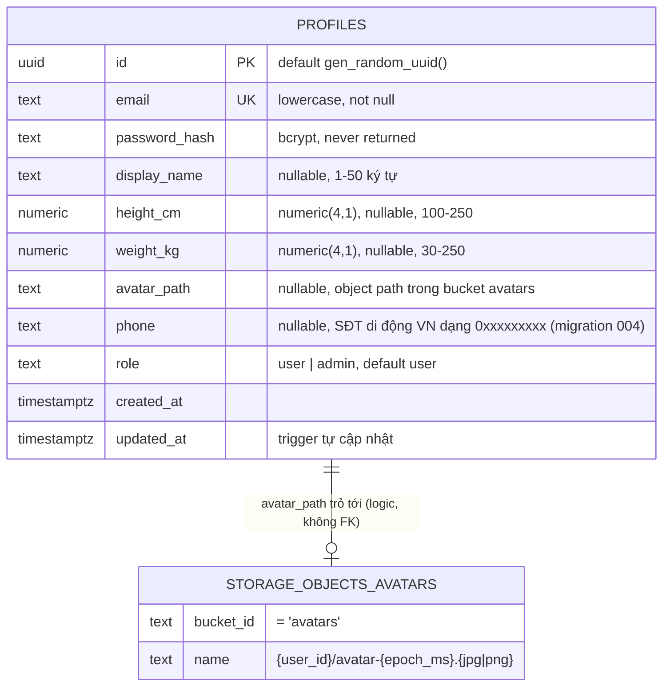

# Thiết kế Database & Storage

> Phạm vi hiện tại: **Sprint 1** (US-01 đăng ký/đăng nhập, US-02 hồ sơ). Migrations: `migrations/001` → `005` (`004` thêm cột `phone`, `005` grant `service_role`; đều đã áp lên Supabase 2026-11-03).

## Mục lục
1. [Nguyên tắc kiến trúc](#1-nguyên-tắc-kiến-trúc)
2. [ERD](#2-erd)
3. [Bảng `profiles`](#3-bảng-profiles)
4. [Storage: bucket `avatars`](#4-storage-bucket-avatars)
5. [Bảo mật: RLS & quyền](#5-bảo-mật-rls--quyền)
6. [Ánh xạ trường API ↔ cột DB](#6-ánh-xạ-trường-api--cột-db)
7. [Seed (dev)](#7-seed-dev)
8. [Quyết định thiết kế](#8-quyết-định-thiết-kế)
9. [Mở rộng cho sprint sau](#9-mở-rộng-cho-sprint-sau)

## 1. Nguyên tắc kiến trúc

- **Không dùng Supabase Auth** (`auth.users`). Backend Express tự hash mật khẩu (`bcrypt`) và phát hành JWT; `profiles` tự chứa `email` + `password_hash`.
- **Chỉ backend truy cập Supabase**, bằng service role key (bypass RLS). Frontend không bao giờ gọi Supabase trực tiếp, không có anon key.
- Tên bảng/cột tiếng Anh `snake_case`; thời gian `timestamptz` (UTC).

## 2. ERD

## 3. Bảng `profiles`

| Cột | Kiểu | Null | Mặc định | Ràng buộc / ghi chú |
|-----|------|------|----------|---------------------|
| `id` | `uuid` | không | `gen_random_uuid()` | PK. Dùng làm `sub` trong JWT |
| `email` | `text` | không | | `UNIQUE`; `CHECK email = lower(btrim(email))`; `CHECK` định dạng cơ bản, ≤ 254 ký tự |
| `password_hash` | `text` | không | | `CHECK` định dạng bcrypt (`$2a/$2b/$2y$`, 60 ký tự). **Không bao giờ select/trả về client** |
| `display_name` | `text` | có | `null` | Nếu có: 1–50 ký tự sau trim |
| `height_cm` | `numeric(4,1)` | có | `null` | 100–250 khi không null. Null = chưa nhập (user mới) |
| `weight_kg` | `numeric(4,1)` | có | `null` | 30–250 khi không null |
| `avatar_path` | `text` | có | `null` | Object path trong bucket `avatars`; `CHECK` phải bắt đầu bằng `{id}/` |
| `phone` | `text` | có | `null` | Thêm ở migration `004`. Số di động VN chuẩn hoá `0xxxxxxxxx` (10 số, đầu 03/05/07/08/09); `CHECK profiles_phone_format`. Không unique |
| `role` | `text` | không | `'user'` | `CHECK role in ('user','admin')` – admin dùng cho Epic 2 |
| `created_at` | `timestamptz` | không | `now()` | |
| `updated_at` | `timestamptz` | không | `now()` | Trigger `profiles_set_updated_at` (BEFORE UPDATE) gọi `public.set_updated_at()` |

**Indexes**
- `profiles_pkey` (id) – lấy/cập nhật hồ sơ theo `sub` trong JWT.
- `profiles_email_unique` (email) – btree do unique constraint tạo; phục vụ login và check trùng.
- Không thêm index khác ở sprint 1 (bảng nhỏ, mọi truy vấn theo PK/email). Index `role` cân nhắc khi có màn hình quản lý user.

**Quy tắc backend phải tuân theo**
- Chuẩn hoá email `trim().toLowerCase()` **trước** khi insert và khi tìm lúc login. DB chặn email chưa chuẩn hoá bằng CHECK (lỗi `23514`), chặn trùng bằng UNIQUE (lỗi `23505` → map `409 EMAIL_EXISTS`).
- Validate ở backend trước (thông báo thân thiện), CHECK ở DB là lớp phòng thủ cuối.
- Luôn select cột tường minh, không `select *` (tránh lộ `password_hash`).
- `phone`: chuẩn hoá **trước** khi ghi: bỏ khoảng trắng, `.`, `-`, `(`, `)`; đầu `+84`/`84` đổi thành `0`; rỗng → `null`. Sau chuẩn hoá phải khớp `^0[35789][0-9]{8}$`, nếu không trả `VALIDATION_ERROR`.
- `height_cm`/`weight_kg`: nhận số, làm tròn 1 chữ số thập phân; PostgREST trả `numeric` dạng số JSON.
- bcrypt cost khuyến nghị 10–12 (seed dùng 10). bcrypt chỉ xử lý 72 byte đầu → giới hạn mật khẩu tối đa 72 ký tự ở validate.

## 4. Storage: bucket `avatars`

| Thuộc tính | Giá trị |
|------------|---------|
| Bucket id/name | `avatars` |
| Public | **false (private)** |
| `file_size_limit` | 5242880 (5 MB) |
| `allowed_mime_types` | `image/jpeg`, `image/png` |
| Object path | `{user_id}/avatar-{epoch_ms}.{jpg\|png}` |
| Truy cập | Chỉ backend (service role). Client nhận **signed URL** (TTL khuyến nghị 1 giờ) |

**Luồng thay ảnh (mỗi user đúng 1 ảnh)**
1. Backend validate loại/dung lượng (và dimension nếu có), upload object mới với path có timestamp.
2. Cập nhật `profiles.avatar_path` = path mới.
3. Nếu bước 2 lỗi → xoá object vừa upload. Nếu thành công → xoá object cũ (best-effort, lỗi xoá chỉ log, không fail request).
4. Trả về `avatarUrl` = signed URL của path mới.

**Luồng xoá ảnh** (`DELETE /api/user/profile/avatar`): đặt `profiles.avatar_path = null` **trước**, sau đó xoá object cũ (best-effort, lỗi chỉ log). Làm theo thứ tự này để `avatar_path` không bao giờ trỏ tới file đã mất; lỗi xoá Storage chỉ để lại file mồ côi. `avatar_path` đã nullable nên không cần migration.

Path có timestamp thay vì ghi đè `avatar.<ext>` để: tránh cache trình duyệt/CDN hiển thị ảnh cũ, không để rác khi đổi đuôi jpg↔png, và không mất ảnh cũ nếu cập nhật DB thất bại.

## 5. Bảo mật: RLS & quyền

- `profiles`: **bật RLS, không có policy nào** cho `anon`/`authenticated` + `REVOKE ALL` khỏi hai role này. Service role có `BYPASSRLS` nên backend vẫn hoạt động. Kết quả: dù anon key bị lộ, PostgREST không đọc/ghi được `profiles` (email, hash, số đo cơ thể).
- **`service_role` cần GRANT mức bảng**: bypass RLS không thay thế GRANT. Project Supabase này không tự cấp quyền cho bảng mới, nên migration `005` cấp `select, insert, update, delete` trên `profiles` cho `service_role`. **Mọi bảng mới ở sprint sau phải có `grant ... to service_role` trong migration tạo bảng** (và không cấp cho `anon`/`authenticated`).
- `storage.objects` (bucket `avatars`): **không tạo policy** cho anon/authenticated → chỉ service role upload/đọc/xoá; bucket private nên không có URL public.
- Service role key chỉ nằm trong `backend/.env`, không bao giờ gửi về frontend hay log.
- Dữ liệu nhạy cảm (ảnh toàn thân, chiều cao, cân nặng): không log, chỉ trả cho chính chủ (lọc theo `id = sub` của JWT).

## 6. Ánh xạ trường API ↔ cột DB

API dùng `camelCase`, DB dùng `snake_case`. API contract chi tiết: `design/flows/README.md`.

| Trường API | Cột DB | Dùng ở | Ghi chú |
|------------|--------|--------|---------|
| `id` | `id` | login response, profile | `sub` trong JWT |
| `email` | `email` | register, login, profile (read-only) | lowercase |
| `password` (request) | `password_hash` | register, login | Chỉ nhận vào, hash/so sánh; không bao giờ có trong response |
| `displayName` | `display_name` | GET/PUT `/api/user/profile` | |
| `heightCm` | `height_cm` | GET/PUT `/api/user/profile` | 100–250 |
| `weightKg` | `weight_kg` | GET/PUT `/api/user/profile` | 30–250 |
| `phone` | `phone` | GET/PUT `/api/user/profile` | Tuỳ chọn; nhận nhiều dạng, lưu/trả dạng `0xxxxxxxxx` hoặc `null` |
| `avatarUrl` (response) | `avatar_path` | GET/PUT `/api/user/profile` | Backend tạo signed URL từ path; `null` nếu chưa có ảnh |
| `avatar` (file upload) | `avatar_path` | PUT `/api/user/profile/avatar` (endpoint riêng, xem `design/flows/avatar-upload.md`) | multipart, ≤ 5MB, jpeg/png |
| `role` | `role` | login response, JWT claim | `user` \| `admin` |
| `createdAt`, `updatedAt` | `created_at`, `updated_at` | profile | |

## 7. Seed (dev)

File `migrations/003_seed_profiles.sql`. **Chỉ dùng dev/test, không chạy production.** Hash bcrypt thật (cost 10). Mật khẩu plaintext KHÔNG nằm trong repo (repo public): lưu ở `backend/.env.seed-accounts` (gitignore); đã đổi ngày 2026-11-03.

| id | Email | Mật khẩu (dev) | Role | Trạng thái hồ sơ | Kịch bản test |
|----|-------|----------------|------|------------------|---------------|
| `…0001` | `newuser@tryon.dev` | (xem `backend/.env.seed-accounts`, không commit) | user | Chưa có tên, số đo, ảnh | Login; mở hồ sơ lần đầu; đăng ký trùng email |
| `…0002` | `member@tryon.dev` | (xem `backend/.env.seed-accounts`) | user | Tên "Lan Anh", 162.0 cm, 50.5 kg; chưa có ảnh | Xem/sửa số đo; upload ảnh lần đầu rồi thay ảnh |
| `…0003` | `admin@tryon.dev` | (xem `backend/.env.seed-accounts`) | admin | Tên "Quản trị viên" | Dự phòng Epic 2 (phân quyền admin) |

`avatar_path` của seed để `null` vì không seed file thật lên Storage; upload qua UI/API để test ảnh.

## 8. Quyết định thiết kế

| Vấn đề | Quyết định | Lý do |
|--------|-----------|-------|
| Bucket public hay private | **Private + signed URL** | Ảnh toàn thân là dữ liệu cá nhân nhạy cảm; URL public có thể bị chia sẻ/đoán ra. Signed URL có hạn, chỉ cấp cho chính chủ. Trade-off: mỗi lần GET profile phải ký URL (chi phí nhỏ) |
| `avatar_path` vs `avatar_url` | **Lưu path** | URL signed thay đổi theo thời gian, không lưu được; path độc lập domain/project, dễ đổi sang public/CDN sau; backend dùng path để xoá ảnh cũ |
| Email unique | `UNIQUE(email)` + `CHECK email = lower(btrim(email))` | Đơn giản hơn unique index trên `lower(email)`: index dùng trực tiếp được cho `where email = $1`, DB bắt buộc dữ liệu đã chuẩn hoá. Không dùng `citext` để tránh phụ thuộc extension |
| Kiểu số đo | `numeric(4,1)` | Chính xác thập phân (vd 50.5 kg), không lỗi làm tròn float; 4,1 đủ cho tối đa 250.0 |
| Số đo nullable | Có | User mới đăng ký chưa nhập; tính năng thử đồ (Epic 3) kiểm tra hồ sơ đủ trước khi dùng |
| `role` | `text` + CHECK | Dễ mở rộng hơn enum type (thêm giá trị không cần `ALTER TYPE`) |
| Cột `phone` | **Có** (migration `004`), tuỳ chọn, không unique | Chốt 2026-11-03: Task 7 ghi "name, email, phone". Chỉ hỗ trợ số di động VN (10 số) vì dự án nhắm thị trường Việt Nam; số bàn/quốc tế để sau. Không unique vì nhiều tài khoản có thể dùng chung số và không dùng phone để đăng nhập. Seed `003` không đổi (đã áp dụng), `phone` seed = null |
| Email sửa được? | Không (US-02 khoá email) | Email là định danh login |

## 9. Mở rộng cho sprint sau

Chỉ ghi nhận hướng, **chưa tạo** ở Task 3:
- **Epic 2:** `categories` (id, name unique, slug…), `products` (id, category_id FK, name, price `numeric(12,0)` VND, flat_lay_path, is_active…); bucket `products` (có thể public vì ảnh sản phẩm không nhạy cảm).
- **Epic 3:** `try_on_results` (profile_id, product_id, avatar_path dùng lúc sinh, result_path, status…) để cache ảnh GenAI; unique (profile_id, product_id, avatar_path); bucket private `try-on-results`. Khi user đổi ảnh/số đo → kết quả cũ hết hiệu lực.
- **Epic 4:** `cart_items` (profile_id, product_id, quantity), `orders`, `order_items` (giá snapshot).
- Dùng lại `public.set_updated_at()` cho bảng mới; giữ nguyên tắc RLS bật + không policy + revoke anon/authenticated.
