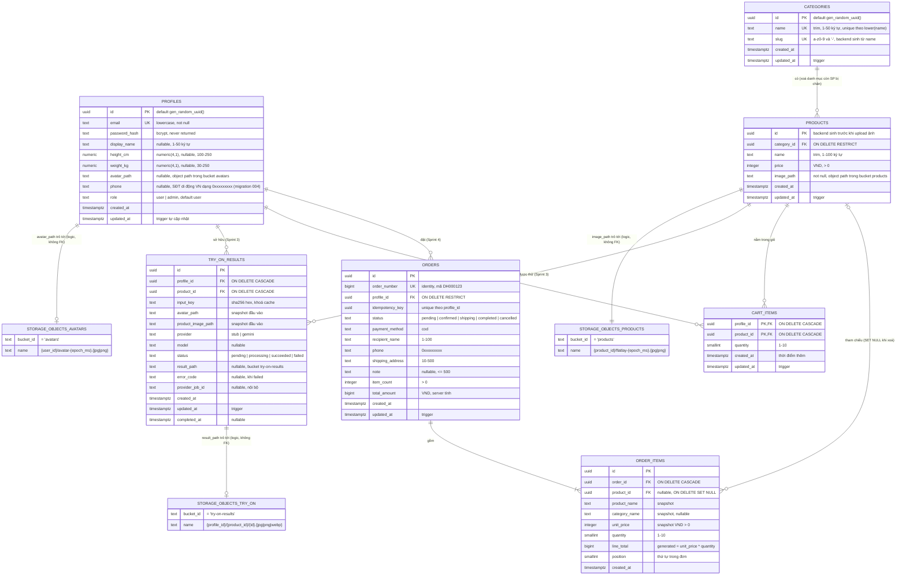

# Thiết kế Database & Storage

> Phạm vi hiện tại: **Sprint 1** (US-01, US-02) + **Sprint 2** (US-03 danh mục, US-04 sản phẩm) + **Sprint 3 – thiết kế** (US-05, US-06 phòng thử đồ). Migrations: `migrations/001` → `009` (`004` cột `phone`, `005` grant `service_role` – áp 2026-11-03; `006` bảng `categories`/`products` + seed 3 danh mục, `007` bucket `products` – áp 2026-11-03; `008` bảng `try_on_results` + cột `profiles.try_on_consent_at`, `009` bucket `try-on-results` – **đã áp qua MCP 2026-11-17**) + **Sprint 4 – thiết kế đề xuất** (US-07/08 giỏ hàng, US-10 đặt hàng, US-09 đơn hàng admin): `010` bảng `cart_items`, `011` bảng `orders`, `order_items` + hàm `place_order` – **ĐÃ ÁP 2026-11-18** (chờ chốt Q23–Q34, `design/flows/README.md` mục 7).

## Mục lục
1. [Nguyên tắc kiến trúc](#1-nguyên-tắc-kiến-trúc)
2. [ERD](#2-erd)
3. [Bảng `profiles`](#3-bảng-profiles)
4. [Storage: bucket `avatars`](#4-storage-bucket-avatars)
5. [Bảo mật: RLS & quyền](#5-bảo-mật-rls--quyền)
6. [Ánh xạ trường API ↔ cột DB](#6-ánh-xạ-trường-api--cột-db)
7. [Seed (dev)](#7-seed-dev)
8. [Quyết định thiết kế](#8-quyết-định-thiết-kế)
9. [Mở rộng cho sprint sau](#9-mở-rộng-cho-sprint-sau)
10. [Bảng `categories` (Sprint 2)](#10-bảng-categories-sprint-2)
11. [Bảng `products` (Sprint 2)](#11-bảng-products-sprint-2)
12. [Storage: bucket `products` (Sprint 2)](#12-storage-bucket-products-sprint-2)
13. [Bảng `try_on_results` + cột `profiles.try_on_consent_at` (Sprint 3)](#13-bảng-try_on_results--cột-profilestry_on_consent_at-sprint-3)
14. [Storage: bucket `try-on-results` (Sprint 3)](#14-storage-bucket-try-on-results-sprint-3)
15. [Bảng `cart_items` (Sprint 4)](#15-bảng-cart_items-sprint-4)
16. [Bảng `orders` (Sprint 4)](#16-bảng-orders-sprint-4)
17. [Bảng `order_items` + hàm `place_order` (Sprint 4)](#17-bảng-order_items--hàm-place_order-sprint-4)

## 1. Nguyên tắc kiến trúc

- **Không dùng Supabase Auth** (`auth.users`). Backend Express tự hash mật khẩu (`bcrypt`) và phát hành JWT; `profiles` tự chứa `email` + `password_hash`.
- **Chỉ backend truy cập Supabase**, bằng service role key (bypass RLS). Frontend không bao giờ gọi Supabase trực tiếp, không có anon key.
- Tên bảng/cột tiếng Anh `snake_case`; thời gian `timestamptz` (UTC).

## 2. ERD

`PROFILES` thêm cột `try_on_consent_at timestamptz` nullable ở migration `008` (Sprint 3, đã áp 2026-11-17).

## 3. Bảng `profiles`

| Cột | Kiểu | Null | Mặc định | Ràng buộc / ghi chú |
|-----|------|------|----------|---------------------|
| `id` | `uuid` | không | `gen_random_uuid()` | PK. Dùng làm `sub` trong JWT |
| `email` | `text` | không | | `UNIQUE`; `CHECK email = lower(btrim(email))`; `CHECK` định dạng cơ bản, ≤ 254 ký tự |
| `password_hash` | `text` | không | | `CHECK` định dạng bcrypt (`$2a/$2b/$2y$`, 60 ký tự). **Không bao giờ select/trả về client** |
| `display_name` | `text` | có | `null` | Nếu có: 1–50 ký tự sau trim |
| `height_cm` | `numeric(4,1)` | có | `null` | 100–250 khi không null. Null = chưa nhập (user mới) |
| `weight_kg` | `numeric(4,1)` | có | `null` | 30–250 khi không null |
| `avatar_path` | `text` | có | `null` | Object path trong bucket `avatars`; `CHECK` phải bắt đầu bằng `{id}/` |
| `phone` | `text` | có | `null` | Thêm ở migration `004`. Số di động VN chuẩn hoá `0xxxxxxxxx` (10 số, đầu 03/05/07/08/09); `CHECK profiles_phone_format`. Không unique |
| `role` | `text` | không | `'user'` | `CHECK role in ('user','admin')` – admin dùng cho Epic 2 |
| `created_at` | `timestamptz` | không | `now()` | |
| `updated_at` | `timestamptz` | không | `now()` | Trigger `profiles_set_updated_at` (BEFORE UPDATE) gọi `public.set_updated_at()` |

**Indexes**
- `profiles_pkey` (id) – lấy/cập nhật hồ sơ theo `sub` trong JWT.
- `profiles_email_unique` (email) – btree do unique constraint tạo; phục vụ login và check trùng.
- Không thêm index khác ở sprint 1 (bảng nhỏ, mọi truy vấn theo PK/email). Index `role` cân nhắc khi có màn hình quản lý user.

**Quy tắc backend phải tuân theo**
- Chuẩn hoá email `trim().toLowerCase()` **trước** khi insert và khi tìm lúc login. DB chặn email chưa chuẩn hoá bằng CHECK (lỗi `23514`), chặn trùng bằng UNIQUE (lỗi `23505` → map `409 EMAIL_EXISTS`).
- Validate ở backend trước (thông báo thân thiện), CHECK ở DB là lớp phòng thủ cuối.
- Luôn select cột tường minh, không `select *` (tránh lộ `password_hash`).
- `phone`: chuẩn hoá **trước** khi ghi: bỏ khoảng trắng, `.`, `-`, `(`, `)`; đầu `+84`/`84` đổi thành `0`; rỗng → `null`. Sau chuẩn hoá phải khớp `^0[35789][0-9]{8}$`, nếu không trả `VALIDATION_ERROR`.
- `height_cm`/`weight_kg`: nhận số, làm tròn 1 chữ số thập phân; PostgREST trả `numeric` dạng số JSON.
- bcrypt cost khuyến nghị 10–12 (seed dùng 10). bcrypt chỉ xử lý 72 byte đầu → giới hạn mật khẩu tối đa 72 ký tự ở validate.

## 4. Storage: bucket `avatars`

| Thuộc tính | Giá trị |
|------------|---------|
| Bucket id/name | `avatars` |
| Public | **false (private)** |
| `file_size_limit` | 5242880 (5 MB) |
| `allowed_mime_types` | `image/jpeg`, `image/png` |
| Object path | `{user_id}/avatar-{epoch_ms}.{jpg\|png}` |
| Truy cập | Chỉ backend (service role). Client nhận **signed URL** (TTL khuyến nghị 1 giờ) |

**Luồng thay ảnh (mỗi user đúng 1 ảnh)**
1. Backend validate loại/dung lượng (và dimension nếu có), upload object mới với path có timestamp.
2. Cập nhật `profiles.avatar_path` = path mới.
3. Nếu bước 2 lỗi → xoá object vừa upload. Nếu thành công → xoá object cũ (best-effort, lỗi xoá chỉ log, không fail request).
4. Trả về `avatarUrl` = signed URL của path mới.

**Luồng xoá ảnh** (`DELETE /api/user/profile/avatar`): đặt `profiles.avatar_path = null` **trước**, sau đó xoá object cũ (best-effort, lỗi chỉ log). Làm theo thứ tự này để `avatar_path` không bao giờ trỏ tới file đã mất; lỗi xoá Storage chỉ để lại file mồ côi. `avatar_path` đã nullable nên không cần migration.

Path có timestamp thay vì ghi đè `avatar.<ext>` để: tránh cache trình duyệt/CDN hiển thị ảnh cũ, không để rác khi đổi đuôi jpg↔png, và không mất ảnh cũ nếu cập nhật DB thất bại.

## 5. Bảo mật: RLS & quyền

- `profiles`: **bật RLS, không có policy nào** cho `anon`/`authenticated` + `REVOKE ALL` khỏi hai role này. Service role có `BYPASSRLS` nên backend vẫn hoạt động. Kết quả: dù anon key bị lộ, PostgREST không đọc/ghi được `profiles` (email, hash, số đo cơ thể).
- **`service_role` cần GRANT mức bảng**: bypass RLS không thay thế GRANT. Project Supabase này không tự cấp quyền cho bảng mới, nên migration `005` cấp `select, insert, update, delete` trên `profiles` cho `service_role`. **Mọi bảng mới ở sprint sau phải có `grant ... to service_role` trong migration tạo bảng** (và không cấp cho `anon`/`authenticated`).
- `try_on_results` (migration `008`, Sprint 3, đã áp 2026-11-17): cùng mô hình – RLS bật, 0 policy, REVOKE anon/authenticated, GRANT `service_role` trong migration tạo bảng. Mọi truy vấn của backend lọc `profile_id = sub` (kể cả GET theo id: không thuộc user → 404).
- `categories`, `products` (migration `006`): cùng mô hình – RLS bật, 0 policy, `REVOKE ALL` anon/authenticated, `GRANT select, insert, update, delete` cho `service_role` ngay trong migration tạo bảng. Đã verify 2026-11-03: `service_role` có quyền (project còn tự gán thêm `REFERENCES/TRIGGER/TRUNCATE`, giống `profiles`), anon/authenticated không có dòng nào.
- `cart_items`, `orders`, `order_items` (migration `010`, `011`, Sprint 4 – **đã áp 2026-11-18**): cùng mô hình (RLS bật, 0 policy, REVOKE anon/authenticated, GRANT `service_role` trong migration tạo bảng; sequence identity của `orders.order_number` cũng chỉ cấp `service_role`). Mọi truy vấn người mua lọc `profile_id = sub`. Hàm `public.place_order`: `SECURITY INVOKER`, `search_path = ''`, **REVOKE EXECUTE khỏi `public, anon, authenticated`** (Postgres mặc định cấp EXECUTE cho `PUBLIC`), chỉ GRANT `service_role`. Verify sau khi áp: `has_function_privilege('anon', 'public.place_order(uuid,uuid,text,text,text,text,bigint)', 'execute')` = false.
- `storage.objects` (bucket `avatars`, `products`, `try-on-results`): **không tạo policy** cho anon/authenticated → chỉ service role upload/đọc/xoá; bucket private nên không có URL public.
- Service role key chỉ nằm trong `backend/.env`, không bao giờ gửi về frontend hay log.
- Dữ liệu nhạy cảm (ảnh toàn thân, chiều cao, cân nặng): không log, chỉ trả cho chính chủ (lọc theo `id = sub` của JWT).

## 6. Ánh xạ trường API ↔ cột DB

API dùng `camelCase`, DB dùng `snake_case`. API contract chi tiết: `design/flows/README.md` (Sprint 2: `category-management.md`, `product-management.md`).

| Trường API | Cột DB | Dùng ở | Ghi chú |
|------------|--------|--------|---------|
| `id` | `id` | login response, profile | `sub` trong JWT |
| `email` | `email` | register, login, profile (read-only) | lowercase |
| `password` (request) | `password_hash` | register, login | Chỉ nhận vào, hash/so sánh; không bao giờ có trong response |
| `displayName` | `display_name` | GET/PUT `/api/user/profile` | |
| `heightCm` | `height_cm` | GET/PUT `/api/user/profile` | 100–250 |
| `weightKg` | `weight_kg` | GET/PUT `/api/user/profile` | 30–250 |
| `phone` | `phone` | GET/PUT `/api/user/profile` | Tuỳ chọn; nhận nhiều dạng, lưu/trả dạng `0xxxxxxxxx` hoặc `null` |
| `avatarUrl` (response) | `avatar_path` | GET/PUT `/api/user/profile` | Backend tạo signed URL từ path; `null` nếu chưa có ảnh |
| `avatar` (file upload) | `avatar_path` | PUT `/api/user/profile/avatar` (endpoint riêng, xem `design/flows/avatar-upload.md`) | multipart, ≤ 5MB, jpeg/png |
| `role` | `role` | login response, JWT claim | `user` \| `admin` |
| `createdAt`, `updatedAt` | `created_at`, `updated_at` | profile, category, product | |
| `name` | `categories.name` / `products.name` | API danh mục / sản phẩm (Sprint 2) | Backend trim trước khi ghi |
| `slug` | `categories.slug` | API danh mục (response) | Backend sinh, client không gửi |
| `categoryId` (request, query) | `products.category_id` | POST/PUT sản phẩm, `GET /api/admin/products?categoryId=` | uuid danh mục tồn tại |
| `category` (response) | join `categories` (`id, name, slug`) | `AdminProduct` | Response không có `categoryId` thô |
| `productCount` (response) | `count(products)` theo `category_id` | `AdminCategory` | Embed count PostgREST |
| `price` | `products.price` | API sản phẩm | Số nguyên VND > 0 |
| `imageUrl` (response) | `products.image_path` | API sản phẩm | Signed URL bucket `products`; không trả `image_path` |
| `image` (file upload) | `products.image_path` | POST/PUT sản phẩm (multipart) | ≤ 5MB, jpeg/png (magic bytes) |
| `tryOnConsentAt` | `profiles.try_on_consent_at` | `Profile` (GET/PUT `/api/user/profile`), `POST /api/try-on/consent` | Sprint 3; `null` = chưa đồng ý |
| `productId` (request/response) | `try_on_results.product_id` | `POST /api/try-on`, `TryOn` | uuid sản phẩm tồn tại |
| `status` (response) | `try_on_results.status` | `TryOn` | `pending`/`processing` gộp thành `processing` |
| `imageUrl` (response `TryOn`) | `try_on_results.result_path` | `TryOn` | Signed URL bucket `try-on-results`; không trả `result_path` |
| `error.code` (response `TryOn`) | `try_on_results.error_code` | `TryOn` khi `failed` | |
| `simulated` (response) | `try_on_results.provider = 'stub'` | `TryOn` | Không trả tên provider |
| `completedAt` | `try_on_results.completed_at` | `TryOn` | |
| `productId`, `quantity`, `addedAt` | `cart_items.product_id`, `quantity`, `created_at` | `CartItem` (Sprint 4) | `price`, `name`, `imageUrl`, `category` join `products`/`categories` lúc đọc |
| `lineTotal`, `total`, `itemCount`, `lineCount` | tính từ `cart_items` × `products.price` | `Cart` | Không có cột; server tính mỗi lần đọc |
| `code` | `orders.order_number` | `Order`, `AdminOrderSummary` | `DH` + đệm 6 chữ số; không trả `order_number` thô |
| `status`, `paymentMethod` | `orders.status`, `payment_method` | `Order` | |
| `recipientName`, `phone`, `shippingAddress`, `note` | `orders.recipient_name`, `phone`, `shipping_address`, `note` | `Order`, `AdminOrder` | Dữ liệu cá nhân: **không** có trong `AdminOrderSummary` |
| `total` (đơn), `itemCount` (đơn) | `orders.total_amount`, `item_count` | `Order`, `AdminOrderSummary` | `bigint` → number JSON |
| `idempotencyKey` (request) | `orders.idempotency_key` | `POST /api/orders` | Không trả ra response |
| `expectedTotal` (request) | – (tham số `p_expected_total` của `place_order`) | `POST /api/orders` | Chỉ để so khớp, không ghi |
| `name`, `categoryName`, `unitPrice`, `lineTotal` (dòng đơn) | `order_items.product_name`, `category_name`, `unit_price`, `line_total` | `OrderItem` | Snapshot; `imageUrl` ký từ `products.image_path` nếu `product_id` còn |
| `customer` | join `profiles` (`id, email, display_name`) | `AdminOrder`, `AdminOrderSummary` | Chỉ API admin |

## 7. Seed (dev)

File `migrations/003_seed_profiles.sql`. **Chỉ dùng dev/test, không chạy production.** Hash bcrypt thật (cost 10). Mật khẩu plaintext KHÔNG nằm trong repo (repo public): lưu ở `backend/.env.seed-accounts` (gitignore); đã đổi ngày 2026-11-03.

| id | Email | Mật khẩu (dev) | Role | Trạng thái hồ sơ | Kịch bản test |
|----|-------|----------------|------|------------------|---------------|
| `…0001` | `newuser@tryon.dev` | (xem `backend/.env.seed-accounts`, không commit) | user | Chưa có tên, số đo, ảnh | Login; mở hồ sơ lần đầu; đăng ký trùng email |
| `…0002` | `member@tryon.dev` | (xem `backend/.env.seed-accounts`) | user | Tên "Lan Anh", 162.0 cm, 50.5 kg; chưa có ảnh | Xem/sửa số đo; upload ảnh lần đầu rồi thay ảnh |
| `…0003` | `admin@tryon.dev` | (xem `backend/.env.seed-accounts`) | admin | Tên "Quản trị viên" | Dự phòng Epic 2 (phân quyền admin) |

`avatar_path` của seed để `null` vì không seed file thật lên Storage; upload qua UI/API để test ảnh.

**Seed danh mục (migration `006`, mọi môi trường – dữ liệu nền theo PB):** `Áo thun`/`ao-thun`, `Váy`/`vay`, `Quần Jeans`/`quan-jeans`. UUID do DB sinh (không cố định) – code/test tra theo `slug`. `on conflict do nothing` nên chạy lại không lỗi. Không seed sản phẩm (cần file ảnh thật; tạo qua UI/API ở Task 5).

## 8. Quyết định thiết kế

| Vấn đề | Quyết định | Lý do |
|--------|-----------|-------|
| Bucket public hay private | **Private + signed URL** | Ảnh toàn thân là dữ liệu cá nhân nhạy cảm; URL public có thể bị chia sẻ/đoán ra. Signed URL có hạn, chỉ cấp cho chính chủ. Trade-off: mỗi lần GET profile phải ký URL (chi phí nhỏ) |
| `avatar_path` vs `avatar_url` | **Lưu path** | URL signed thay đổi theo thời gian, không lưu được; path độc lập domain/project, dễ đổi sang public/CDN sau; backend dùng path để xoá ảnh cũ |
| Email unique | `UNIQUE(email)` + `CHECK email = lower(btrim(email))` | Đơn giản hơn unique index trên `lower(email)`: index dùng trực tiếp được cho `where email = $1`, DB bắt buộc dữ liệu đã chuẩn hoá. Không dùng `citext` để tránh phụ thuộc extension |
| Kiểu số đo | `numeric(4,1)` | Chính xác thập phân (vd 50.5 kg), không lỗi làm tròn float; 4,1 đủ cho tối đa 250.0 |
| Số đo nullable | Có | User mới đăng ký chưa nhập; tính năng thử đồ (Epic 3) kiểm tra hồ sơ đủ trước khi dùng |
| `role` | `text` + CHECK | Dễ mở rộng hơn enum type (thêm giá trị không cần `ALTER TYPE`) |
| Cột `phone` | **Có** (migration `004`), tuỳ chọn, không unique | Chốt 2026-11-03: Task 7 ghi "name, email, phone". Chỉ hỗ trợ số di động VN (10 số) vì dự án nhắm thị trường Việt Nam; số bàn/quốc tế để sau. Không unique vì nhiều tài khoản có thể dùng chung số và không dùng phone để đăng nhập. Seed `003` không đổi (đã áp dụng), `phone` seed = null |
| Email sửa được? | Không (US-02 khoá email) | Email là định danh login |
| Xoá danh mục còn sản phẩm (Sprint 2) | **Chặn**: FK `ON DELETE RESTRICT`, API trả `409 CATEGORY_NOT_EMPTY` | Không mất sản phẩm/ảnh ngoài ý muốn; admin phải xoá hoặc chuyển sản phẩm trước. Cascade sẽ để lại object mồ côi trong Storage (DB không xoá được file) |
| Tên danh mục unique | Unique index trên `lower(name)` + CHECK `name = btrim(name)` | 'Váy' và 'VÁY' bị coi là trùng. Không chuẩn hoá lowercase khi lưu (khác email) vì cần giữ cách viết hiển thị |
| `slug` | Có, unique, backend sinh từ name (bỏ dấu tiếng Việt, `đ`→`d`, lowercase, ký tự khác → `-`), sinh lại khi đổi tên | Dùng cho URL thân thiện ở Sprint 3. Hệ quả: 'Váy' và 'Vay' khác tên nhưng cùng slug → vi phạm `categories_slug_unique` → cũng trả 409 |
| Kiểu giá | **`integer` VND, CHECK > 0** (thay cho `numeric(12,0)` dự kiến ở mục 9) | VND không có phần lẻ; integer (tối đa ~2,1 tỷ) đủ cho quần áo, JSON trả số thường, không bị PostgREST trả chuỗi. Giới hạn trên (khuyến nghị ≤ 100.000.000) validate ở backend, ghi trong API contract (Task 2) |
| Ẩn/hiện sản phẩm | **Không có** cột `is_active` | Chốt phạm vi Sprint 2. Muốn ẩn → xoá. Thêm sau bằng migration mới nếu cần |
| `image_path` bắt buộc | `not null` + CHECK bắt đầu bằng `{id}/` | US-04 yêu cầu ảnh flat lay; Epic 3 cần ảnh để sinh thử đồ. Backend sinh `id` (uuid) trước để đặt path |
| Bucket `products` public hay private | **Private + signed URL** (thay cho "có thể public" ở mục 9) | Nhất quán với `avatars`, tái dùng 1 cơ chế; không lộ ảnh khi chưa đăng nhập. Trade-off: phải ký URL cho mỗi sản phẩm trong danh sách (dùng `createSignedUrls` theo lô) |
| Tên sản phẩm unique? | Không | Có thể trùng tên khác màu/size; phân biệt bằng id |

## 9. Mở rộng cho sprint sau

Chỉ ghi nhận hướng, **chưa tạo**:
- **Epic 2:** đã thiết kế và tạo ở Sprint 2 – xem mục 10–12 (quyết định cuối cùng khác hướng ban đầu: giá `integer`, cột `image_path`, không `is_active`, bucket private).
- **Epic 3:** đã thiết kế ở Sprint 3 – xem mục 13–14 (khác hướng ban đầu: khoá cache là `input_key` băm cả provider/model/phiên bản prompt/ảnh sản phẩm thay vì chỉ `avatar_path`; unique index **một phần** cho `succeeded` và job đang chạy; thêm cột `profiles.try_on_consent_at`).
- **Epic 4:** đã thiết kế ở Sprint 4 (đã áp 2026-11-18) – xem mục 15–17 (khác hướng ban đầu: PK ghép thay cho id riêng ở `cart_items`; `order_items` snapshot cả tên/danh mục, `product_id` SET NULL; tổng `bigint`; hàm `place_order` cho transaction).
- Dùng lại `public.set_updated_at()` cho bảng mới; giữ nguyên tắc RLS bật + không policy + revoke anon/authenticated + **grant `service_role`**.

## 10. Bảng `categories` (Sprint 2)

Migration `006_create_categories_products.sql`.

| Cột | Kiểu | Null | Mặc định | Ràng buộc / ghi chú |
|-----|------|------|----------|---------------------|
| `id` | `uuid` | không | `gen_random_uuid()` | PK |
| `name` | `text` | không | | `CHECK name = btrim(name)`; `CHECK` 1–50 ký tự; unique index `categories_name_lower_unique` trên `lower(name)` |
| `slug` | `text` | không | | `UNIQUE` (`categories_slug_unique`); `CHECK` 1–60 ký tự, `^[a-z0-9]+(-[a-z0-9]+)*$` |
| `created_at` | `timestamptz` | không | `now()` | |
| `updated_at` | `timestamptz` | không | `now()` | Trigger `categories_set_updated_at` → `public.set_updated_at()` |

**Indexes:** `categories_pkey`, `categories_slug_unique` (tra theo slug ở Sprint 3), `categories_name_lower_unique` (chặn trùng tên). Bảng rất nhỏ, danh sách sắp `order by name` hoặc `created_at` không cần index.

**Quy tắc backend**
- `name`: trim, rỗng → `VALIDATION_ERROR`, > 50 ký tự → `VALIDATION_ERROR`. Sinh `slug` từ name; slug rỗng sau chuẩn hoá (tên toàn ký tự đặc biệt) → `VALIDATION_ERROR`.
- Lỗi `23505` (constraint `categories_name_lower_unique` hoặc `categories_slug_unique`) → `409 CATEGORY_EXISTS`.
- Xoá: lỗi `23503` (FK `products_category_id_fkey`) → `409 CATEGORY_NOT_EMPTY`. Có thể đếm sản phẩm trước để trả thông báo kèm số lượng, nhưng vẫn phải bắt `23503` (race giữa đếm và xoá).
- Không tìm thấy id → `404`.

## 11. Bảng `products` (Sprint 2)

Migration `006_create_categories_products.sql`.

| Cột | Kiểu | Null | Mặc định | Ràng buộc / ghi chú |
|-----|------|------|----------|---------------------|
| `id` | `uuid` | không | `gen_random_uuid()` | PK. **Backend tự sinh (`crypto.randomUUID()`) trước khi upload ảnh** để đặt object path |
| `category_id` | `uuid` | không | | FK `products_category_id_fkey` → `categories.id`, `ON DELETE RESTRICT`, `ON UPDATE CASCADE` |
| `name` | `text` | không | | `CHECK name = btrim(name)`; 1–100 ký tự. Không unique |
| `price` | `integer` | không | | VND, `CHECK price > 0` (`products_price_positive`) |
| `image_path` | `text` | không | | Object path bucket `products`; `CHECK image_path like id || '/%'` (`products_image_path_owner`) |
| `created_at` | `timestamptz` | không | `now()` | |
| `updated_at` | `timestamptz` | không | `now()` | Trigger `products_set_updated_at` |

**Indexes**
- `products_pkey` (id).
- `products_category_id_created_at_idx` (`category_id, created_at, id`): lọc theo danh mục ở admin và Sprint 3 (`where category_id = $1 order by created_at, id` – thứ tự ổn định để "sản phẩm đầu tiên"/"tiếp theo" của US-05/06 không nhảy). Cột đầu `category_id` cũng phục vụ kiểm tra FK khi xoá danh mục, nên không cần index riêng `category_id`.
- Danh sách admin không lọc (`order by created_at desc`) chưa cần index ở quy mô hiện tại.

**Quy tắc backend**
- Validate trước: `name` trim 1–100; `price` là số nguyên > 0 (không nhận chuỗi có dấu chấm/phẩy, không nhận số lẻ); `categoryId` là uuid và tồn tại (không tồn tại → lỗi validate, DB trả `23503` khi insert là lớp cuối); ảnh bắt buộc khi tạo.
- Lỗi DB: `23514` (CHECK) → `400 VALIDATION_ERROR`; `23503` khi insert/update → `400 VALIDATION_ERROR` với `fields.categoryId` (chốt ở API contract Task 2, `design/flows/README.md` D20). Giá trần 100.000.000 validate ở backend (D21).
- Select cột tường minh, không trả `image_path` cho client – trả `imageUrl` (signed URL).

## 12. Storage: bucket `products` (Sprint 2)

Migration `007_create_products_bucket.sql`.

| Thuộc tính | Giá trị |
|------------|---------|
| Bucket id/name | `products` |
| Public | **false (private)** |
| `file_size_limit` | 5242880 (5 MB) |
| `allowed_mime_types` | `image/jpeg`, `image/png` |
| Object path | `{product_id}/flatlay-{epoch_ms}.{jpg\|png}` (tên file do server tạo, không dùng `originalname`) |
| Truy cập | Chỉ backend (service role), không policy. Client nhận signed URL (TTL 1 giờ như avatar); danh sách dùng `createSignedUrls` theo lô |

Backend vẫn kiểm tra magic bytes (`detectImageType` trong `avatarService.js`) – giới hạn của bucket chỉ là lớp cuối. Nên tổng quát hoá logic upload/xoá object của avatar thành hàm nhận `bucket` (Sprint 2 Task 5).

**Luồng tạo sản phẩm:** sinh `id` → upload object `{id}/flatlay-{ts}.{ext}` → insert row với `id` và `image_path` đó → nếu insert lỗi: xoá object vừa upload (không để object mồ côi), trả lỗi.

**Luồng thay ảnh (sửa sản phẩm):** giống avatar – upload object mới → update `image_path` → update lỗi thì xoá object mới; thành công thì xoá object cũ (best-effort, chỉ log).

**Luồng xoá sản phẩm:** delete row **trước** → xoá object (best-effort, chỉ log). Thứ tự này đảm bảo không có row trỏ tới file đã mất; lỗi Storage chỉ để lại file mồ côi.

**Xoá danh mục:** chỉ thành công khi không còn sản phẩm, nên không bao giờ phải dọn Storage.

**Sprint 3:** thay ảnh / xoá sản phẩm phải dọn thêm ảnh kết quả thử đồ của sản phẩm đó (mục 13, `design/flows/try-on-room.md` mục 8).

## 13. Bảng `try_on_results` + cột `profiles.try_on_consent_at` (Sprint 3)

Migration `008_create_try_on_results.sql` – **ĐÃ ÁP 2026-11-17** ( chỉ sửa comment theo Q12 đã chốt, cấu trúc không đổi). Provider: `stub` (mặc định) / `gemini`. Flow: `design/flows/try-on-room.md`.

**Cột mới ở `profiles`:** `try_on_consent_at timestamptz null` – thời điểm user đồng ý gửi ảnh toàn thân tới dịch vụ AI (Q14). Không cần index (đọc theo PK). Trả ra API dạng `tryOnConsentAt`.

| Cột | Kiểu | Null | Mặc định | Ràng buộc / ghi chú |
|-----|------|------|----------|---------------------|
| `id` | `uuid` | không | `gen_random_uuid()` | PK; dùng làm tên file kết quả |
| `profile_id` | `uuid` | không | | FK → `profiles.id` `ON DELETE CASCADE` |
| `product_id` | `uuid` | không | | FK → `products.id` `ON DELETE CASCADE` |
| `input_key` | `text` | không | | SHA-256 hex (64 ký tự) của `provider`, `model`, phiên bản prompt (`promptVersion`, hằng trong backend – không có cột riêng), `avatar_path`, `product_image_path` (+ `height_cm`, `weight_kg` nếu provider dùng số đo). CHECK `^[0-9a-f]{64}$` |
| `avatar_path` | `text` | không | | Snapshot `profiles.avatar_path` lúc tạo job; CHECK bắt đầu bằng `{profile_id}/`. Job đọc ảnh theo snapshot này, không theo giá trị hiện tại |
| `product_image_path` | `text` | không | | Snapshot `products.image_path`; CHECK bắt đầu bằng `{product_id}/` |
| `provider` | `text` | không | | `stub` hoặc `gemini` (Q12 đã chốt 2026-11-17; CHECK định dạng chung để thêm provider sau không cần migration). CHECK `^[a-z0-9_-]{1,30}$`. Không trả client (chỉ suy ra `simulated`) |
| `model` | `text` | có | | Tên model thực dùng (vd `gemini-3.1-flash-image`; stub: `stub`) |
| `status` | `text` | không | `'pending'` | CHECK `pending` / `processing` / `succeeded` / `failed` |
| `result_path` | `text` | có | | Object path bucket `try-on-results`; CHECK có giá trị **khi và chỉ khi** `succeeded`; CHECK bắt đầu bằng `{profile_id}/{product_id}/` |
| `error_code` | `text` | có | | Bắt buộc khi `failed`; CHECK `^[A-Z_]{1,40}$` (`GENERATION_FAILED`, `GENERATION_TIMEOUT`, `INPUT_REJECTED`, `PROVIDER_UNAVAILABLE`) |
| `provider_job_id` | `text` | có | | Id phía provider để debug (Gemini: `responseId` của phản hồi, nếu có), không trả client |
| `created_at` | `timestamptz` | không | `now()` | Dùng đếm hạn mức ngày |
| `updated_at` | `timestamptz` | không | `now()` | Trigger `try_on_results_set_updated_at`; dùng phát hiện job treo |
| `completed_at` | `timestamptz` | có | | CHECK có giá trị **khi và chỉ khi** `succeeded`/`failed` |

**Indexes**
- `try_on_results_succeeded_unique` – unique (`profile_id, product_id, input_key`) `WHERE status = 'succeeded'`: tra cache, 1 kết quả mỗi khoá.
- `try_on_results_active_unique` – unique (`profile_id, product_id, input_key`) `WHERE status IN ('pending','processing')`: chống sinh trùng khi 2 request song song (lỗi `23505` → đọc lại row).
- `try_on_results_profile_created_idx` (`profile_id, created_at`): đếm hạn mức ngày, dọn theo user.
- `try_on_results_product_id_idx` (`product_id`): dọn khi admin thay/xoá ảnh sản phẩm; phục vụ FK cascade khi xoá sản phẩm.
- Row `failed` không bị unique chặn → giữ nhiều lần thử làm nhật ký.

**Quy tắc backend**
- Chuyển trạng thái có điều kiện: `pending → processing` (`WHERE status = 'pending'`), `processing → succeeded|failed` (`WHERE status = 'processing'`); 0 dòng → row đã bị dọn/đổi, job dừng và xoá object vừa upload. Đặt `completed_at = now()` khi kết thúc.
- Job treo: `pending`/`processing` có `updated_at < now() - (TRY_ON_TIMEOUT_MS + 30 s)` → `failed` + `GENERATION_TIMEOUT` khi đọc lại.
- Hạn mức ngày: `count(*) WHERE profile_id = $1 AND status <> 'failed' AND created_at >= <00:00 hôm nay giờ Asia/Ho_Chi_Minh>`.
- Dọn dữ liệu (xoá row trước, object sau, best-effort): thay/xoá ảnh toàn thân → theo `profile_id`; thay ảnh/xoá sản phẩm → theo `product_id` (với xoá sản phẩm: SELECT `result_path` **trước** khi DELETE sản phẩm vì cascade xoá mất row).
- Select cột tường minh; không trả `*_path`, `input_key`, `provider`, `provider_job_id`.

## 14. Storage: bucket `try-on-results` (Sprint 3)

Migration `009_create_try_on_results_bucket.sql` – **ĐÃ ÁP 2026-11-17**.

| Thuộc tính | Giá trị |
|------------|---------|
| Bucket id/name | `try-on-results` |
| Public | **false (private)** – ảnh chứa hình người dùng |
| `file_size_limit` | 10485760 (10 MB) |
| `allowed_mime_types` | `image/jpeg`, `image/png`, `image/webp` |
| Object path | `{profile_id}/{product_id}/{try_on_result_id}.{jpg\|png\|webp}` (server đặt, đuôi và `contentType` theo magic bytes của ảnh provider trả – ảnh Gemini có thể khác kích thước/mime ảnh vào; jpeg/png/webp đã đủ) |
| Truy cập | Chỉ backend (service role), không policy. Client nhận signed URL TTL 3600 s, chỉ cho chủ sở hữu |

**Quyết định thiết kế (Sprint 3)**

| Vấn đề | Quyết định | Lý do |
|--------|-----------|-------|
| Lưu ảnh kết quả ở đâu | Bucket private riêng, không dùng URL của provider | Gemini trả ảnh base64 trong phản hồi (không có URL lưu phía provider); cache cần bền và nằm trong kiểm soát của dự án |
| Khoá cache | `input_key` băm (provider, model, phiên bản prompt, ảnh người, ảnh sản phẩm, [số đo]) | Một cột cho mọi yếu tố đầu vào; đổi provider/model/prompt/ảnh tự sinh lại, không cần migration khi thêm yếu tố (vì vậy không thêm cột `prompt_version`) |
| 1 bảng cho cache + job | Có (`status`) | Đơn giản, đủ cho 1 instance; nhật ký lỗi nằm cùng chỗ |
| Hạn mức lưu ở đâu | Đếm từ `try_on_results` | Bền qua restart; không cần bảng riêng |
| FK cascade | `ON DELETE CASCADE` tới `profiles`, `products` | Kết quả vô nghĩa khi người/sản phẩm mất; khác `categories → products` (RESTRICT) vì không có rủi ro mất dữ liệu nghiệp vụ. Object phải dọn bằng code |
| Snapshot path đầu vào | Có (`avatar_path`, `product_image_path`) | Job chạy sau khi request trả về; đọc đúng ảnh tại thời điểm yêu cầu; dọn theo ảnh cũ |
| Đồng ý xử lý ảnh | Cột `profiles.try_on_consent_at` | Ảnh toàn thân gửi tới Google Gemini API (bên thứ ba) cần đồng ý rõ ràng, lưu thời điểm để kiểm chứng (Q14) |

## 15. Bảng `cart_items` (Sprint 4)

Migration `010_create_cart_items.sql` – **ĐÃ ÁP 2026-11-18** (viết 2026-11-18; chờ chốt Q23, Q25, Q26, Q33). Flow: `design/flows/cart-and-orders.md` mục 4, 6, 7.

| Cột | Kiểu | Null | Mặc định | Ràng buộc / ghi chú |
|-----|------|------|----------|---------------------|
| `profile_id` | `uuid` | không | | PK (cùng `product_id`); FK → `profiles.id` `ON DELETE CASCADE` |
| `product_id` | `uuid` | không | | PK; FK → `products.id` `ON DELETE CASCADE` (sản phẩm bị xoá tự rời giỏ, Q30) |
| `quantity` | `smallint` | không | `1` | CHECK 1–10 (`cart_items_quantity_range`) |
| `created_at` | `timestamptz` | không | `now()` | Thời điểm thêm lần đầu; sắp xếp giỏ `created_at desc, product_id` |
| `updated_at` | `timestamptz` | không | `now()` | Trigger `cart_items_set_updated_at` |

**Không có cột giá**: giá/tổng luôn tính từ `products.price` hiện tại (D34).

**Indexes**
- `cart_items_pkey` (`profile_id, product_id`): đọc giỏ theo user (cột đầu), một dòng mỗi sản phẩm, bắt `23505` khi 2 tab cùng thêm.
- `cart_items_product_id_idx` (`product_id`): FK cascade khi admin xoá sản phẩm.

**Quy tắc backend**
- POST thêm: sản phẩm phải tồn tại (404 `PRODUCT_NOT_FOUND`; `23503` khi race cũng → 404); có dòng → `UPDATE … SET quantity = quantity + n WHERE … AND quantity + n <= 10` (0 dòng → 409 `CART_QUANTITY_LIMIT`); chưa có → đếm dòng (≥ 50 → 409 `CART_FULL`) rồi INSERT; INSERT `23505` → chuyển sang UPDATE cộng dồn. Giới hạn 50 dòng là **mềm** (race có thể dư 1–2 dòng, chấp nhận). supabase-js không biểu diễn được `quantity = quantity + n` nên cộng dồn là **đọc rồi ghi có điều kiện** (optimistic): `UPDATE … SET quantity = cũ + n WHERE profile_id, product_id AND quantity = cũ`; 0 dòng (tab khác vừa đổi) → đọc lại và lặp tối đa 3 lần; dòng biến mất → coi như chưa có (INSERT); hết lượt lặp → 500 (hiếm, log). Không thêm hàm SQL cho giỏ.
- `23514` (CHECK quantity) → 400 `VALIDATION_ERROR` (lớp cuối; validate trước).
- Đọc giỏ: join `products(id, name, price, image_path, category:categories(id, name))`, ký URL theo lô (`signUrls`), không trả `image_path`.

## 16. Bảng `orders` (Sprint 4)

Migration `011_create_orders.sql` – **ĐÃ ÁP 2026-11-18** (chờ chốt Q24, Q27–Q29). Chứa **dữ liệu cá nhân** (tên, SĐT, địa chỉ).

| Cột | Kiểu | Null | Mặc định | Ràng buộc / ghi chú |
|-----|------|------|----------|---------------------|
| `id` | `uuid` | không | `gen_random_uuid()` | PK; dùng trên URL/API |
| `order_number` | `bigint` | không | identity (`generated always`) | UNIQUE; mã hiển thị `DH` + đệm 6 chữ số (D41) |
| `profile_id` | `uuid` | không | | FK → `profiles.id` **`ON DELETE RESTRICT`** (không âm thầm mất lịch sử đơn; dọn user test phải xoá đơn trước) |
| `idempotency_key` | `uuid` | không | | UNIQUE (`profile_id, idempotency_key`) – `orders_idempotency_unique` (D36) |
| `status` | `text` | không | `'pending'` | CHECK `pending/confirmed/shipping/completed/cancelled`; Sprint 4 chỉ tạo `pending` (Q29) |
| `payment_method` | `text` | không | `'cod'` | CHECK `in ('cod')` (Q28); thêm phương thức = migration mới |
| `recipient_name` | `text` | không | | Đã trim, 1–100 |
| `phone` | `text` | không | | CHECK `^0[35789][0-9]{8}$` (như `profiles_phone_format`) |
| `shipping_address` | `text` | không | | Đã trim, 10–500 |
| `note` | `text` | có | | Nếu có: đã trim, 1–500 |
| `item_count` | `integer` | không | | Σ quantity, > 0 |
| `total_amount` | `bigint` | không | | VND, > 0; = Σ `order_items.line_total` (do `place_order` tính) |
| `created_at` | `timestamptz` | không | `now()` | |
| `updated_at` | `timestamptz` | không | `now()` | Trigger `orders_set_updated_at` (dùng khi admin đổi trạng thái ở sprint sau) |

**Indexes**
- `orders_status_created_idx` (`status, created_at desc, id desc`): admin lọc theo trạng thái + phân trang.
- `orders_created_idx` (`created_at desc, id desc`): admin không lọc.
- `orders_profile_created_idx` (`profile_id, created_at desc`): đơn của người mua (Q34, sprint sau) và kiểm tra FK RESTRICT khi xoá profile.
- `orders_idempotency_unique`, `orders_order_number_unique` (do constraint tạo).

**Quy tắc backend**
- Chỉ tạo đơn qua `rpc('place_order')` (mục 17); không INSERT `orders` trực tiếp.
- Người mua: `GET /api/orders/:id` lọc `id = :id AND profile_id = sub` → không có → 404 `ORDER_NOT_FOUND`.
- Admin danh sách: select cột tường minh **không** gồm `phone`, `shipping_address`, `note`; `count: 'exact'` + `.range((page-1)*pageSize, page*pageSize-1)`; join `profiles(id, email, display_name)`.
- Không trả `profile_id`, `idempotency_key`, `order_number` thô; không log các cột dữ liệu cá nhân.

## 17. Bảng `order_items` + hàm `place_order` (Sprint 4)

Migration `011_create_orders.sql` – **ĐÃ ÁP 2026-11-18** (chờ chốt Q30, Q32).

| Cột | Kiểu | Null | Mặc định | Ràng buộc / ghi chú |
|-----|------|------|----------|---------------------|
| `id` | `uuid` | không | `gen_random_uuid()` | PK |
| `order_id` | `uuid` | không | | FK → `orders.id` `ON DELETE CASCADE` |
| `product_id` | `uuid` | có | | FK → `products.id` **`ON DELETE SET NULL`**: admin xoá sản phẩm không mất dòng đơn (D38) |
| `product_name` | `text` | không | | Snapshot `products.name`; đã trim, 1–100 |
| `category_name` | `text` | có | | Snapshot `categories.name` (hiển thị) |
| `unit_price` | `integer` | không | | Snapshot `products.price` lúc đặt, > 0 |
| `quantity` | `smallint` | không | | 1–10 |
| `line_total` | `bigint` | không | generated `unit_price::bigint * quantity` stored | Không ghi trực tiếp |
| `position` | `smallint` | không | | Thứ tự hiển thị (0-based, theo thứ tự giỏ); UNIQUE (`order_id, position`) |
| `created_at` | `timestamptz` | không | `now()` | |

**Indexes:** `order_items_order_position_unique` (`order_id, position`) – đọc dòng theo đơn đúng thứ tự; `order_items_product_id_idx` – FK SET NULL khi xoá sản phẩm.

**Không snapshot ảnh** (Q32): `imageUrl` ký từ `products.image_path` hiện tại khi `product_id` còn; sản phẩm đã xoá → `imageUrl: null`. Không thêm bucket. Hệ quả: admin thay ảnh sản phẩm thì đơn cũ hiện ảnh mới (chấp nhận ở quy mô demo).

**Hàm `public.place_order(p_profile_id uuid, p_idempotency_key uuid, p_recipient_name text, p_phone text, p_shipping_address text, p_note text, p_expected_total bigint) returns table (out_order_id uuid, out_created boolean)`** – PL/pgSQL, một transaction (D35):
1. `SELECT … FROM profiles WHERE id = p_profile_id FOR UPDATE` – tuần tự hoá mọi lượt đặt của cùng user; không có → `P0001 'PROFILE_NOT_FOUND'`.
2. Đã có đơn với (`profile_id`, `idempotency_key`) → trả `(id, false)`.
3. Khoá `cart_items` của user `FOR UPDATE` và `products` liên quan `FOR SHARE` (admin sửa giá/xoá sản phẩm phải chờ transaction xong).
4. Tính số dòng, Σ quantity, Σ `price × quantity`; 0 dòng → `P0001 'CART_EMPTY'`; tổng ≠ `p_expected_total` → `P0001 'CART_CHANGED'` (rollback toàn bộ).
5. INSERT `orders` (`pending`, `cod`), INSERT `order_items` (snapshot + `position`), DELETE `cart_items` của user, trả `(id, true)`.

Bảo mật: `SECURITY INVOKER` (chạy bằng quyền `service_role` của backend, cần GRANT bảng – đã có), `set search_path = ''` (mọi bảng ghi đủ schema `public.`), `REVOKE EXECUTE … FROM public, anon, authenticated`, `GRANT EXECUTE … TO service_role`. Backend ánh xạ: `error.code = 'P0001'` + `message` ∈ {`CART_EMPTY`, `CART_CHANGED`} → 409 cùng mã; `PROFILE_NOT_FOUND` → 401 `INVALID_TOKEN`; `23505` (dự phòng) → đọc lại đơn theo khoá → 200; khác → 500.

**Quyết định thiết kế (Sprint 4, đã chốt 2026-11-18)**

| Vấn đề | Quyết định | Lý do |
|--------|-----------|-------|
| Giỏ lưu ở đâu | Bảng `cart_items` ở server (Q23, D32) | Đồng bộ thiết bị/tab; tính tiền ở server; chỉ backend truy cập DB |
| Khoá giỏ | PK ghép (`profile_id, product_id`), không cột `id` | Mỗi sản phẩm một dòng là bất biến nghiệp vụ; API định danh dòng bằng `productId` |
| Lưu giá trong giỏ | Không (D34) | Một nguồn giá duy nhất; giá chốt bằng snapshot khi đặt |
| Kiểu tổng tiền | `bigint` (`total_amount`, `line_total`) | 50 × 10 × 100.000.000 = 5·10^10 > `integer` |
| Transaction đặt hàng | Hàm Postgres `place_order` gọi qua RPC (D35) | supabase-js không có transaction; tránh đơn thiếu dòng / giỏ không xoá |
| Xoá sản phẩm có trong đơn | `order_items.product_id` SET NULL + snapshot tên/danh mục/giá (D38) | Giữ lịch sử đơn; luồng xoá sản phẩm Sprint 2 không phải đổi |
| Xoá user có đơn | `orders.profile_id` RESTRICT | Không mất đơn ngoài ý muốn; chưa có tính năng xoá tài khoản |
| Snapshot ảnh | Không (Q32) | Tránh copy object/bucket mới; tên + giá đủ cho lịch sử |
| Trạng thái đơn | `text` + CHECK đủ 5 giá trị, Sprint 4 chỉ `pending` (Q29) | Thêm "admin đổi trạng thái" sau không cần migration |
| Mã đơn | `order_number` identity + uuid `id` (D41) | Mã ngắn dễ đọc; URL không đoán được |
