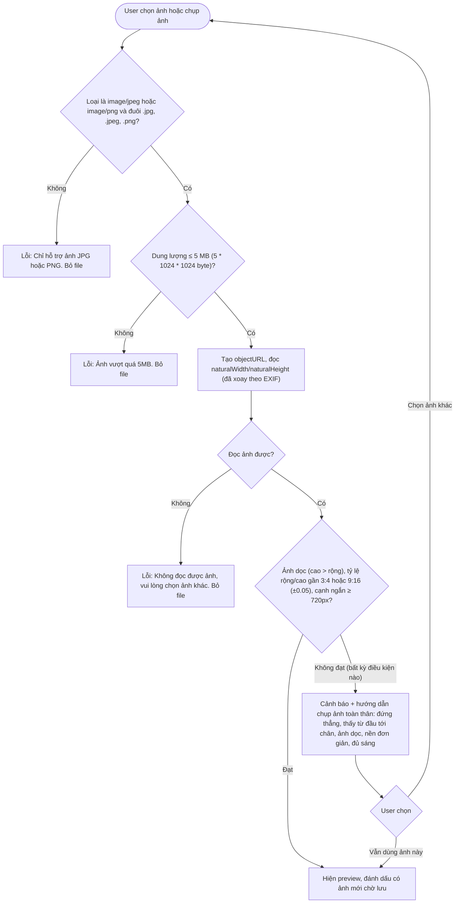
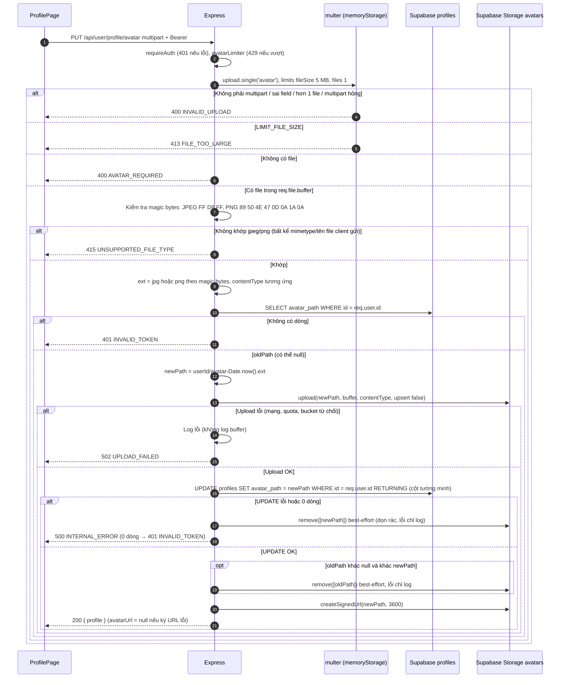
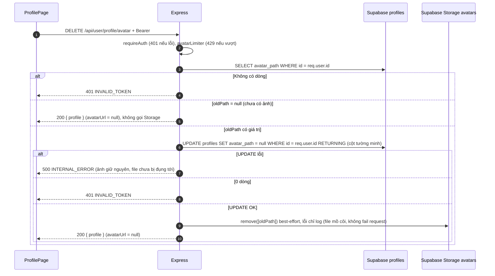

# Flow: Upload ảnh toàn thân (avatar)

> US-02 · Task 7 · `PUT` và `DELETE /api/user/profile/avatar` · Storage: `design/database/schema.md` mục 4 · Quy ước: [README.md](README.md)

## Tóm tắt
Mỗi user có **đúng 1 ảnh**. Ảnh mới upload vào bucket private `avatars` với path có timestamp, cập nhật `profiles.avatar_path`, xoá ảnh cũ (best-effort), trả `profile` kèm signed URL mới. Upload thành công nhưng cập nhật DB lỗi → xoá file vừa upload. User cũng có thể **xoá ảnh** để về trạng thái chưa có ảnh (mục 4, README D18).

## Request

```
PUT /api/user/profile/avatar
Authorization: Bearer <token>
Content-Type: multipart/form-data; boundary=...   (trình duyệt tự đặt, apiClient không set khi body là FormData)

field "avatar": 1 file image/jpeg hoặc image/png, ≤ 5 MB
```

Frontend: `const fd = new FormData(); fd.append('avatar', file); apiClient.put('/user/profile/avatar', fd)`.

**Response 200**: `{ "success": true, "data": { "profile": Profile } }`, `profile.avatarUrl` là signed URL của ảnh mới.

## 1. Kiểm tra phía client (khi chọn file, trước khi bấm Lưu)



- Kiểm tra tỷ lệ/kích thước chỉ **cảnh báo** (README D14, câu hỏi Q3). Loại và dung lượng **chặn**.
- Chọn ảnh khác thay ảnh đang chờ; `URL.revokeObjectURL` ảnh preview cũ.
- Input: `accept="image/jpeg,image/png"`; trên mobile cho phép chụp trực tiếp.

## 2. Xử lý phía server

Thứ tự middleware: `requireAuth` → `avatarLimiter` (20 / 15 phút theo `req.user.id`) → kiểm tra `req.is('multipart/form-data')` (sai → 400 `INVALID_UPLOAD`, vì multer bỏ qua request không phải multipart) → `multer` → controller. `requireAuth` chạy **trước** multer để không nhận file của request chưa xác thực.

Ánh xạ lỗi multer (`err instanceof multer.MulterError`): `LIMIT_FILE_SIZE` → 413 `FILE_TOO_LARGE`; `LIMIT_UNEXPECTED_FILE`, `LIMIT_FILE_COUNT` và mã khác → 400 `INVALID_UPLOAD`; lỗi stream không phải MulterError → 400 `INVALID_UPLOAD`. Không trả `err.filename` (input không tin cậy).



## 3. Phản hồi ở frontend

| Kết quả | UI |
|---------|----|
| 200 | Thay preview bằng `profile.avatarUrl`, revoke objectURL, bỏ trạng thái "ảnh chờ lưu", toast theo bảng ở `profile.md` mục 3 |
| 400 / 413 / 415 | Message của server dưới khu vực ảnh, giữ file để user chọn lại |
| 429 / 502 / 500 / `NETWORK_ERROR` | Message thân thiện + nút "Thử lại tải ảnh", giữ file đã chọn |
| 401 | Xử lý chung (về `/login`) |

Trong lúc upload: hiển thị trạng thái đang tải trên khung ảnh, disable chọn ảnh và nút Lưu.

## Ghi chú
- Đúng quy ước schema: path `{user_id}/avatar-{epoch_ms}.{jpg|png}`, thoả CHECK `profiles_avatar_path_owner`. Bucket đã giới hạn 5 MB và MIME jpeg/png ở mức Storage: là lớp phòng thủ thứ hai.
- Hai upload đồng thời của cùng user có thể để lại 1 file mồ côi (cả hai đọc cùng `oldPath`). Hiếm, chấp nhận ở Sprint 1; client đã chặn submit lặp.
- Không log ảnh, tên file gốc, kích thước cơ thể. `req.file.originalname` không được dùng cho path.

## 4. Xoá ảnh toàn thân (`DELETE /api/user/profile/avatar`)

Q5 đã chốt: có nút xoá ảnh (README D18). Xoá là hành động **riêng, thực hiện ngay**, không đi cùng nút Lưu.

```
DELETE /api/user/profile/avatar
Authorization: Bearer <token>        (không body)
```

**Response 200**: `{ "success": true, "data": { "profile": Profile } }` với `profile.avatarUrl = null`. Idempotent: user chưa có ảnh vẫn nhận 200.

Thứ tự middleware: `requireAuth` → `avatarLimiter` (dùng chung bộ đếm với PUT) → controller. Không cần multer.



**Vì sao cập nhật DB trước khi xoá file**: nếu xoá file trước rồi DB lỗi, `avatar_path` trỏ tới file không còn, ảnh hỏng vĩnh viễn. Làm ngược lại, lỗi xoá Storage chỉ để lại 1 file mồ côi (tốn dung lượng, không ảnh hưởng người dùng).

### Frontend

Hai hành động khác nhau, hiển thị theo trạng thái:

| Trạng thái khung ảnh | Nút | Hành vi |
|----------------------|-----|---------|
| Có ảnh đã lưu, chưa chọn ảnh mới | **Xoá ảnh** | Mở hộp thoại xác nhận (xem dưới) → gọi `DELETE` |
| Đã chọn ảnh mới, chưa Lưu | **Bỏ ảnh đã chọn** | Chỉ phía client: revoke objectURL, quay lại ảnh đã lưu (nếu có). Không gọi API |
| Chưa có ảnh, chưa chọn gì | (không hiện nút xoá) | – |

- **Xác nhận**: "Xoá ảnh toàn thân? Bạn cần tải ảnh mới để dùng tính năng thử đồ." với nút "Xoá ảnh" (nhấn mạnh hành động nguy hiểm) và "Huỷ".
- Trong lúc gọi API: disable nút Xoá, nút Lưu và chọn ảnh; hiện trạng thái đang xử lý.
- Khi đang có ảnh mới chờ lưu thì **không** hiện "Xoá ảnh" (tránh nhầm với ảnh đang chọn).

| Kết quả | UI |
|---------|----|
| 200 | Khung ảnh về trạng thái chưa có ảnh (placeholder + hướng dẫn chọn ảnh), toast "Đã xoá ảnh." |
| 429 / 500 / `NETWORK_ERROR` | Toast message thân thiện, giữ nguyên ảnh hiện tại, cho bấm lại |
| 401 | Xử lý chung (về `/login`) |

### Ảnh hưởng tới tính năng sau
Epic 3 (thử đồ) cần ảnh toàn thân: user chưa có ảnh (kể cả sau khi xoá) phải được hướng dẫn quay lại `/profile` để tải ảnh. Kết quả thử đồ đã cache theo `avatar_path` cũ hết hiệu lực khi ảnh bị xoá (xem `schema.md` mục 9).
