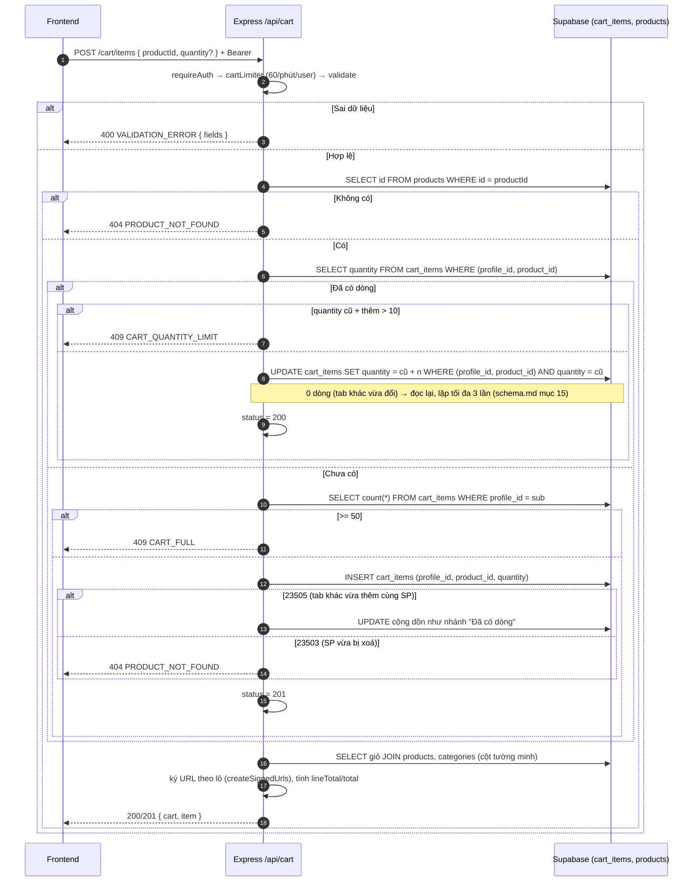
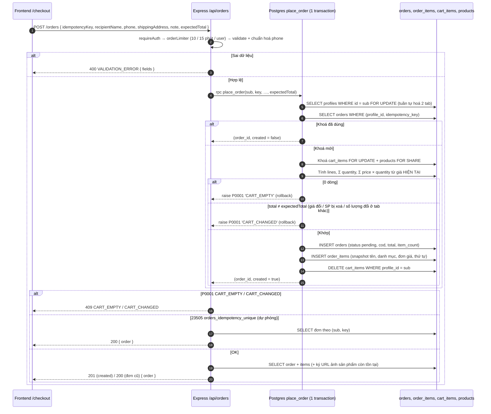
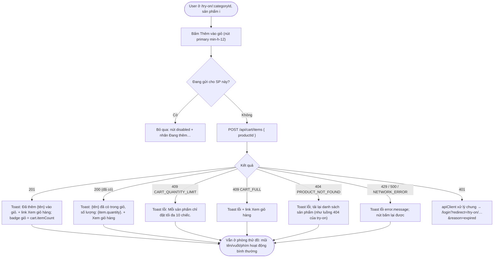
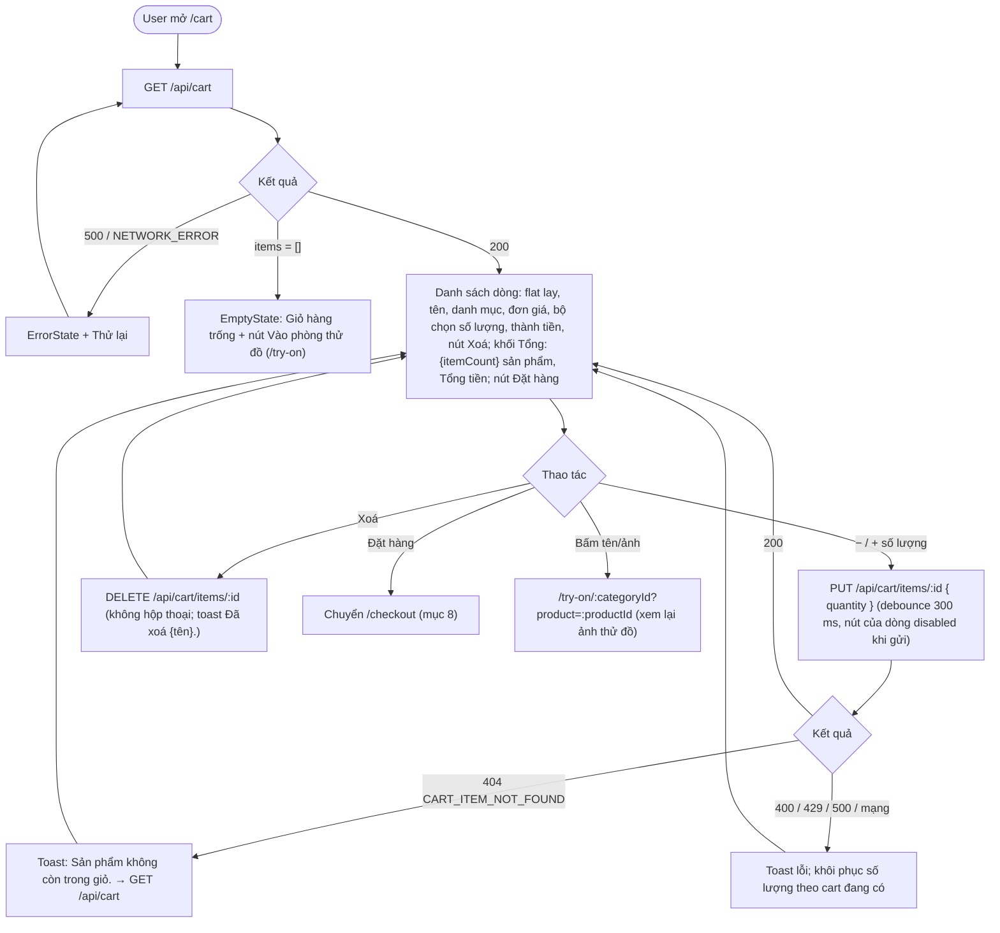
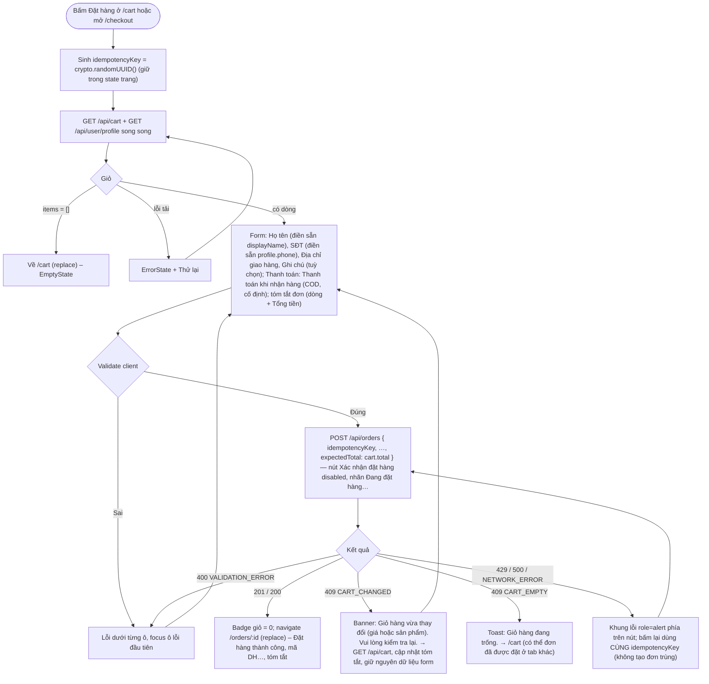
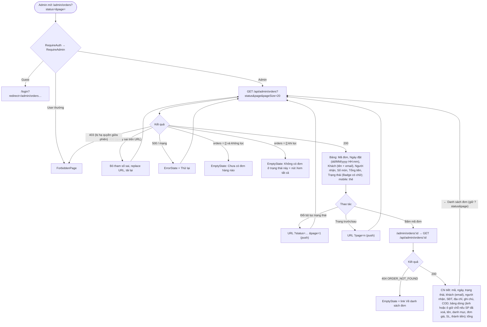

# Flow: Giỏ hàng, đặt hàng, đơn hàng admin (Sprint 4)

> Sprint 4, Task 1 (thiết kế 2026-11-18, **bản đề xuất – chờ người dùng chốt Q23–Q34**, `README.md` mục 7). US-07 (thêm vào giỏ từ phòng thử đồ), US-08 (xem giỏ + tổng tiền), **US-10 (đặt hàng – bổ sung ngoài PB, chờ duyệt)**, US-09 (admin xem đơn).
> Đọc kèm: [README.md](README.md) (envelope, mã lỗi, route, D32–D41), [try-on-room.md](try-on-room.md) mục 9 (nơi đặt nút), [../database/schema.md](../database/schema.md) mục 15–17, migration `010`/`011` (**chưa áp**). Code cài đặt **đúng** theo tài liệu này; muốn đổi thì sửa tài liệu trước.

## Mục lục
1. [Phạm vi và khoảng trống PB](#1-phạm-vi-và-khoảng-trống-pb)
2. [Đối tượng response](#2-đối-tượng-response)
3. [API chi tiết](#3-api-chi-tiết)
4. [Server: thêm/sửa/xoá dòng giỏ](#4-server-thêmsửaxoá-dòng-giỏ)
5. [Server: đặt hàng (`place_order`)](#5-server-đặt-hàng-place_order)
6. [Frontend: "Thêm vào giỏ" ở phòng thử đồ (US-07)](#6-frontend-thêm-vào-giỏ-ở-phòng-thử-đồ-us-07)
7. [Frontend: xem và sửa giỏ (US-08)](#7-frontend-xem-và-sửa-giỏ-us-08)
8. [Frontend: đặt hàng (US-10)](#8-frontend-đặt-hàng-us-10)
9. [Frontend: admin xem đơn (US-09)](#9-frontend-admin-xem-đơn-us-09)
10. [Tình huống biên và race](#10-tình-huống-biên-và-race)
11. [Bảo mật, quyền riêng tư, chống lạm dụng](#11-bảo-mật-quyền-riêng-tư-chống-lạm-dụng)
12. [Kiểm thử và dọn dữ liệu](#12-kiểm-thử-và-dọn-dữ-liệu)

## 1. Phạm vi và khoảng trống PB

PB Epic 4 có US-07, US-08 (người mua) và US-09 (admin xem "đơn hàng **đã đặt**") nhưng **không có story nào để người mua đặt hàng** → US-09 không có dữ liệu. Đề xuất bổ sung **US-10 "Người mua đặt hàng từ giỏ"** ở mức tối thiểu (đã ghi vào `PB.md`, đánh dấu chờ duyệt – Q24):

| Có trong Sprint 4 (đề xuất) | Không có (Won't S4) |
|-----------------------------|---------------------|
| Giỏ lưu ở server theo user (Q23); số lượng 1–10/dòng, tối đa 50 dòng (Q25, Q33) | Size/màu/biến thể, tồn kho, mã giảm giá |
| Thêm sản phẩm đã có → tăng số lượng +1 (Q26) | Thanh toán online, phí vận chuyển, hoá đơn (Q28) |
| Tổng tiền **luôn tính ở server** từ giá hiện tại; giá chốt lúc đặt (Q30) | Khách (guest) có giỏ; gộp giỏ guest khi đăng nhập |
| Đặt hàng: họ tên, SĐT, địa chỉ, ghi chú; thanh toán khi nhận hàng – COD, chỉ ghi nhận (Q27, Q28) | Người mua huỷ đơn; admin đổi trạng thái đơn (Q29) |
| Trang xác nhận đơn `/orders/:id` (chỉ chủ đơn) | Danh sách "Đơn hàng của tôi" (Q34), email/SMS thông báo |
| Admin: danh sách đơn phân trang, lọc trạng thái, xem chi tiết | Xuất CSV, tìm kiếm đơn, thống kê doanh thu |

MoSCoW: US-07, US-08, US-09 **Must** (PB); US-10 **Must** (điều kiện để US-09 có ý nghĩa); Q29/Q34 là **Could** cho sprint sau.

Phụ thuộc: US-07 ← US-05/06 (màn thử đồ, `ProductPanel`) + `010`; US-08 ← US-07; US-10 ← US-08 + `011`; US-09 ← US-10.

## 2. Đối tượng response

Envelope, tiền tố `/api`, mã lỗi chung như [README.md](README.md) mục 2. Tiền là **number** JSON (VND, số nguyên); tổng có thể > 2^31 nên backend đọc `bigint` thành `Number` (an toàn tới 2^53).

`CartItem`
```json
{ "productId": "uuid", "name": "Váy lụa", "price": 890000, "imageUrl": "https://…/sign/products/…",
  "category": { "id": "uuid", "name": "Váy" }, "quantity": 2, "lineTotal": 1780000,
  "addedAt": "2026-11-18T03:00:00.000Z" }
```
- `price` = `products.price` **hiện tại**; `imageUrl` = signed URL flat lay (TTL 3600 s, lỗi ký → `null`, D23). Không có ảnh thử đồ (Q32).

`Cart`
```json
{ "items": [CartItem], "lineCount": 1, "itemCount": 2, "total": 1780000,
  "limits": { "maxLines": 50, "maxQuantity": 10 } }
```
- `items` sắp `addedAt desc, productId` (vừa thêm lên đầu). `total` = Σ `lineTotal` (không phí vận chuyển, Q28). Giỏ trống: `items: []`, `total: 0`.

`OrderItem`
```json
{ "productId": "uuid | null", "name": "Váy lụa", "categoryName": "Váy", "unitPrice": 890000,
  "quantity": 2, "lineTotal": 1780000, "imageUrl": "… | null" }
```
- `name`, `categoryName`, `unitPrice` là **snapshot lúc đặt**. `productId = null` khi sản phẩm đã bị xoá; `imageUrl` ký từ ảnh **hiện tại** của sản phẩm (đã xoá → `null`, UI hiện ô giữ chỗ).

`Order` (chủ đơn) / `AdminOrder` (admin = `Order` + `customer`)
```json
{ "id": "uuid", "code": "DH000123", "status": "pending", "paymentMethod": "cod",
  "recipientName": "Lan Anh", "phone": "0912345678", "shippingAddress": "12 Lê Lợi, Q.1, TP.HCM",
  "note": null, "items": [OrderItem], "itemCount": 2, "total": 1780000,
  "createdAt": "2026-11-18T03:05:00.000Z",
  "customer": { "id": "uuid", "email": "member@tryon.dev", "displayName": "Lan Anh" } }
```
- `code` = `DH` + `order_number` đệm 6 chữ số (backend tạo). `status` ∈ `pending | confirmed | shipping | completed | cancelled` (Sprint 4 chỉ tạo `pending`, Q29); nhãn tiếng Việt do frontend map: Chờ xử lý / Đã xác nhận / Đang giao / Hoàn tất / Đã huỷ.
- `customer` **chỉ có** trong API admin.

`AdminOrderSummary` (dòng danh sách admin – **không** có SĐT/địa chỉ, tối thiểu hoá dữ liệu cá nhân)
```json
{ "id": "uuid", "code": "DH000123", "status": "pending", "itemCount": 2, "total": 1780000,
  "recipientName": "Lan Anh", "customer": { "id": "uuid", "email": "member@tryon.dev", "displayName": "Lan Anh" },
  "createdAt": "…" }
```

`Pagination`: `{ "page": 1, "pageSize": 20, "total": 57, "totalPages": 3 }`.

## 3. API chi tiết

Mọi route: Bearer; lỗi chung 401 (`AUTH_REQUIRED`/`TOKEN_EXPIRED`/`INVALID_TOKEN`), 500 `INTERNAL_ERROR`. Route người mua dùng được cho **mọi role** (admin cũng mua được – Q31). Route `/api/admin/*` thêm `requireAdmin` (403 `FORBIDDEN`, D19).

| Method | Path | Request | Thành công | Mã lỗi riêng |
|--------|------|---------|------------|--------------|
| GET | `/api/cart` | – | 200 `data: { cart }` | 429 |
| POST | `/api/cart/items` | JSON `{ productId, quantity? }` (`quantity` mặc định 1) | **201** `data: { cart, item }` (dòng mới) · **200** `data: { cart, item }` (đã có → cộng dồn) | 400 `VALIDATION_ERROR`/`BAD_REQUEST`, 404 `PRODUCT_NOT_FOUND`, 409 `CART_FULL` / `CART_QUANTITY_LIMIT`, 429 |
| PUT | `/api/cart/items/:productId` | JSON `{ quantity }` (giá trị **tuyệt đối**) | 200 `data: { cart }` | 400, 404 `CART_ITEM_NOT_FOUND`, 429 |
| DELETE | `/api/cart/items/:productId` | – | 200 `data: { cart }` (idempotent: không có dòng vẫn 200) | 400 (`:productId` không phải uuid), 429 |
| POST | `/api/orders` | JSON `{ idempotencyKey, recipientName, phone, shippingAddress, note?, expectedTotal }` | **201** `data: { order }` (đơn mới) · **200** `data: { order }` (khoá đã dùng → đơn cũ) | 400 `VALIDATION_ERROR`/`BAD_REQUEST`, 409 `CART_EMPTY` / `CART_CHANGED`, 429 |
| GET | `/api/orders/:id` | – | 200 `data: { order }` | 404 `ORDER_NOT_FOUND` (không có / không phải uuid / của user khác) |
| GET | `/api/admin/orders` | Query `status?`, `page?` (≥ 1, mặc định 1), `pageSize?` (1–50, mặc định 20) | 200 `data: { orders: AdminOrderSummary[], pagination }` | 400 `VALIDATION_ERROR` (`fields.status/page/pageSize`), 403 |
| GET | `/api/admin/orders/:id` | – | 200 `data: { order: AdminOrder }` | 403, 404 `ORDER_NOT_FOUND` |

Khai báo route: `/api/cart` và `/api/orders` là router mới (`cartRoutes.js`, `orderRoutes.js`) với `requireAuth`; `/api/admin/orders` thêm vào `adminRoutes.js`. Không có `GET /api/orders` (danh sách của tôi) ở Sprint 4 (Q34).

**Validate (backend; DB CHECK là lớp cuối)**

| Trường | Quy tắc | Lỗi |
|--------|---------|-----|
| `productId` (body, path) | uuid (`isUuid`) | body: 400 `fields.productId`; path PUT/DELETE: 400 `VALIDATION_ERROR` `fields.productId` |
| `quantity` | JSON **number nguyên** (không nhận chuỗi `"2"`), POST 1–10, PUT 1–10 (muốn bỏ thì dùng DELETE) | 400 `fields.quantity` "Số lượng phải từ 1 đến 10." |
| Cộng dồn POST | `quantity_cũ + quantity` > 10 | 409 `CART_QUANTITY_LIMIT` (không đổi giỏ) |
| Số dòng | dòng mới khi giỏ đã có 50 dòng | 409 `CART_FULL` |
| `idempotencyKey` | uuid, bắt buộc | 400 `fields.idempotencyKey` |
| `recipientName` | NFC + trim + gộp khoảng trắng (`normalizeName`), 1–100, không ký tự điều khiển | 400 `fields.recipientName` |
| `phone` | **bắt buộc**; chuẩn hoá như `profiles.phone` (bỏ khoảng trắng `.-()`, `+84`/`84` → `0`), khớp `^0[35789][0-9]{8}$` – tái dùng `normalizePhone` của `validators/profileValidator.js` | 400 `fields.phone` |
| `shippingAddress` | trim + gộp khoảng trắng, 10–500 ký tự | 400 `fields.shippingAddress` |
| `note` | tuỳ chọn; thiếu/`""`/`null` → `null`; ≤ 500 | 400 `fields.note` |
| `expectedTotal` | number nguyên ≥ 0 (là `cart.total` client đang hiển thị) | 400 `fields.expectedTotal` |
| `status` (query) | một trong 5 giá trị ở mục 2; thiếu = tất cả | 400 `fields.status` |
| `page`, `pageSize` | chuỗi chữ số; `page` ≥ 1; `pageSize` 1–50; `page` vượt `totalPages` → 200 `orders: []` | 400 |

Trường lạ trong body bị bỏ qua (như D16). Client **không** gửi giá/tổng để server dùng: `expectedTotal` chỉ để so khớp (D37).

## 4. Server: thêm/sửa/xoá dòng giỏ



- `PUT /cart/items/:productId { quantity }`: `UPDATE … SET quantity = $q WHERE profile_id = sub AND product_id = :productId RETURNING` → 0 dòng → 404 `CART_ITEM_NOT_FOUND` (đã bị xoá ở tab khác hoặc sản phẩm bị admin xoá → cascade). Giá trị tuyệt đối nên gửi lại an toàn (idempotent).
- `DELETE /cart/items/:productId`: `DELETE … WHERE profile_id = sub AND product_id = :productId`; 0 dòng vẫn 200.
- Mọi thao tác trả **toàn bộ** `cart` mới nhất để client thay state (không tự tính tổng).
- Không có trường giá trong `cart_items`: đổi giá sản phẩm phản ánh ngay ở lần GET sau (Q30).

## 5. Server: đặt hàng (`place_order`)

supabase-js không có transaction phía client nên đặt hàng gọi **một hàm Postgres** `public.place_order` (migration `011`) qua `supabase.rpc('place_order', {...})`. Hàm `SECURITY INVOKER`, chạy với quyền `service_role`; EXECUTE đã thu hồi khỏi `public/anon/authenticated`.



- Lỗi khác từ RPC (23514 CHECK, mạng) → 500 `INTERNAL_ERROR`, log chỉ `code` Postgres, **không** log tham số (chứa SĐT/địa chỉ).
- `PROFILE_NOT_FOUND` (user bị xoá giữa chừng) → 401 `INVALID_TOKEN` (như `requireAuth`).
- Idempotency theo user: cùng khoá gửi lại (mạng chập chờn, bấm 2 lần) → đúng 1 đơn. Khoá do client sinh (`crypto.randomUUID()`) khi mở `/checkout`, giữ tới khi đặt thành công.

## 6. Frontend: "Thêm vào giỏ" ở phòng thử đồ (US-07)

Vị trí: chỗ đã chừa trong `ProductPanel` ngay dưới khối sản phẩm (`try-on-room.md` mục 9, Q20). Nút dùng `productId` của sản phẩm **đang hiển thị**, hoạt động **độc lập với trạng thái ảnh thử đồ** (đang tạo / lỗi / hết lượt vẫn thêm được).



- Không cập nhật lạc quan (quy ước admin/screens): badge chỉ đổi theo `cart` server trả. Chuyển sản phẩm trong lúc đang gửi không huỷ request; toast nêu đúng tên sản phẩm đã gửi.
- Không thêm vào giỏ bằng phím tắt; phím ←/→ vẫn thuộc vùng phòng thử đồ (nút là `<button>`, Enter/Space kích hoạt).
- **Badge giỏ ở header** (`MainLayout`, `AccountMenu`, `LandingHeader` khi đã đăng nhập): link "Giỏ hàng" + số `itemCount` (ẩn số khi 0); nạp bằng `GET /api/cart` một lần khi đăng nhập/khôi phục phiên và khi tab lấy lại focus (`visibilitychange`), cập nhật theo mọi response giỏ. Đăng xuất → xoá state.

## 7. Frontend: xem và sửa giỏ (US-08)

Route `/cart` (bảo vệ, `RequireAuth` + `MainLayout`).



- Nút "−" disabled khi `quantity = 1` (bỏ dòng bằng nút Xoá); "+" disabled khi `quantity = 10`. Số lượng chỉ đổi qua nút −/+ (không ô gõ tự do, tránh validate phức tạp).
- Mọi số tiền lấy từ server (`lineTotal`, `total`), định dạng `formatVnd`. Có dòng ghi chú "Giá có thể thay đổi; giá cuối cùng được chốt khi bạn đặt hàng." (Q30).
- Sản phẩm bị admin xoá → tự biến khỏi giỏ (cascade) ở lần GET sau; đổi giá → hiển thị giá mới ở lần GET sau. Không có thông báo riêng (Q30), trừ khi xảy ra lúc đặt hàng (mục 8).

## 8. Frontend: đặt hàng (US-10)

Route `/checkout` (bảo vệ). `/orders/:id` (bảo vệ, chỉ chủ đơn) là trang xác nhận.



- Không lưu ngược SĐT/địa chỉ vào hồ sơ (Q27); không lưu form vào `localStorage` (dữ liệu cá nhân).
- `/orders/:id`: `GET /api/orders/:id` → 404 `ORDER_NOT_FOUND` → `EmptyState` "Không tìm thấy đơn hàng" + link `/try-on`. Hiển thị: tiêu đề "Đặt hàng thành công" (chỉ khi đến từ `/checkout` qua router state `{ placed: true }`; truy cập lại thì tiêu đề "Đơn hàng DH…"), mã đơn, trạng thái "Chờ xử lý", phương thức COD, người nhận/SĐT/địa chỉ, các dòng + tổng, nút "Tiếp tục thử đồ".

## 9. Frontend: admin xem đơn (US-09)

Route `/admin/orders` (query `?status=&page=`) và `/admin/orders/:id`; thêm mục "Đơn hàng" vào menu `AdminLayout` (3 pill: Danh mục, Sản phẩm, Đơn hàng – route cũ không đổi).



- Sắp xếp: `created_at desc, id desc` (mới nhất trước). Phân trang offset (`range`) + `count: 'exact'`; chỉ số trang + nút Trước/Sau, không tải vô hạn.
- Sprint 4 chỉ xem, **không** có nút đổi trạng thái (Q29). Bộ lọc vẫn có đủ 5 trạng thái để không phải đổi UI khi bổ sung.
- Dòng sản phẩm đã bị xoá: nhãn "Sản phẩm đã ngừng bán" (có chữ), không link.

## 10. Tình huống biên và race

| Tình huống | Xử lý | Ở đâu |
|-----------|-------|-------|
| Hai tab cùng thêm 1 sản phẩm lần đầu | INSERT tab sau lỗi `23505` → chuyển sang UPDATE cộng dồn; kết quả 2 chiếc | Mục 4 |
| Hai tab cùng "Thêm vào giỏ" sản phẩm đã có | UPDATE có điều kiện `quantity = cũ` (optimistic); 0 dòng → đọc lại, lặp; vượt 10 → 409 `CART_QUANTITY_LIMIT`. PUT (−/+ ở `/cart`) là giá trị tuyệt đối: tab ghi sau thắng | Mục 4 |
| Tab A sửa số lượng, tab B đang ở `/checkout` với tổng cũ | `expectedTotal` lệch → 409 `CART_CHANGED`; tab B tải lại giỏ | Mục 5, 8 |
| Hai tab cùng bấm "Xác nhận đặt hàng" (khoá khác nhau) | Khoá `profiles … FOR UPDATE` tuần tự hoá; tab sau thấy giỏ trống → 409 `CART_EMPTY` | Mục 5 |
| Bấm đặt hàng 2 lần / mạng lỗi rồi gửi lại | Cùng `idempotencyKey` → 200 đơn cũ, không tạo đơn trùng | Mục 5 |
| Admin đổi giá khi sản phẩm đang trong giỏ | Giỏ hiển thị giá mới ở lần GET sau; đang ở checkout → `CART_CHANGED`. Admin đổi giá **trong lúc** `place_order` chạy → chờ khoá `FOR SHARE` | Q30 |
| Admin xoá sản phẩm đang trong giỏ | `cart_items` cascade; checkout → `CART_CHANGED`; PUT dòng đó → 404 `CART_ITEM_NOT_FOUND`; POST thêm → 404 `PRODUCT_NOT_FOUND` | Q30 |
| Admin xoá sản phẩm đã nằm trong đơn | `order_items.product_id` → `NULL`, giữ tên/giá snapshot; `imageUrl: null` | Q32, `schema.md` mục 17 |
| Admin xoá danh mục | Vẫn bị chặn khi còn sản phẩm (`RESTRICT`, Sprint 2); đơn cũ giữ `category_name` snapshot | – |
| Giá 100.000.000 × 10 × 50 dòng | 5·10^10 > `integer` → `total_amount`, `line_total` là `bigint`, JSON number an toàn | Mục 2 |
| Giỏ vượt 50 dòng do race (giới hạn mềm) | Chấp nhận dư 1–2 dòng; DB không chặn; đặt hàng vẫn được | Q33 |
| User đổi tên hiển thị/SĐT hồ sơ sau khi đặt | Đơn giữ thông tin nhập lúc đặt | Q27 |
| Token hết hạn giữa checkout | `apiClient` → `/login?redirect=/checkout&reason=expired`; quay lại sinh khoá mới (giỏ còn nguyên vì chưa đặt) | – |

## 11. Bảo mật, quyền riêng tư, chống lạm dụng

- Mọi truy vấn giỏ/đơn người mua lọc `profile_id = sub`; đơn của người khác → 404 `ORDER_NOT_FOUND` (không lộ tồn tại, như D31). Admin đọc mọi đơn; quyền admin đọc từ DB (D19).
- **Dữ liệu cá nhân mới:** họ tên người nhận, SĐT, địa chỉ giao hàng. Chỉ chủ đơn và admin xem; danh sách admin không trả SĐT/địa chỉ (chỉ trang chi tiết); **không log** body `POST /api/orders` hay tham số RPC; không lưu `localStorage`. Không có policy RLS (chỉ service role).
- Tổng tiền và đơn giá **chỉ** tính ở Postgres từ `products.price`; client không gửi giá. `expectedTotal` chỉ để phát hiện thay đổi.
- Hàm `place_order`: `SECURITY INVOKER`, `search_path = ''`, EXECUTE chỉ `service_role` (Postgres mặc định cấp cho `PUBLIC` – đã `REVOKE`). Verify bằng `has_function_privilege` sau khi áp.
- Limiter (`createLimiter`, theo `req.user.id`, sau `requireAuth`): `cartLimiter` 60 / phút cho POST/PUT/DELETE giỏ; `cartReadLimiter` 120 / phút cho `GET /api/cart`; `orderLimiter` 10 / 15 phút cho `POST /api/orders`. Vượt → 429 `TOO_MANY_REQUESTS` + `Retry-After`. Không đặt limiter riêng cho API admin đọc đơn (như API admin khác).
- Không có thanh toán → không xử lý dữ liệu thẻ. Nếu sau này thêm cổng thanh toán, cần story + thiết kế riêng.

## 12. Kiểm thử và dọn dữ liệu

- **Test tự động (Vitest + supertest, mock `config/supabase.js`)**: validate từng trường (mục 3); 201 vs 200 khi thêm trùng; cộng dồn > 10 → 409; 51 dòng → 409 `CART_FULL`; `23505` khi INSERT → cộng dồn; `23503` → 404; PUT 0 dòng → 404; DELETE idempotent; ánh xạ lỗi RPC (`P0001` + message `CART_EMPTY`/`CART_CHANGED`/`PROFILE_NOT_FOUND`, `23505`, lỗi khác → 500); 201 vs 200 theo `out_created`; đơn user khác → 404; admin 401/403, phân trang (`range` đúng offset, `totalPages`), lọc trạng thái, query sai → 400; response không có `profile_id`, `idempotency_key`, `image_path`, `order_number` thô; frontend: `CartProvider` (badge, xoá khi logout), stepper (disable 1/10), checkout giữ `idempotencyKey` khi gửi lại, `CART_CHANGED` giữ form.
- **Kiểm thử trên DB thật** (agent chính chạy SQL qua MCP): `place_order` trong transaction rollback – giỏ trống → `CART_EMPTY`; tổng lệch → `CART_CHANGED`; gọi 2 lần cùng khoá → 1 đơn; xoá sản phẩm có trong đơn → `product_id` NULL, đơn còn nguyên; `anon` không EXECUTE được.
- **Dọn dữ liệu** (common_errors 7.1, 1.3 – agent chính chạy): `orders.profile_id` là `RESTRICT` nên **xoá đơn trước** rồi mới xoá user test: `delete from public.orders where profile_id in (select id from public.profiles where email like 'test.%@example.com') returning id;` (order_items cascade) → xoá user. Đơn của tài khoản seed `@tryon.dev` tạo khi test: xoá theo danh sách id ghi lại lúc test. `cart_items` cascade theo user/sản phẩm. Sau test: `select count(*) from public.cart_items` / `orders` / `order_items` về số trước test; bucket không đổi (tính năng không tạo object mới).
