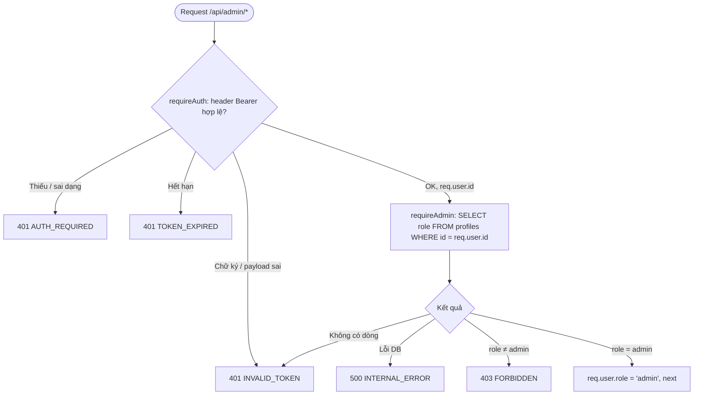
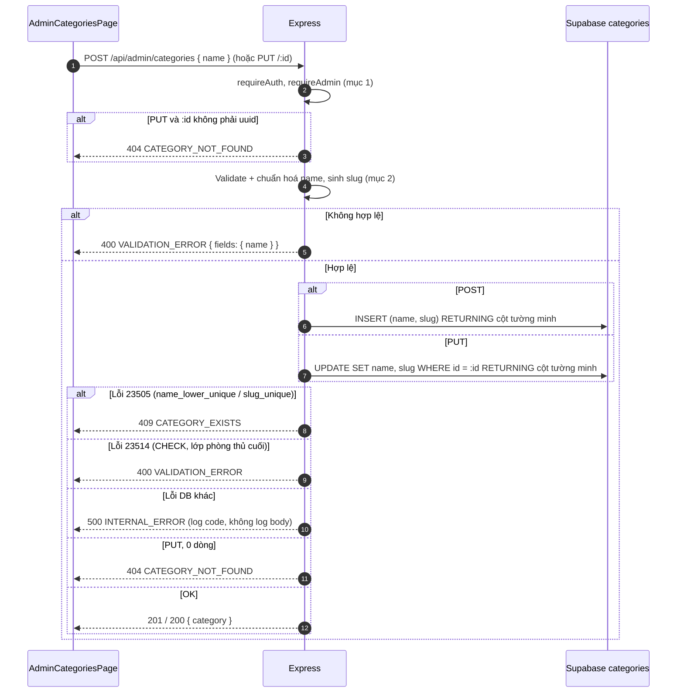
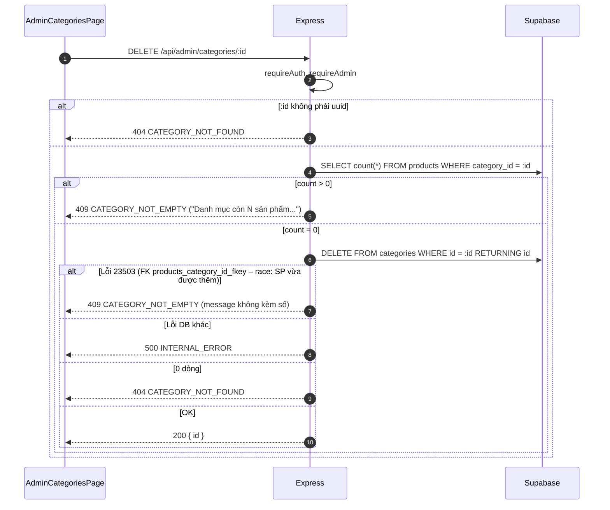
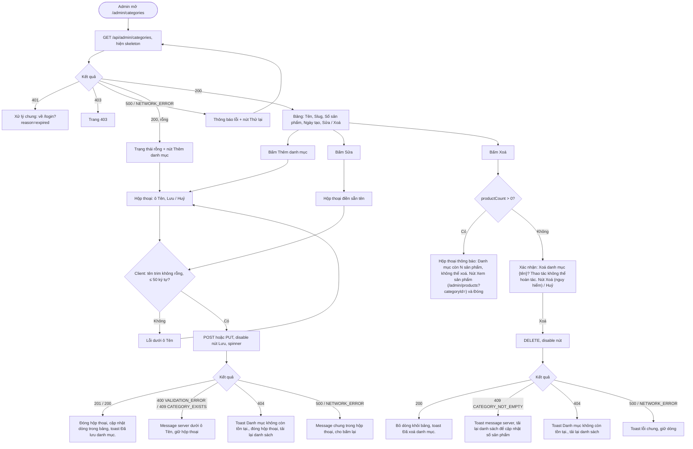

# Flow: Quản lý danh mục (Admin)

> US-03 · Sprint 2 Task 2 (thiết kế), Task 3 (`requireAdmin`), Task 4 (cài đặt), Task 7 (`GET /api/categories`) · Bảng: `design/database/schema.md` mục 10 · Quy ước envelope, mã lỗi: [README.md](README.md) · Story: `sprints/US-03.md`

## Tóm tắt
Admin vào `/admin/categories` xem danh sách danh mục (kèm số sản phẩm), thêm / đổi tên / xoá danh mục. Tên duy nhất không phân biệt hoa thường; backend sinh `slug`. Xoá danh mục còn sản phẩm bị **chặn** (409 `CATEGORY_NOT_EMPTY`). Mọi API `/api/admin/*` qua `requireAuth` → `requireAdmin` (role đọc từ DB).

## 1. Phân quyền admin (dùng chung cho mọi `/api/admin/*`)

Thứ tự middleware: `requireAuth` (có sẵn, 401) → `requireAdmin` (mới) → limiter (nếu có) → parser → controller. Gắn một lần cho cả router admin (đã cài ở Task 3: `backend/src/routes/adminRoutes.js` gọi `router.use(requireAuth, requireAdmin)`, mount tại `/api/admin`).

`requireAdmin` **không tin `role` trong JWT** (token 7 ngày có thể mang role cũ): `SELECT role FROM profiles WHERE id = req.user.id`.



Frontend: guard `RequireAdmin` (sau `RequireAuth`) đọc `role` từ AuthContext (lấy từ `GET /api/user/profile`, tức từ DB). Guest → `/login?redirect=<path>`; user thường → trang 403 trong layout chung (không render layout admin). API vẫn là nơi chặn thật; nhận 403 từ API khi đang ở trang admin (vừa bị hạ quyền) → hiển thị trang 403.

## 2. Validate

| Trường | Quy tắc (theo thứ tự) | Message (`fields.name`) |
|--------|-----------------------|-------------------------|
| `name` | Bắt buộc, kiểu string (khác → lỗi) | "Vui lòng nhập tên danh mục." |
| | Chuẩn hoá: `normalize('NFC')` → `trim()` → gộp khoảng trắng liên tiếp thành 1 dấu cách | – |
| | Sau chuẩn hoá rỗng | "Vui lòng nhập tên danh mục." |
| | > 50 ký tự (đếm code point: `[...name].length`, khớp `char_length` của Postgres) | "Tên danh mục tối đa 50 ký tự." |
| `slug` (server sinh) | `name` → NFD → bỏ dấu (`\p{M}`) → `đ/Đ` → `d` → lowercase → chuỗi `[^a-z0-9]+` thành `-` → bỏ `-` đầu/cuối → cắt 60 ký tự, bỏ `-` cuối. Rỗng → lỗi | "Tên danh mục phải chứa ít nhất một chữ cái hoặc chữ số." |

- Body không phải object / JSON hỏng → 400 `BAD_REQUEST` (đã có). Trường thừa (`slug`, `id`…) bị bỏ qua.
- NFC bắt buộc: chuỗi tổ hợp (NFD, hay gặp trên macOS) và dựng sẵn của "Váy" là hai chuỗi khác nhau, sẽ lọt qua unique index `lower(name)`.
- Trùng: kiểm tra bằng **lỗi DB** `23505` (constraint `categories_name_lower_unique` hoặc `categories_slug_unique`) → 409 `CATEGORY_EXISTS`. Có thể SELECT trước để thoát sớm nhưng vẫn phải bắt `23505` (race).
- `:id` trên path không phải uuid → 404 `CATEGORY_NOT_FOUND` (không gửi xuống DB, tránh lỗi `22P02`).

## 3. API

Đối tượng `AdminCategory`:
```json
{ "id": "uuid", "name": "Quần Jeans", "slug": "quan-jeans", "productCount": 3,
  "createdAt": "2026-11-03T03:00:00.000Z", "updatedAt": "2026-11-03T03:00:00.000Z" }
```
Đối tượng `Category` (API công khai, Task 7): `{ "id", "name", "slug" }`.

| Method | Path | Request | Thành công | Lỗi riêng (ngoài 401/403/500) |
|--------|------|---------|------------|-------------------------------|
| GET | `/api/admin/categories` | – | 200 `data: { categories: AdminCategory[] }` | – |
| POST | `/api/admin/categories` | JSON `{ name }` | **201** `data: { category: AdminCategory }` (`productCount: 0`) | 400 `VALIDATION_ERROR` / `BAD_REQUEST`, 409 `CATEGORY_EXISTS` |
| PUT | `/api/admin/categories/:id` | JSON `{ name }` | 200 `data: { category: AdminCategory }` (slug sinh lại) | 400, 404 `CATEGORY_NOT_FOUND`, 409 `CATEGORY_EXISTS` |
| DELETE | `/api/admin/categories/:id` | – | 200 `data: { id }` | 404 `CATEGORY_NOT_FOUND`, 409 `CATEGORY_NOT_EMPTY` |
| GET | `/api/categories` | – (Bearer, mọi role) | 200 `data: { categories: Category[] }` — **chỉ danh mục có >= 1 sản phẩm** (Q8), không có `productCount` | 401 |

- Sắp xếp (cả admin và công khai): `created_at asc, id asc` – giữ thứ tự seed theo PB (Áo thun, Váy, Quần Jeans), danh mục mới ở cuối, ổn định giữa các lần gọi.
- Không phân trang (bảng rất nhỏ).
- `productCount`: dùng embed count của PostgREST (`select('id, name, slug, created_at, updated_at, products(count)')`), map về number.
- Đổi tên thành chính nó khác hoa/thường ("Váy" → "VÁY") hợp lệ: unique index không xung đột với chính dòng đó.
- `GET /api/categories` (Q8, chốt 2026-11-03) **ẩn** danh mục chưa có sản phẩm và không trả `productCount`/`createdAt`/`updatedAt`; danh mục rỗng vẫn thấy ở API admin. Cài đặt: `categoryService.listBuyerCategories` lọc từ `listCategories` (tái dùng, không query riêng). Đã cài và verify ở Sprint 2 Task 7.

## 4. Luồng thêm / sửa (server)



Message 409 `CATEGORY_EXISTS`: "Danh mục này đã tồn tại." (trùng slug như "Váy"/"Vay" cũng dùng message này – xem `schema.md` mục 8). Frontend hiển thị dưới ô tên.

## 5. Luồng xoá (server)



- Message 409 có số: "Danh mục còn {N} sản phẩm. Hãy xoá hoặc chuyển các sản phẩm sang danh mục khác trước khi xoá." Không có số (race): "Danh mục vẫn còn sản phẩm. Hãy xoá hoặc chuyển các sản phẩm trước khi xoá."
- Xoá danh mục không bao giờ đụng Storage (chỉ xoá được khi rỗng).

## 6. Luồng người dùng (frontend)



- 401 ở mọi bước: xử lý chung của `apiClient` (xoá token, về `/login?redirect=…&reason=expired`).
- Không cập nhật lạc quan (optimistic): chỉ đổi bảng khi server trả thành công.
- Enter trong ô tên = Lưu; Esc = Huỷ; bấm Lưu nhiều lần chỉ gửi 1 request.

## Ghi chú
- Không có rate limit riêng cho API danh mục (admin, JSON nhỏ).
- Không log tên danh mục kèm thông tin người dùng; log lỗi DB theo `code`.
- Seed 3 danh mục có slug cố định; test tự động tra theo `slug`, không theo UUID.
