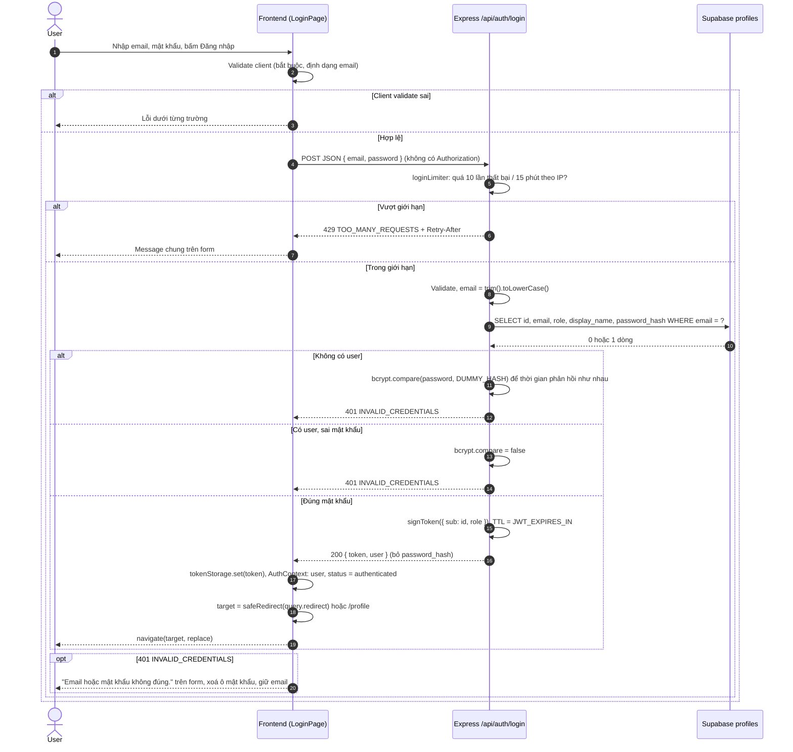

# Flow: Đăng nhập + JWT

> US-01 · Task 6 · `POST /api/auth/login` · Quy ước response, mã lỗi: [README.md](README.md)

## Tóm tắt
Khách mở `/login` (có thể kèm `?redirect=/profile&reason=expired`, hoặc router state `{ registered: true, email }` khi vừa đăng ký xong), nhập email + mật khẩu. Backend tìm user theo email đã chuẩn hoá, so sánh bcrypt, phát JWT. Frontend lưu token vào `localStorage['tryon_token']`, cập nhật AuthContext, chuyển tới `redirect` hợp lệ hoặc `/profile`.

## Validate
| Trường | Quy tắc | Message |
|--------|---------|---------|
| `email` | Bắt buộc, string; `trim().toLowerCase()`. **Không** kiểm tra regex ở server (sai định dạng thì không tìm thấy → 401 chung). Client vẫn kiểm tra định dạng để báo sớm | "Vui lòng nhập email." |
| `password` | Bắt buộc, string không rỗng, **không** áp quy tắc độ mạnh (tránh lộ chính sách / chặn tài khoản cũ) | "Vui lòng nhập mật khẩu." |

Thiếu trường → 400 `VALIDATION_ERROR` + `fields`. Mật khẩu > 72 byte → coi như sai, trả 401 chung.

## Sequence diagram



Lỗi DB/Supabase → 500 `INTERNAL_ERROR`; lỗi mạng → `NETWORK_ERROR`; form hiện message chung, bật lại nút.

## JWT

| Mục | Giá trị |
|-----|---------|
| Thuật toán | HS256, secret `JWT_SECRET` (≥ 32 byte ngẫu nhiên) |
| Payload | `{ "sub": "<profiles.id>", "role": "user" \| "admin", "iat": ..., "exp": ... }` |
| TTL | `JWT_EXPIRES_IN` (mặc định `7d`), `jsonwebtoken` tự sinh `exp` |
| Verify | `jwt.verify(token, secret, { algorithms: ['HS256'] })`: cần sửa `verifyToken` trong `backend/src/config/jwt.js` (Task 6) |
| Không chứa | email, display name, số đo, avatar |
| Refresh token | Không có. Hết hạn → đăng nhập lại |

`role` trong token có thể cũ tới khi token hết hạn nếu admin đổi role; chấp nhận ở Sprint 1 (Epic 2 xem lại, xem README mục 8).

**Response 200**
```json
{
  "success": true,
  "data": {
    "token": "eyJhbGciOiJIUzI1NiIs...",
    "user": { "id": "uuid", "email": "member@tryon.dev", "role": "user", "displayName": "Lan Anh" }
  }
}
```

**Response 401**
```json
{ "success": false, "error": { "code": "INVALID_CREDENTIALS", "message": "Email hoặc mật khẩu không đúng." } }
```

## Chi tiết frontend
- `/login` là route chỉ-khách; nếu đã đăng nhập thì chuyển ngay tới `safeRedirect(redirect)` hoặc `/profile`.
- Router state `{ registered: true, email }` (đến từ đăng ký thành công, `register.md`) → banner thành công "Đăng ký thành công. Vui lòng đăng nhập.", điền sẵn ô email bằng `state.email`, focus ô mật khẩu. Ngay sau khi đọc, xoá state bằng `navigate(pathname + search, { replace: true, state: null })` để reload/Back không hiện lại banner. Đăng ký **không** tự đăng nhập, nên đây là lần đăng nhập đầu tiên của tài khoản mới; sau login chuyển `redirect` hợp lệ hoặc `/profile` như bình thường.
- `reason=expired` → banner thông tin "Phiên đăng nhập đã hết hạn. Vui lòng đăng nhập lại." phía trên form.
- `safeRedirect(value)`: hợp lệ khi là string, bắt đầu bằng `/`, không bắt đầu bằng `//` hoặc `/\`, không phải `/login`, `/register`; ngược lại trả `/profile`.
- Có link "Chưa có tài khoản? Đăng ký" (giữ `redirect` khi chuyển trang).
- Sau khi đăng nhập ở một tab, tab khác nhận sự kiện `storage` và tải lại user (xem `logout-protected-routes.md`).

## Ghi chú bảo mật
- `DUMMY_HASH`: một hash bcrypt hợp lệ, sinh sẵn một lần (hằng số), cùng cost với hash thật.
- Không log email kèm kết quả sai/đúng, không log mật khẩu, không log token.
- Rate limit dùng `skipSuccessfulRequests: true` để user đăng nhập đúng không bị tính lượt. Khi deploy sau reverse proxy cần `app.set('trust proxy', 1)` để lấy đúng IP.
