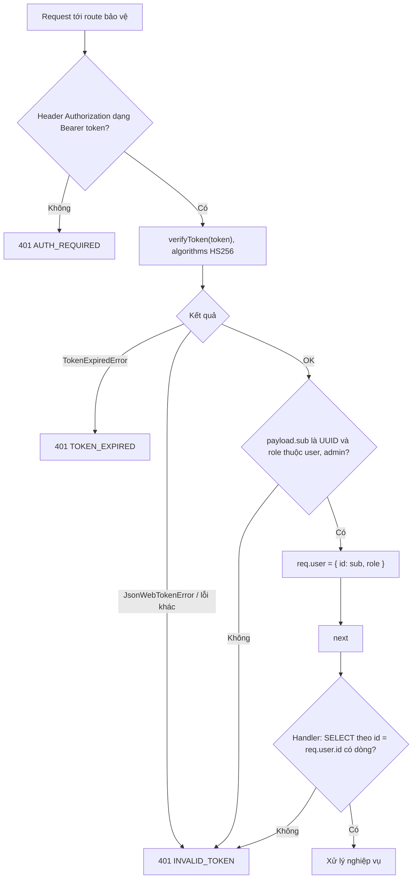
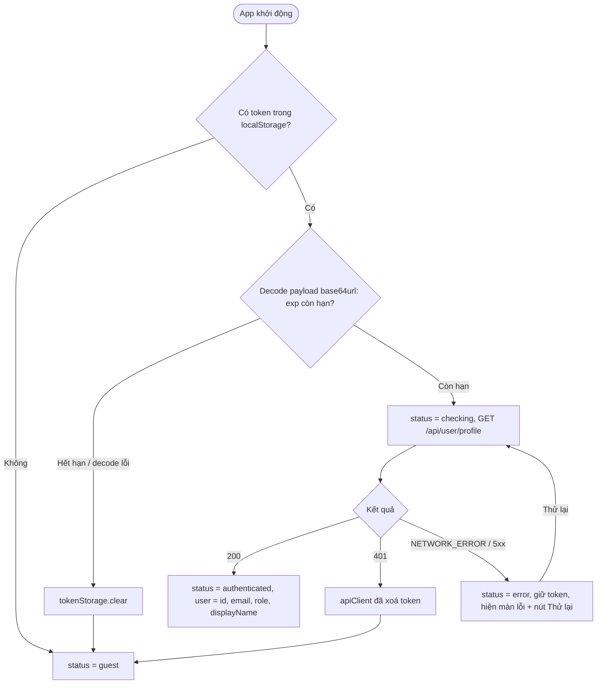
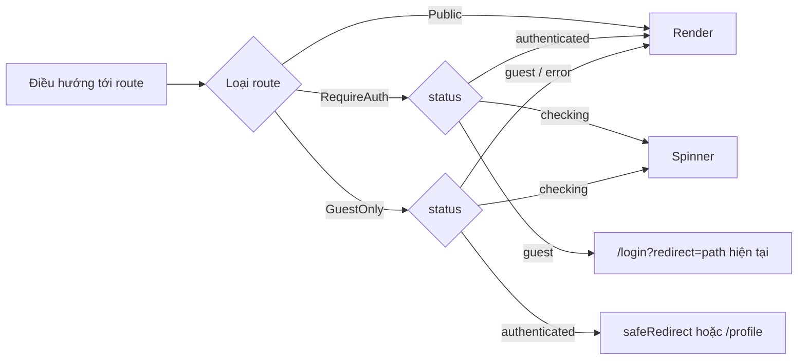
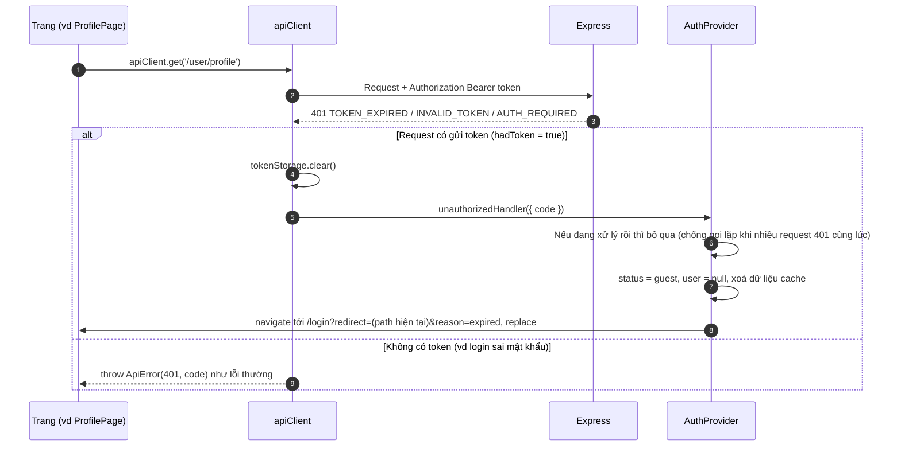
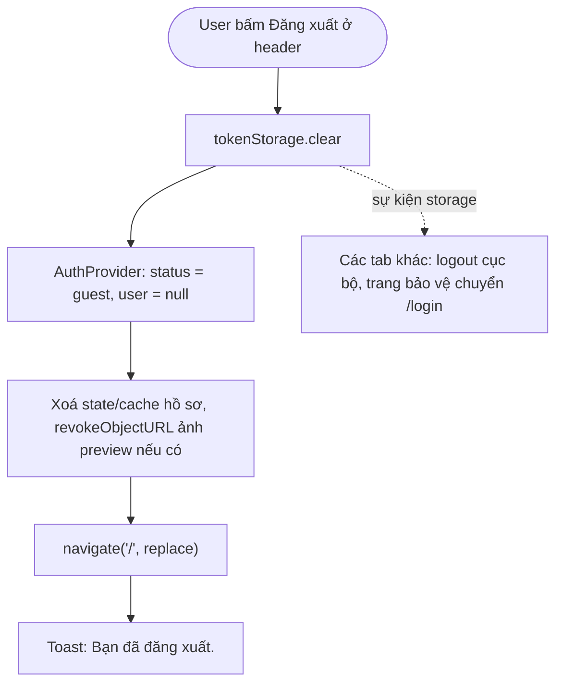

# Flow: Logout, bảo vệ route & phiên đăng nhập

> US-01, US-02 · Task 6 (middleware dùng lại ở Task 7) · Mã lỗi: [README.md](README.md)

## Mục lục
1. [Middleware `requireAuth` (backend)](#1-middleware-requireauth-backend)
2. [Trạng thái auth ở frontend](#2-trạng-thái-auth-ở-frontend)
3. [Route guard (frontend)](#3-route-guard-frontend)
4. [Xử lý 401 / token hết hạn trong `apiClient`](#4-xử-lý-401--token-hết-hạn-trong-apiclient)
5. [Logout](#5-logout)

## 1. Middleware `requireAuth` (backend)

Gắn cho mọi route `/api/user/*`. Không truy vấn DB (stateless); handler phía sau tự xử lý trường hợp user không còn tồn tại.

- Chỉ đọc header `Authorization`, không đọc token từ query/cookie.
- `requireRole('admin')` (dự phòng Epic 2): `req.user.role !== 'admin'` → 403 `FORBIDDEN`.
- Không log token.

## 2. Trạng thái auth ở frontend

`AuthProvider` (context) bọc router, giữ `{ status, user }`, `status ∈ checking | authenticated | guest | error`.

- Decode `exp` ở client chỉ để tránh gọi API vô ích; **server mới là nơi verify**.
- Đồng bộ nhiều tab: lắng nghe `window` event `storage` với key `tryon_token`. `newValue === null` → logout cục bộ (mục 5, không gọi lại `clear`). Token mới → chạy lại bước `checking`.

## 3. Route guard (frontend)

| Guard | Áp dụng | Hành vi |
|-------|---------|---------|
| `RequireAuth` | `/profile` (và route cần đăng nhập sau này) | `checking` → spinner toàn trang; `error` → màn lỗi + Thử lại; `guest` → `<Navigate to="/login?redirect=<pathname+search>" replace />`; `authenticated` → render |
| `GuestOnly` | `/login`, `/register` | `checking` → spinner; `authenticated` → `<Navigate to={safeRedirect(redirect) hoặc /profile} replace />`; còn lại → render. Đăng ký thành công **không** tạo phiên: user vẫn `guest` và được chuyển sang `/login` (router state `registered`), không đi qua nhánh `authenticated` |

Route guard chỉ là UX; dữ liệu luôn được bảo vệ ở backend bằng `requireAuth`.

## 4. Xử lý 401 / token hết hạn trong `apiClient`

Sửa `frontend/src/services/apiClient.js` (Task 6):

- `reason=expired` dùng cho cả `TOKEN_EXPIRED` và `INVALID_TOKEN` (cùng một banner).
- Form đang nhập dở trên trang bị đá ra sẽ mất: chấp nhận ở Sprint 1 (profile form ngắn).

## 5. Logout

**Quyết định:** chỉ phía client, **không** có endpoint `/api/auth/logout`, **không** blacklist token (README D6). Lý do: JWT stateless, chưa có bảng phiên; blacklist cần thêm bảng + 1 truy vấn mỗi request. Hệ quả: token đã bị lộ vẫn dùng được tới `exp`. Hướng nâng cấp: `token_version` (README mục 8).

- Không cần hộp thoại xác nhận (thao tác an toàn, đăng nhập lại dễ).
- Nút "Đăng xuất" hiển thị ở header khi `status = authenticated` (vị trí cụ thể do agent-uiux chốt trong `screens.md`).
- Bấm Back sau logout về `/profile` → `RequireAuth` chuyển `/login`.
