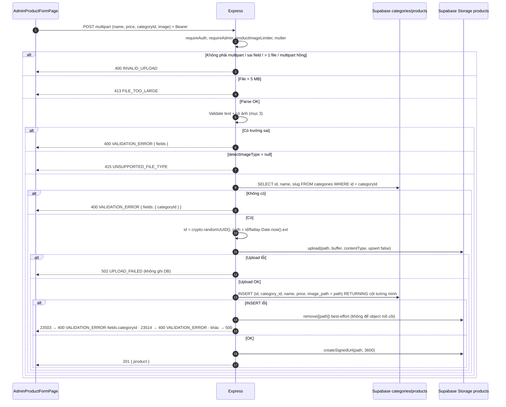
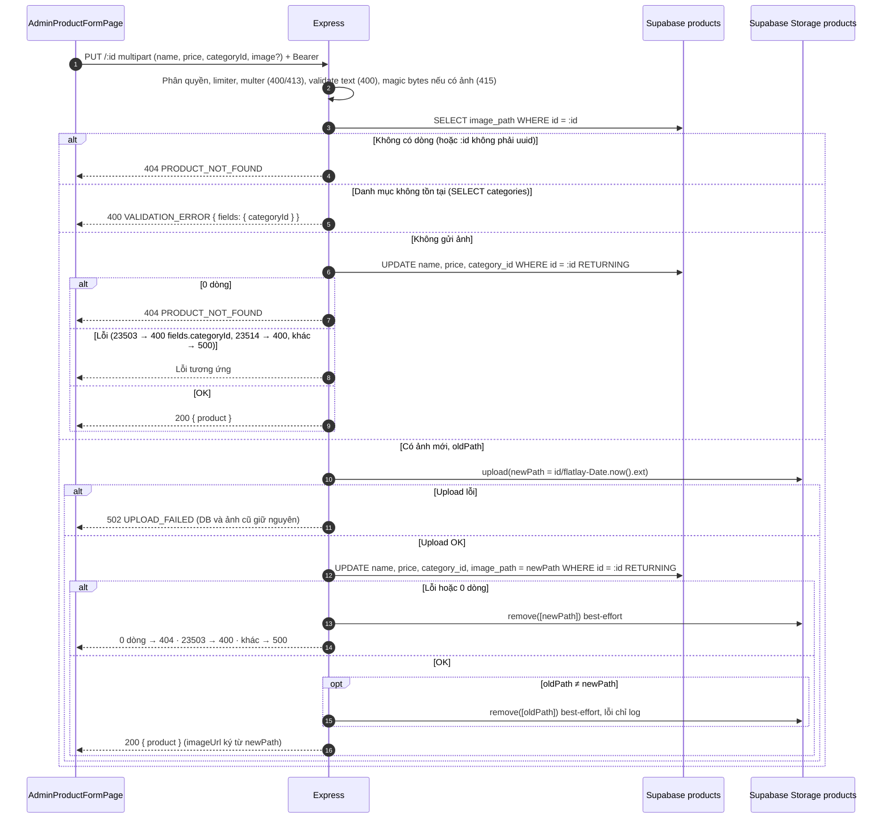
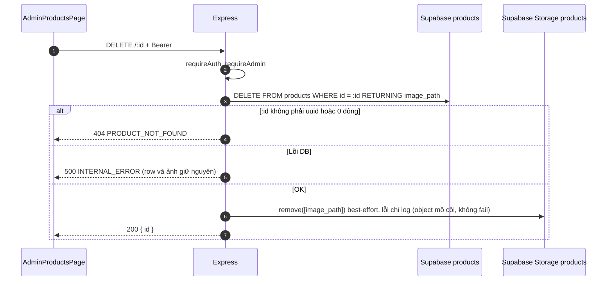
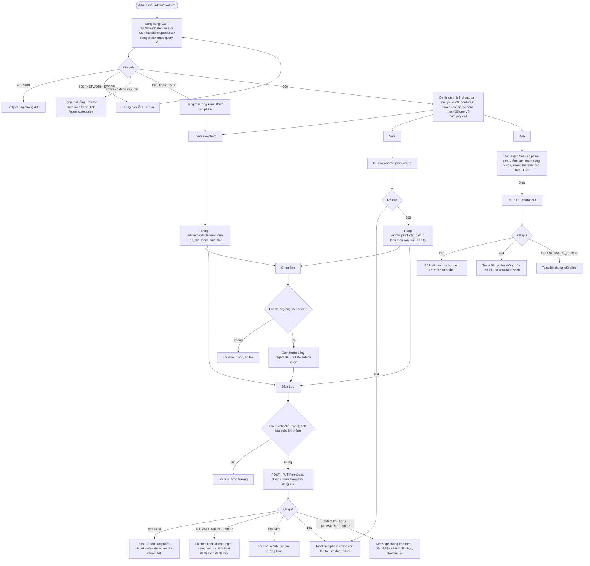

# Flow: Quản lý sản phẩm (Admin)

> US-04 · Sprint 2 Task 2 (thiết kế), Task 5 (thêm + upload ảnh), Task 6 (sửa / xoá), Task 7 (`GET /api/categories/:id/products`) · Bảng/bucket: `design/database/schema.md` mục 11–12 · Phân quyền admin: [category-management.md](category-management.md) mục 1 · Quy ước: [README.md](README.md) · Story: `sprints/US-04.md`

## Tóm tắt
Admin xem danh sách sản phẩm (lọc theo danh mục), thêm sản phẩm (tên, giá VND, danh mục, 1 ảnh flat lay), sửa (ảnh tuỳ chọn thay), xoá. Ảnh lưu bucket private `products` tại `{product_id}/flatlay-{epoch_ms}.{jpg|png}`; client nhận `imageUrl` là signed URL TTL 3600 giây. Nguyên tắc Storage giống avatar: **lỗi DB sau khi upload → xoá object vừa upload; thay ảnh thành công → xoá object cũ; xoá sản phẩm → xoá row trước, object sau** (best-effort, lỗi chỉ log).

## 1. Đối tượng response

`AdminProduct` (mọi API `/api/admin/products*`):
```json
{
  "id": "uuid", "name": "Áo thun basic trắng", "price": 199000,
  "category": { "id": "uuid", "name": "Áo thun", "slug": "ao-thun" },
  "imageUrl": "https://<project>.supabase.co/storage/v1/object/sign/products/...?...token=...",
  "createdAt": "2026-11-03T03:00:00.000Z", "updatedAt": "2026-11-03T03:00:00.000Z"
}
```

`Product` (API công khai Task 7, chỉ trường cần cho phòng thử đồ):
```json
{ "id": "uuid", "name": "Áo thun basic trắng", "price": 199000, "imageUrl": "https://..." }
```

- `price` là **number** nguyên (VND). Frontend hiển thị `new Intl.NumberFormat('vi-VN').format(price) + ' ₫'` → "199.000 ₫".
- `imageUrl`: signed URL TTL **3600 giây** (giống avatar). Ký lỗi → `null` (UI hiện placeholder "Không tải được ảnh"), không fail request. Danh sách dùng `createSignedUrls(paths, 3600)` một lần cho cả lô.
- **Không bao giờ** trả `image_path`/`imagePath`, `category_id` dạng cột thô, hay lỗi Supabase.

## 2. API

| Method | Path | Request | Thành công | Lỗi riêng (ngoài 401/403/500) |
|--------|------|---------|------------|-------------------------------|
| GET | `/api/admin/products` | Query tuỳ chọn `categoryId=<uuid>` | 200 `data: { products: AdminProduct[] }` | 400 `VALIDATION_ERROR` (`categoryId` sai định dạng) |
| GET | `/api/admin/products/:id` | – | 200 `data: { product: AdminProduct }` | 404 `PRODUCT_NOT_FOUND` |
| POST | `/api/admin/products` | `multipart/form-data`: `name`, `price`, `categoryId`, file `image` (bắt buộc) | **201** `data: { product: AdminProduct }` | 400 `VALIDATION_ERROR` / `INVALID_UPLOAD`, 413 `FILE_TOO_LARGE`, 415 `UNSUPPORTED_FILE_TYPE`, 429, 502 `UPLOAD_FAILED` |
| PUT | `/api/admin/products/:id` | `multipart/form-data`: `name`, `price`, `categoryId` (đều bắt buộc), file `image` (**tuỳ chọn**, có thì thay ảnh) | 200 `data: { product: AdminProduct }` | như POST + 404 `PRODUCT_NOT_FOUND` |
| DELETE | `/api/admin/products/:id` | – | 200 `data: { id }` | 404 `PRODUCT_NOT_FOUND` |
| GET | `/api/categories/:id/products` | – (Bearer, mọi role) | 200 `data: { category: Category, products: Product[] }` | 404 `CATEGORY_NOT_FOUND` |

**Quyết định**
- **Sắp xếp:** admin `created_at desc, id desc` (mới nhất lên đầu, tiện kiểm tra vừa thêm). Công khai `created_at asc, id asc` – khớp index `products_category_id_created_at_idx`, cố định "sản phẩm đầu tiên"/"tiếp theo" cho US-05/06.
- **Không phân trang ở Sprint 2**: dữ liệu demo vài chục sản phẩm; chi phí chính là ký URL (1 lời gọi lô). Ngưỡng xem lại: > 200 sản phẩm hoặc response > 500 ms → thêm `limit`/`cursor` (theo `created_at, id`) ở sprint sau, không phá contract (trường mới tuỳ chọn).
- **Lọc admin với `categoryId` không tồn tại** (đúng định dạng uuid): 200 danh sách rỗng (là bộ lọc, không phải tài nguyên).
- **PUT luôn là multipart** (kể cả khi không đổi ảnh) để một endpoint, một parser; frontend luôn gửi `FormData`. PUT thay toàn bộ trường sửa được (giống `PUT /profile`).
- `:id` không phải uuid → 404 (`PRODUCT_NOT_FOUND` / `CATEGORY_NOT_FOUND`), không gửi xuống DB.

## 3. Validate

Field multipart luôn là **string**. Trường lạ bị bỏ qua.

| Trường | Quy tắc (theo thứ tự) | Message (`fields.<tên>`) |
|--------|-----------------------|--------------------------|
| `name` | Bắt buộc; `normalize('NFC')` → `trim()` → gộp khoảng trắng; rỗng → lỗi | "Vui lòng nhập tên sản phẩm." |
| | > 100 ký tự (đếm code point) | "Tên sản phẩm tối đa 100 ký tự." |
| `price` | Bắt buộc; `trim()`; rỗng → lỗi | "Vui lòng nhập giá sản phẩm." |
| | Khớp `^[1-9][0-9]*$` (chỉ chữ số, không dấu chấm/phẩy/khoảng trắng/âm/thập phân/số 0 đầu) | "Giá phải là số nguyên dương (VND), không có dấu chấm hoặc phẩy." |
| | `Number(price)` trong **1 – 100.000.000** | "Giá tối đa 100.000.000 ₫." |
| `categoryId` | Bắt buộc, khớp regex uuid | "Vui lòng chọn danh mục." |
| | Tồn tại trong `categories` (SELECT theo id) | "Danh mục không tồn tại. Vui lòng chọn lại." |
| `image` | POST: bắt buộc. PUT: tuỳ chọn | "Vui lòng chọn ảnh sản phẩm." |
| | Magic bytes JPEG `FF D8 FF` / PNG `89 50 4E 47 0D 0A 1A 0A` (`detectImageType`) | 415 `UNSUPPORTED_FILE_TYPE` "Chỉ hỗ trợ ảnh JPG hoặc PNG." |
| | ≤ 5 MB (multer `LIMIT_FILE_SIZE`) | 413 `FILE_TOO_LARGE` "Ảnh vượt quá 5MB. Vui lòng chọn ảnh nhỏ hơn." |
| | **Chiều rộng và chiều cao đều ≥ 400 px** (Q10; hằng số `MIN_IMAGE_SIDE`, đọc từ header PNG IHDR / JPEG SOF, không giải mã ảnh; không kiểm tra tỷ lệ) | 400 `VALIDATION_ERROR` `fields.image` "Ảnh quá nhỏ, cần tối thiểu 400×400 px." (header hỏng, không đọc được kích thước: "Không đọc được kích thước ảnh. Vui lòng chọn ảnh khác.") |

**Mã lỗi khi `categoryId` không tồn tại: `400 VALIDATION_ERROR` với `fields.categoryId`** (không dùng 404). Lý do: `categoryId` là dữ liệu trong body, không phải tài nguyên trên URL; 404 ở endpoint này có nghĩa "sản phẩm không tồn tại" và frontend sẽ đóng form – sai hành vi. Gộp vào `fields` để form hiện lỗi đúng ô chọn danh mục cùng các lỗi khác. Áp dụng cả khi DB trả `23503` lúc INSERT/UPDATE (danh mục bị xoá giữa lúc kiểm tra và ghi). Ảnh thiếu cũng nằm trong `fields.image` (khác avatar dùng `AVATAR_REQUIRED`, vì đây là form nhiều trường – hiện mọi lỗi một lần).

**Thứ tự kiểm tra:** (1) parse multipart (400/413) → (2) validate text + có ảnh (400 kèm **mọi** `fields` sai) → (3) magic bytes (415) → (4) kích thước ảnh tối thiểu và danh mục tồn tại (400, gộp `fields.image` + `fields.categoryId` nếu cùng sai) → (5) Storage/DB.

**Tên (sản phẩm và danh mục):** ký tự thay thế U+FFFD và ký tự điều khiển bị từ chối: 400 `fields.name` "Tên chứa ký tự không hợp lệ."

## 4. Middleware & upload

Thứ tự: `requireAuth` → `requireAdmin` → `productImageLimiter` (POST, PUT; **60 lần / 15 phút theo `req.user.id`**, 429 `TOO_MANY_REQUESTS`) → kiểm tra `req.is('multipart/form-data')` (sai → 400 `INVALID_UPLOAD`) → multer → controller. Multer chạy **sau** phân quyền để không nhận file của request không phải admin.

Multer (`memoryStorage`): `.single('image')`, `limits: { fileSize: 5 MB, files: 1, fields: 10, fieldSize: 1 KB }`. Ánh xạ lỗi như avatar: `LIMIT_FILE_SIZE` → 413 `FILE_TOO_LARGE`; `LIMIT_UNEXPECTED_FILE` (sai tên field), `LIMIT_FILE_COUNT`, `LIMIT_FIELD_*`, multipart hỏng → 400 `INVALID_UPLOAD`. Không trả `err.field`/`filename`.

Tổng quát hoá code avatar (Task 5), **không sao chép**: middleware `createImageUpload({ field })` dùng cho cả `avatar` và `image`; hàm Storage nhận `bucket` (`uploadObject(bucket, path, buffer, contentType)`, `removeObject(bucket, path)` best-effort, `signUrl(s)(bucket, …)`); `detectImageType` dùng chung. Hành vi API avatar giữ nguyên.

## 5. Thêm sản phẩm (`POST /api/admin/products`)



## 6. Sửa sản phẩm (`PUT /api/admin/products/:id`)



Thứ tự PUT: parse → validate text/magic bytes (không cần DB) → 404 sản phẩm → danh mục tồn tại → upload (nếu có ảnh) → UPDATE. Kiểm tra 404 trước upload để không tốn Storage cho sản phẩm đã bị xoá.

## 7. Xoá sản phẩm (`DELETE /api/admin/products/:id`)



Xoá row **trước**, object sau: không bao giờ có row trỏ tới file đã mất. Epic 4 (đơn hàng) sẽ cần snapshot giá/tên ở `order_items` để xoá sản phẩm không làm hỏng đơn cũ (`schema.md` mục 9).

## 8. API công khai (`GET /api/categories/:id/products`, Task 7)

`requireAuth` (mọi role, **không** `requireAdmin`). SELECT `id, name, slug` của danh mục → không có → 404 `CATEGORY_NOT_FOUND`. SELECT `id, name, price, image_path` WHERE `category_id = :id` ORDER BY `created_at, id` (cài đặt: tái dùng `listProducts` rồi đảo thứ tự) → ký URL theo lô → trả `{ category, products }` (danh mục rỗng → `products: []`). Không trả `createdAt/updatedAt`, `image_path`. Không cache ở server; signed URL hết hạn sau 1 giờ → client gọi lại API khi ảnh lỗi 400/403 từ Storage.

## 9. Luồng người dùng (frontend)



- Ô giá: `inputMode="numeric"`, chỉ nhận chữ số; có thể hiển thị định dạng "199.000" khi nhập nhưng **gửi chuỗi chữ số thuần** ("199000"). Gợi ý dưới ô: "Đơn vị: VND".
- Ô danh mục: `<select>` từ `GET /api/admin/categories`; trang thêm mở từ bộ lọc → chọn sẵn danh mục đang lọc.
- Ảnh flat lay: **không** kiểm tra tỷ lệ (khác avatar); client chặn ảnh có cạnh ngắn < 400 px (đọc bằng `Image`, cùng thông báo với server). Gợi ý tĩnh dưới ô ảnh: "Ảnh trải phẳng, nền trơn, thấy toàn bộ sản phẩm. JPG hoặc PNG, tối đa 5MB, tối thiểu 400×400 px."
- Rời form khi có thay đổi chưa lưu: không bắt buộc ở Sprint 2.

## Ghi chú
- Object path do server tạo; không dùng `originalname`. Path thoả CHECK `products_image_path_owner`.
- Hai request sửa ảnh đồng thời cho cùng sản phẩm có thể để lại 1 object mồ côi (giống avatar). Chấp nhận; client chặn submit lặp.
- Test: dọn bằng `DELETE` qua API để xoá cả object; sau test `select count(*) from storage.objects where bucket_id = 'products'` về số object của dữ liệu demo cố ý giữ lại (`common_errors.md` 7.1b). Không xoá thẳng row bằng SQL khi còn object.

Đã cài ở Sprint 2 Task 7 (`routes/categoryRoutes.js` → `categoryController.getBuyerCategoryProducts` → `productService.listBuyerProducts`). `:id` không phải uuid cũng trả 404 `CATEGORY_NOT_FOUND` (không gửi xuống DB).
