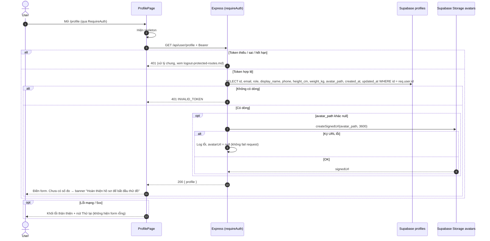
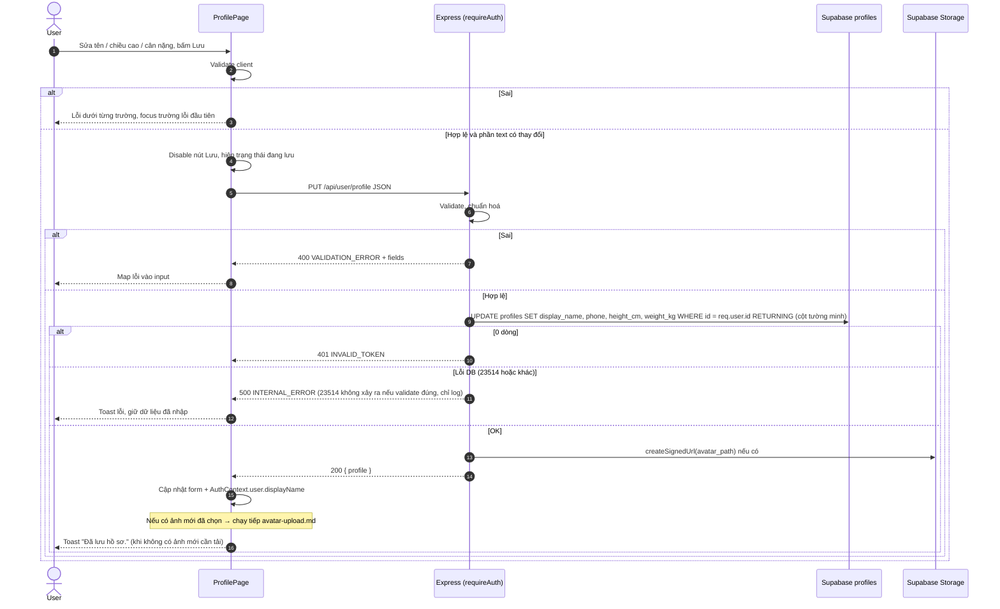

# Flow: Xem & cập nhật hồ sơ

> US-02 · Task 7 · `GET /api/user/profile`, `PUT /api/user/profile` · Upload ảnh: [avatar-upload.md](avatar-upload.md) · Quy ước: [README.md](README.md)

## Tóm tắt
User đã đăng nhập mở `/profile` → client gọi `GET` → hiển thị form (email chỉ đọc; tên hiển thị, chiều cao, cân nặng; ảnh toàn thân). Bấm **Lưu** → client gọi `PUT /api/user/profile` (JSON) nếu phần text thay đổi, rồi `PUT /api/user/profile/avatar` nếu có chọn ảnh mới (README D1, D2).

## 1. GET `/api/user/profile`



- Signed URL hết hạn sau 1 giờ: nếu `` báo `onError` khi đang mở trang lâu → gọi lại `GET` **một lần** để lấy URL mới; vẫn lỗi → hiện ảnh placeholder.
- `avatarUrl = null` do lỗi ký URL hiếm gặp; UI hiển thị như chưa có ảnh.

## 2. PUT `/api/user/profile`

**Request** `Content-Type: application/json`
```json
{ "displayName": "Lan Anh", "phone": "0912 345 678", "heightCm": 162, "weightKg": 50.5 }
```

**Validate** (client và server cùng quy tắc; server trả hết lỗi trong `fields`)

| Trường | Quy tắc | Message khi sai |
|--------|---------|-----------------|
| `displayName` | Tuỳ chọn. Thiếu / `null` / chuỗi rỗng sau trim → `null`. Nếu có: string, trim, 1–50 ký tự | "Tên hiển thị tối đa 50 ký tự." / "Tên hiển thị không hợp lệ." |
| `phone` | Tuỳ chọn. Thiếu / `null` / rỗng sau trim → `null`. Nếu có: phải là string; **chuẩn hoá** (bỏ khoảng trắng, `.`, `-`, `(`, `)`; đầu `+84` hoặc `84` → `0`) rồi khớp `^0[35789][0-9]{8}$` (số di động VN, 10 số). Lưu/trả dạng chuẩn hoá | "Số điện thoại không hợp lệ. Vui lòng nhập số di động Việt Nam (ví dụ 0912345678)." |
| `heightCm` | **Bắt buộc**, JSON number hữu hạn (không nhận string). Làm tròn 1 chữ số thập phân **rồi** kiểm tra 100–250 | "Vui lòng nhập chiều cao." / "Chiều cao phải từ 100 đến 250 cm." |
| `weightKg` | **Bắt buộc**, JSON number hữu hạn. Làm tròn 1 chữ số thập phân rồi kiểm tra 30–250 | "Vui lòng nhập cân nặng." / "Cân nặng phải từ 30 đến 250 kg." |
| Trường khác | `email`, `role`, `avatarUrl`, `password`, `id`… **bị bỏ qua**, không báo lỗi | – |

- Client: ô số dùng `inputMode="decimal"`, chấp nhận dấu phẩy (`50,5` → `50.5`) rồi gửi **number**; ô rỗng → báo "Vui lòng nhập…" ở client.
- Body không phải JSON object → 400 `BAD_REQUEST`.



- `updated_at` do trigger DB tự cập nhật.
- Không thay đổi gì (form text không đổi và không chọn ảnh) → nút Lưu disabled, không gọi API.

## 3. Kết hợp với upload ảnh khi bấm Lưu (D2)

| PUT profile | PUT avatar | Thông báo UI |
|-------------|-----------|--------------|
| Không gọi (không đổi) | OK | "Đã cập nhật ảnh." |
| OK | Không gọi | "Đã lưu hồ sơ." |
| OK | OK | "Đã lưu hồ sơ." |
| OK | Lỗi | "Đã lưu thông tin, nhưng chưa tải được ảnh: {message}". Giữ ảnh đã chọn, nút "Thử lại tải ảnh" |
| Lỗi 400 | Không gọi | Lỗi dưới từng trường; ảnh đã chọn vẫn giữ |
| Lỗi 5xx / mạng | Không gọi | Toast lỗi chung; giữ toàn bộ dữ liệu |

Trong suốt quá trình: nút Lưu disabled, chặn submit lặp. 401 ở bất kỳ bước nào → xử lý chung (về `/login`).

**Xoá ảnh** (`DELETE /api/user/profile/avatar`, README D18) là hành động riêng, thực hiện ngay sau khi xác nhận, không nằm trong bảng trên và không phụ thuộc nút Lưu. Chi tiết và UI: [avatar-upload.md](avatar-upload.md) mục 4. Khi form text đang có thay đổi chưa lưu, xoá ảnh không làm mất các thay đổi đó (chỉ cập nhật phần ảnh của `profile`).
