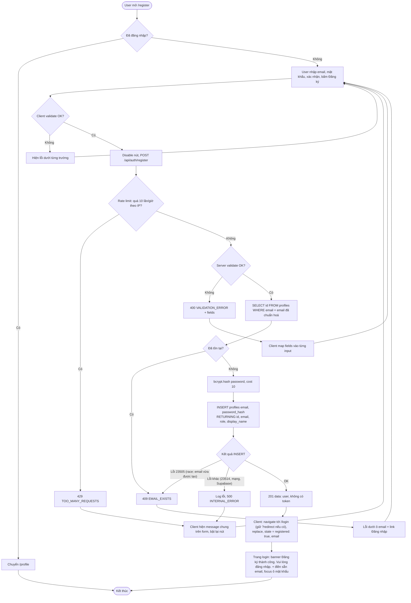

# Flow: Đăng ký

> US-01 · Task 5 · `POST /api/auth/register` · Quy ước response, mã lỗi: [README.md](README.md)

## Tóm tắt
Khách mở `/register`, nhập email, mật khẩu, xác nhận mật khẩu. Backend validate, kiểm tra trùng email, hash bcrypt, tạo `profiles` (role mặc định `user`), trả 201 `{ user }`. **Không phát JWT, không tự đăng nhập** (README D3). Frontend chuyển `/login` kèm thông báo "Đăng ký thành công. Vui lòng đăng nhập." và điền sẵn email.

## Validate

Cùng một bộ quy tắc ở client (phản hồi tức thì) và server (bắt buộc). Server trả **tất cả** lỗi trường cùng lúc trong `error.fields`.

| Trường | Quy tắc | Message khi sai |
|--------|---------|-----------------|
| `email` | Bắt buộc, kiểu string. Chuẩn hoá `trim().toLowerCase()` rồi mới kiểm tra: ≤ 254 ký tự, regex `^[^@\s]+@[^@\s]+\.[^@\s]+$` (khớp CHECK `profiles_email_format`) | "Vui lòng nhập email." / "Email không đúng định dạng." |
| `password` | Bắt buộc, string, **không trim**. 8–72 ký tự và ≤ 72 byte UTF-8; có ít nhất 1 chữ thường `[a-z]`, 1 chữ hoa `[A-Z]`, 1 chữ số `[0-9]` | "Vui lòng nhập mật khẩu." / "Mật khẩu cần 8–72 ký tự, gồm chữ thường, chữ hoa và chữ số." |
| `confirmPassword` | Bắt buộc, `=== password` | "Mật khẩu xác nhận không khớp." |

- Body không phải JSON object / JSON hỏng → 400 `BAD_REQUEST`.
- Trường thừa bị bỏ qua (không cho tự gán `role`).
- Client: nút submit disabled khi đang gửi (chống double submit); hiển thị thanh độ mạnh mật khẩu (khuyến nghị thêm ký tự đặc biệt); có nút hiện/ẩn mật khẩu.

## Activity diagram



Lỗi mạng (fetch fail) → `apiClient` ném `NETWORK_ERROR`, form hiện message chung, giữ nguyên dữ liệu đã nhập (trừ khi user tự xoá).

## Chi tiết backend

| Bước | Ghi chú cài đặt |
|------|-----------------|
| Route | `POST /api/auth/register` → `registerLimiter` → controller. Không cần `requireAuth` |
| Pre-check | `select('id').eq('email', normalizedEmail).maybeSingle()` |
| Hash | `bcrypt.hash(password, 10)` (cost 10–12, khớp seed). Không log `password`, không log body |
| Insert | Chỉ gửi `email`, `password_hash`; để DB tự sinh `id`, `role='user'`, timestamps. `.select('id, email, role, display_name').single()` |
| Lỗi Postgres | `23505` → 409 `EMAIL_EXISTS`; còn lại → để `errorHandler` trả 500 (log `code`, không log dữ liệu) |
| Token | **Không** gọi `signToken`; register không trả JWT |

**Response 201**
```json
{
  "success": true,
  "data": {
    "user": { "id": "uuid", "email": "new@tryon.dev", "role": "user", "displayName": null }
  }
}
```

## Chi tiết frontend sau khi đăng ký thành công
- **Cách truyền thông báo: router state** (không dùng query `?registered=1`):
  `navigate('/login' + (redirect hợp lệ ? '?redirect=' + encodeURIComponent(redirect) : ''), { replace: true, state: { registered: true, email: user.email } })`.
  Lý do: email không lộ trên URL, lịch sử trình duyệt, log server/analytics; `replace` để nút Back không quay lại form đã gửi.
- Không ghi gì vào `tokenStorage`, không đổi trạng thái `AuthProvider` (vẫn `guest`).
- Trang login xử lý state này: xem `login.md` mục "Chi tiết frontend".

**Response 409**
```json
{ "success": false, "error": { "code": "EMAIL_EXISTS", "message": "Email này đã được đăng ký." } }
```

**Response 400**
```json
{
  "success": false,
  "error": {
    "code": "VALIDATION_ERROR",
    "message": "Dữ liệu không hợp lệ. Vui lòng kiểm tra lại.",
    "fields": { "password": "Mật khẩu cần 8–72 ký tự, gồm chữ thường, chữ hoa và chữ số.", "confirmPassword": "Mật khẩu xác nhận không khớp." }
  }
}
```

## Ghi chú bảo mật
- 409 `EMAIL_EXISTS` tiết lộ email đã đăng ký: chấp nhận vì US-01 yêu cầu báo email trùng; giảm thiểu bằng rate limit.
- Test case gợi ý (seed): đăng ký `newuser@tryon.dev` → 409; `  NewUser@TryOn.dev ` → chuẩn hoá thành email trên → 409.
