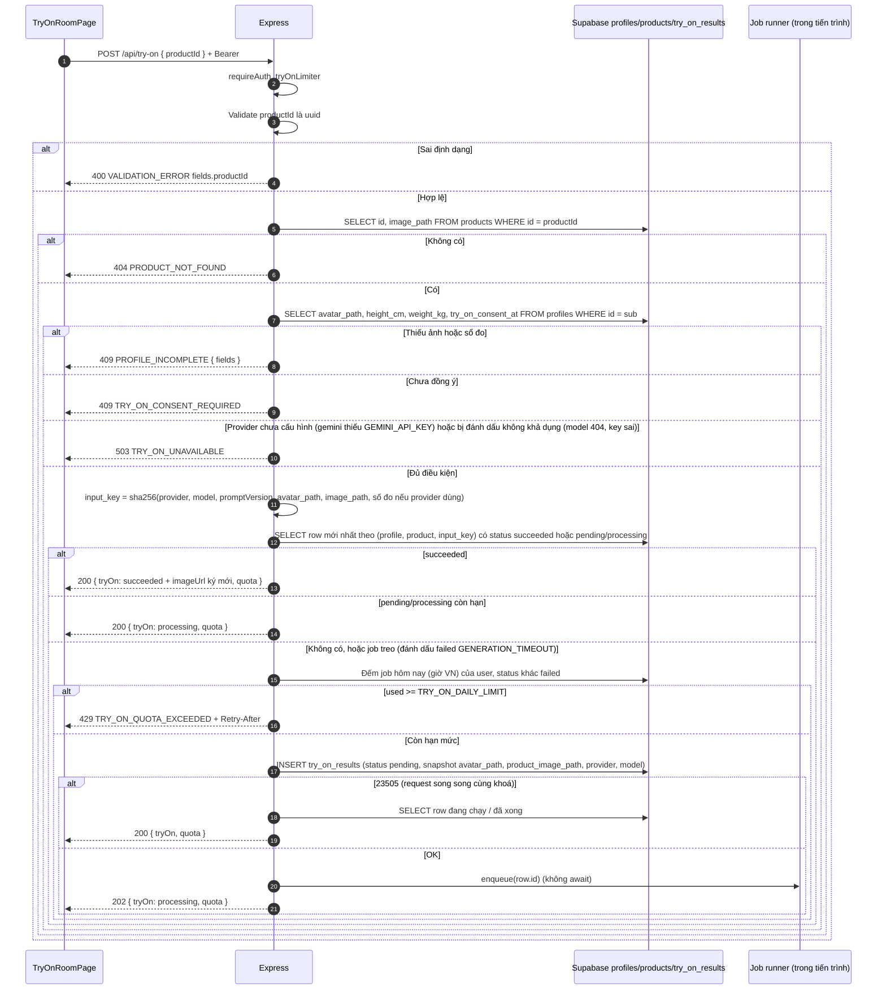
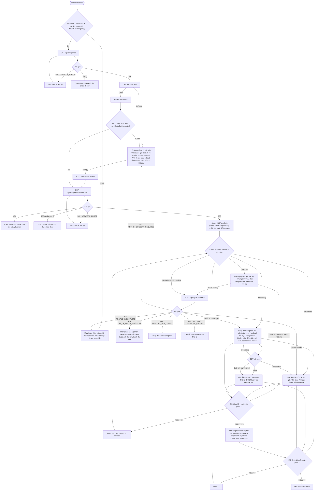

# Flow: Phòng thử đồ (Người mua)

> US-05, US-06 · Sprint 3 Task 1 (thiết kế), Task 3 (backend), Task 4 (nối frontend), Task 6 (nhà cung cấp thật) · Bảng/bucket: `design/database/schema.md` mục 13–14 · API danh mục/sản phẩm đã có: [category-management.md](category-management.md) mục 3, [product-management.md](product-management.md) mục 8 · Quy ước: [README.md](README.md) · Story: `sprints/US-05.md`, `sprints/US-06.md`
>
> Trạng thái: **bản thiết kế 2026-11-17. Q12 đã chốt (2026-11-17): provider thật = Gemini, `stub` mặc định (mục 2). Q13–Q22 đã chốt (2026-11-17) theo mặc định khuyến nghị, trừ Q15 = không sinh trước (không prefetch)** (README mục 7).

## Mục lục
1. [Tóm tắt](#1-tóm-tắt)
2. [Nhà cung cấp GenAI: Gemini](#2-nhà-cung-cấp-genai-gemini-q12-đã-chốt-2026-11-17)
3. [Kiến trúc sinh ảnh: bất đồng bộ + polling + cache](#3-kiến-trúc-sinh-ảnh-bất-đồng-bộ--polling--cache)
4. [Đối tượng response và API](#4-đối-tượng-response-và-api)
5. [Điều kiện vào phòng thử đồ](#5-điều-kiện-vào-phòng-thử-đồ)
6. [Server: `POST /api/try-on`](#6-server-post-apitry-on)
7. [Server: xử lý job và `GET /api/try-on/:id`](#7-server-xử-lý-job-và-get-apitry-onid)
8. [Vô hiệu hoá cache và dọn Storage](#8-vô-hiệu-hoá-cache-và-dọn-storage)
9. [Luồng người dùng (frontend)](#9-luồng-người-dùng-frontend)
10. [Hạn mức, bảo mật, quyền riêng tư](#10-hạn-mức-bảo-mật-quyền-riêng-tư)
11. [Ghi chú kiểm thử](#11-ghi-chú-kiểm-thử)

## 1. Tóm tắt

Người mua đã đăng nhập, hồ sơ đủ (ảnh toàn thân + chiều cao + cân nặng) và đã đồng ý xử lý ảnh, mở `/try-on` → chọn danh mục → `/try-on/:categoryId`. Client lấy danh sách sản phẩm (`GET /api/categories/:id/products`, cũ nhất trước – D24), rồi yêu cầu ảnh thử đồ cho sản phẩm đầu tiên (`POST /api/try-on`). Có sẵn kết quả trong cache → trả ngay (200). Chưa có → server tạo job, trả 202, client poll `GET /api/try-on/:id` tới khi `succeeded`/`failed`. Bấm mũi tên / vuốt → sản phẩm kế tiếp, lặp lại cho sản phẩm user dừng lại xem (debounce 400 ms); **không sinh trước** sản phẩm chưa xem (Q15, đã chốt: không prefetch).

Thành phần chính:
- **Provider adapter** (`backend/src/services/tryOn/providers/*`): một interface, hai cài đặt `stub` (mặc định) và `gemini` (provider thật, Q12 đã chốt), chọn bằng env `TRY_ON_PROVIDER`. Mặc định `stub` → dev/test không tốn tiền, không gửi ảnh ra ngoài.
- **Bảng `try_on_results`** (cache + nhật ký job) và **bucket private `try-on-results`** (ảnh kết quả, signed URL TTL 3600 giây như các bucket khác).
- **Khoá cache `input_key`** = SHA-256 của (provider, model, **phiên bản prompt** `promptVersion`, `avatar_path`, `products.image_path`, [số đo nếu provider dùng]). Đổi ảnh toàn thân / ảnh sản phẩm / provider / model / prompt → khoá đổi → tự sinh lại.

## 2. Nhà cung cấp GenAI: Gemini (Q12 đã chốt 2026-11-17)

**Quyết định (người dùng chốt 2026-11-17):**
1. **`TRY_ON_PROVIDER=stub` là mặc định** cho dev, test tự động, CI và demo không có API key. Stub trả lại ảnh toàn thân (`simulated: true`, UI gắn nhãn "Ảnh mô phỏng"), hỗ trợ `TRY_ON_STUB_MODE` = `success | fail | slow` để test nhánh lỗi/timeout. Không gửi ảnh ra ngoài, không tốn tiền.
2. **`TRY_ON_PROVIDER=gemini` là provider thật**: Google Gemini API qua SDK Node `@google/genai` (đã cài ở `backend/`), adapter `gemini` **tái sử dụng** `backend/src/services/geminiImageService.js` (`editImage`). Model đặt qua `GEMINI_IMAGE_MODEL` (mặc định `gemini-3.1-flash-image`), key `GEMINI_API_KEY` (cả hai đã có trong `backend/.env.example`).
3. Viết theo **adapter**: đổi provider/model chỉ là đổi env (+ 1 file adapter); `provider`, `model`, phiên bản prompt nằm trong `input_key` nên không bao giờ trả nhầm ảnh cũ (mục 1, 2.3).
4. Phương án đã loại (so sánh ngày 2026-11-17): API thử đồ chuyên dụng FASHN `tryon-v1.6` và Google Vertex AI `virtual-try-on-001`; OpenAI gpt-image. Không còn trong phạm vi Sprint 3.

### 2.1 Kết quả thử nghiệm thật (2026-11-17)

Chạy bằng `backend/scripts/gemini-try-on.js` với 1 cặp ảnh: ảnh người mẫu bán thân/3/4 (1000×1500) + ảnh áo vest trên ma-nơ-canh, có nền và chữ.

| Hạng mục | Kết quả |
|----------|---------|
| Model | `gemini-3.1-flash-image-preview` đã bị gỡ → 404. Dùng được với key hiện tại: `gemini-3.1-flash-image` (mặc định), `gemini-3-pro-image`, `gemini-3.1-flash-lite-image`, `gemini-2.5-flash-image` |
| Độ trễ | ~10–12 s/ảnh, 1 ảnh/lần gọi (đồng bộ, không có job phía provider) |
| Ảnh ra | Kích thước khác ảnh vào (843×1264 từ 1000×1500, giữ tỉ lệ 2:3); mime có thể khác ảnh vào → đọc từ phản hồi, xác định lại bằng magic bytes |
| Prompt lỏng ("người mặc món đồ") | Gemini tự "phối đủ bộ": đổi quần, thêm cà vạt, đổi tư thế tay → **không đạt** |
| Prompt chặt (mục 2.3) | Giữ đúng quần, tư thế, mặt, tóc, nền; chỉ thay áo vest. Còn lệch nhẹ sắc độ màu áo (nhạt hơn ảnh sản phẩm) |
| Đã bổ sung ở Task 6 | Ảnh toàn thân, áo thun/sơ mi/váy/quần/hoa văn/áo khoác, giá, chính sách dữ liệu: xem mục "Kết quả đo Task 6" ngay dưới |

#### Kết quả đo Task 6 (2026-11-18)

**Chốt: model `gemini-3.1-flash-image`, `promptVersion` `p2` (prompt giữ nguyên, không đổi nên không tăng phiên bản).** `ai.models.list()` ngày 2026-11-18 vẫn có `gemini-3.1-flash-image`, `gemini-3-pro-image`, `gemini-3.1-flash-lite-image`, `gemini-2.5-flash-image`.

**Bộ ảnh (toàn bộ do Gemini sinh, người HƯ CẤU, không ảnh thật):** 4 người toàn thân (nền trơn, 848×1264) × 7 ảnh flat lay (áo thun vàng, sơ mi sọc, váy xanh, quần chino, sơ mi chấm bi nhỏ, áo khoác bomber, hoodie). 13 cặp chạy qua đúng `createGeminiProvider` (cùng prompt production, `scripts/gemini-bench.js`): áo thun ×2, sơ mi ×2, váy ×2, quần ×2, hoa văn nhỏ ×2, áo khoác ×2, hoodie ×1. Ảnh người/kết quả lưu ngoài repo.

| Hạng mục | Kết quả (n = 13, `gemini-3.1-flash-image`) |
|----------|--------------------------------------------|
| Thành công | 13/13; lỗi theo `error_code`: không có (0 `INPUT_REJECTED`/`GENERATION_*`/`PROVIDER_UNAVAILABLE`) |
| Độ trễ mỗi ảnh | min 8,0 s · **p50 9,0 s** · **p95 10,4 s** · max 10,4 s → đạt p95 ≤ 30 s (đo tuần tự, 1 request/lần, chưa đo song song `TRY_ON_MAX_CONCURRENCY`=3) |
| Ảnh ra | JPEG (`image/jpeg`, ~0,55–0,66 MB) dù ảnh vào PNG; 848×1264 (đúng tỉ lệ 2:3 của ảnh người vào) |
| Qua stack thật | Backend 3100 + frontend 5174, provider `gemini`, user test + 3 sản phẩm: POST 202 → poll → job `succeeded` 8,6 s; ảnh hiển thị trong phòng thử đồ, **không có nhãn "Ảnh mô phỏng"** (`simulated: false`), "Còn 29 lượt hôm nay" |

Nhận xét chất lượng (10/13 ảnh đã xem trực tiếp: 01, 03, 04, 05, 06, 08, 09, 10, 12, 13; 02, 07, 11 chưa xem lại):
- **Áo thun, sơ mi, áo khoác:** tốt. Giữ mặt, tóc, tư thế hai tay, quần/giày, nền; đúng màu (vàng mù tạt, xanh nhạt sọc, đỏ rượu); chi tiết áo khoác (khoá, túi tay, bo gấu) tái tạo đúng. Không thêm đồ.
- **Quần:** tốt. Người mặc quần short được thay bằng quần chino dài đúng màu ô-liu, giữ áo đang mặc (04, 09). Chưa thử quần ống rộng/jeans.
- **Váy:** tốt, đúng kiểu và màu; thay cả bộ áo+quần/short gốc (03, 12). Lỗi nhỏ: 12 còn một mảng nhỏ màu da/be ở nách phải (tàn dư áo gốc).
- **Hoa văn nhỏ (chấm bi):** đúng màu và hoạ tiết nhìn tổng thể, nhưng **mật độ/kích thước chấm lệch nhẹ** so với ảnh sản phẩm và 13 có đường chia dọc giữa thân áo (nửa trái chấm dày hơn nửa phải). Đây là loại yếu nhất; chưa đủ nặng để cần đổi prompt.
- Nền/ánh sáng hầu như giữ nguyên; ảnh bị nén lại (JPEG) nên có khác nhẹ về chi tiết.
- Giới hạn của phép đo: n nhỏ (13), ảnh hư cấu sạch nền trơn/dáng đứng thẳng, chấm bằng mắt không có thước đo định lượng; ảnh người thật chụp bằng điện thoại, dáng lệch, nền phức tạp, áo nhiều lớp chưa được kiểm chứng. Chưa thử: nhiều lớp áo (áo khoác khoác ngoài áo khác), đồ dài tay -> ngắn tay, ảnh sản phẩm có người mặc.

**So sánh `gemini-3-pro-image`** (3 cặp: 05, 12, 13): thành công 3/3, **chậm gần gấp đôi (17,4–19,4 s)**, giá cao gấp ~2 lần; ảnh 13 ra **1024×1024 (đổi khung hình, không giữ tỉ lệ 2:3 của ảnh vào)** nên không khớp khung 3:4 của UI; chất lượng hoạ tiết không rõ rệt hơn. Không chọn; chỉ là dự phòng.

**Giá chính thức** (nguồn: https://ai.google.dev/gemini-api/docs/pricing, chuyển hướng sang aistudio.google.com/docs/pricing; tra 2026-11-18). Ba model ảnh **không có free tier** (chỉ có tier trả phí):

| Model | Giá đầu ra/ảnh (tier trả phí) | Ghi chú |
|-------|-------------------------------|---------|
| `gemini-3.1-flash-image` | 0,045 USD (0,5K), **0,067 USD (1K)**, 0,101 (2K), 0,151 (4K) | đầu vào 0,50 USD/1M token ảnh/text; ảnh ra ~0,7 megapixel (848×1264) gần mức 1K → ước tính ~0,07 USD/ảnh (đã gồm 2 ảnh vào chưa tách riêng) |
| `gemini-3-pro-image` | 0,134 USD (1K/2K), 0,24 (4K) | đầu vào 0,0011 USD/ảnh |
| `gemini-2.5-flash-image` | 0,039 USD (≤1024×1024) | **đã deprecated, dự kiến tắt 2027-03-15** |

Với hạn mức 30 lượt/user/ngày (Q18): tối đa ~2 USD/user/ngày (chỉ lượt gọi thật; cache hit không tốn).

**Chính sách dữ liệu** (nguồn: https://ai.google.dev/gemini-api/terms, chuyển hướng sang aistudio.google.com/docs/terms; tra 2026-11-18):
- **Tier miễn phí (Unpaid Services):** Google dùng nội dung gửi lên để cải thiện sản phẩm/huấn luyện; người đánh giá có thể đọc input/output (đã tách khỏi tài khoản/API key); khuyến cáo không gửi dữ liệu nhạy cảm/cá nhân. Bảng giá ghi "dùng để cải thiện sản phẩm: Có" cho tier miễn phí, "Không" cho tier trả phí.
- **Tier trả phí (Paid Services, project có billing):** Google không dùng prompt/phản hồi để cải thiện sản phẩm; chỉ ghi log prompt/phản hồi trong **thời gian giới hạn** nhằm phát hiện/ngăn vi phạm (điều khoản không nêu số ngày).
- **Xác nhận project đang dùng tier trả phí:** chưa xác nhận trực tiếp từ console. Chứng cứ gián tiếp: key hiện tại gọi thành công 3 model ảnh trong khi bảng giá ghi các model này không có free tier. **Khuyến nghị người dùng kiểm tra Billing của project trong Google AI Studio** trước khi bật cho người dùng thật. Ảnh toàn thân là dữ liệu cá nhân → mục 10 vẫn áp dụng (consent trước khi gửi).

**Kiểm tra lỗi cấu hình (tiến trình riêng, provider `gemini`):** `GEMINI_API_KEY` rỗng → backend khởi động bình thường, `POST /api/try-on` 503 `TRY_ON_UNAVAILABLE`. `GEMINI_IMAGE_MODEL` sai tên → POST đầu 202, job `failed` `PROVIDER_UNAVAILABLE` sau ~1,4 s (log: status 404 + hướng dẫn sửa model), các POST sau 503 `TRY_ON_UNAVAILABLE`, không crash. Log tiến trình không chứa key/base64/ảnh (grep = 0).

**Số lần gọi Gemini ảnh của Task 6:** 28 lần tạo ảnh (11 sinh bộ ảnh + 13 đo + 3 so sánh Pro + 1 qua stack thật), cộng 1 lần gọi model sai tên trả 404 (thường không tính phí), dưới ngân sách 70; chi phí ước tính ≈ 1,5–2 USD (11+13+1 ≈ 25 lần Flash × ~0,07 + 3 lần Pro × 0,134).

### 2.2 Cách gọi (adapter `gemini`)

- `ai.models.generateContent({ model, contents: [{ text: PROMPT }, { inlineData: người }, { inlineData: sản phẩm }], config: { abortSignal } })`. Thứ tự cố định: **ảnh 1 = ảnh toàn thân, ảnh 2 = ảnh flat lay** (prompt dựa vào thứ tự này).
- Ảnh do backend tải từ Storage bằng service role, gửi **base64 inline** (`inlineData: { mimeType, data }`); không gửi URL/signed URL. Tối đa 2 × 5 MB (giới hạn bucket `avatars`/`products`) ≈ 13,4 MB sau base64 – Task 6 kiểm tra lại giới hạn kích thước request inline của Gemini.
- Kết quả: lấy **part `inlineData` đầu tiên** trong `candidates[0].content.parts`; part `text` (nếu có) bỏ qua, không log nguyên văn. Ảnh ra có thể khác kích thước/mime ảnh vào → đuôi file và `contentType` khi upload theo **magic bytes** (`detectImageType`, mở rộng webp); `mimeType` của phản hồi chỉ để đối chiếu, lệch thì tin magic bytes. Không resize/cắt lại; khung hiển thị 3:4 của UI tự co ảnh (agent-uiux quyết `object-fit`).
- Timeout: `abortSignal` theo `TRY_ON_TIMEOUT_MS`. Huỷ phía client **không** huỷ việc tính phí phía Google.
- `provider_job_id` = `responseId` của phản hồi (nếu có) để debug; không trả client.
- `usesMeasurements: false`: Sprint 3 không đưa chiều cao/cân nặng vào prompt (Q13).

**Việc cần sửa ở `geminiImageService.editImage` trước khi dùng cho thử đồ (Task 3):** (1) `GEMINI_IMAGE_MODEL=` để trống như `.env.example` hiện bị đọc thành model rỗng (`''.trim() ?? mặc định` trả `''`) → dùng `||`; (2) nhận `abortSignal`; (3) trả thêm `finishReason`, `promptFeedback.blockReason`, `responseId` để ánh xạ lỗi (mục 2.4); (4) lỗi thiếu key phải phân biệt được (provider chưa cấu hình → 503).

**Interface adapter** (tham khảo cho agent-coder):
```js
// generate({ personImage, garmentImage, signal }) -> { buffer, contentType, providerJobId? }
// personImage/garmentImage: { buffer, contentType } tải từ Storage bằng service role
// Ném TryOnProviderError(code) với code ∈ GENERATION_FAILED | GENERATION_TIMEOUT | INPUT_REJECTED | PROVIDER_UNAVAILABLE
export default { name: 'gemini', model: process.env.GEMINI_IMAGE_MODEL?.trim() || 'gemini-3.1-flash-image', promptVersion: 'p2', usesMeasurements: false, generate };
// stub: { name: 'stub', model: 'stub', promptVersion: 'stub', usesMeasurements: false, generate }
```
- Biến môi trường (`backend/.env.example`, không ghi giá trị thật): `TRY_ON_PROVIDER` (`stub` | `gemini`, mặc định `stub`), `GEMINI_API_KEY` (đã có), `GEMINI_IMAGE_MODEL` (đã có, trống = `gemini-3.1-flash-image`), `TRY_ON_DAILY_LIMIT` (30), `TRY_ON_TIMEOUT_MS` (90000), `TRY_ON_MAX_CONCURRENCY` (3), `TRY_ON_STUB_MODE` (`success`), `TRY_ON_STUB_DELAY_MS` (2000). Không có biến key riêng cho thử đồ. `TRY_ON_PROVIDER=gemini` mà thiếu `GEMINI_API_KEY` → backend **khởi động vẫn được**, `POST /api/try-on` trả 503 `TRY_ON_UNAVAILABLE`.
- Khởi động với `gemini` và có key: gọi `ai.models.get({ model })` một lần, best-effort, không chặn khởi động; 404 → đánh dấu provider không khả dụng (mục 2.4) + log hướng dẫn sửa `GEMINI_IMAGE_MODEL`.

### 2.3 Prompt cố định ở backend

- Prompt là **hằng trong backend** (`services/tryOn/providers/gemini.js`), bản gốc là hằng `PROMPT` trong `backend/scripts/gemini-try-on.js`. Người mua/admin **không nhập prompt**; không chèn dữ liệu người dùng (tên, số đo, mô tả tự do) vào prompt.
- Nguyên tắc (rút từ thử nghiệm 2.1): nêu vai trò từng ảnh; chỉ thay đúng món trong ảnh 2, chỉ phần trang phục nó che; giữ nguyên mọi món khác (quần, giày, thắt lưng, phụ kiện); giữ nguyên mặt, tóc, dáng, màu da, biểu cảm, nền, ánh sáng; giữ nguyên tư thế (cả hai tay), khung hình, tỉ lệ; bỏ qua nền/chữ/ma-nơ-canh của ảnh sản phẩm; tái tạo đúng màu, chất liệu, kiểu dáng, chi tiết.
- Prompt mẫu hiện nhắc chi tiết riêng của áo vest (ve áo, cúc, túi) → Task 6 tổng quát hoá cho áo thun/sơ mi/váy/quần (chi tiết "nếu có") và thêm câu nhấn mạnh giữ đúng sắc độ màu; chọn bản tốt nhất trên bộ ảnh đo.
- Hằng **`promptVersion`** (hiện `p2`: đã tổng quát hoá khỏi áo vest và nhấn mạnh sắc độ màu) đi cùng prompt và nằm trong `input_key`. **Mọi lần sửa prompt phải tăng `promptVersion`** → kết quả cache cũ không còn khớp khoá, tự sinh lại. Không thêm cột DB cho phiên bản prompt.
- Một prompt chung cho mọi danh mục (Q16: không thêm cột loại trang phục). Nếu Task 6 thấy quần/váy kém rõ rệt → đề xuất cột loại trang phục ở sprint sau.

### 2.4 Ánh xạ lỗi Gemini → `error_code` của job

| Tình huống | Nhận biết | `error_code` | Thêm |
|------------|-----------|--------------|------|
| Model bị gỡ/đổi tên | `ApiError.status = 404` (NOT_FOUND) | `PROVIDER_UNAVAILABLE` | Log mức error kèm tên model; đánh dấu provider **không khả dụng** trong bộ nhớ → các `POST /api/try-on` sau trả 503 `TRY_ON_UNAVAILABLE` tới khi sửa `GEMINI_IMAGE_MODEL` và khởi động lại |
| Key sai / thiếu quyền | `status` 401/403, hoặc 400 với lý do `API_KEY_INVALID` | `PROVIDER_UNAVAILABLE` | Như dòng trên |
| Hết quota / vượt tốc độ | `status = 429` (RESOURCE_EXHAUSTED) | `PROVIDER_UNAVAILABLE` | Không tự thử lại ở Sprint 3 (user bấm Thử lại); log "quota" |
| Lỗi máy chủ / mạng | `status` 500/503/504, lỗi kết nối | `PROVIDER_UNAVAILABLE` | – |
| Quá thời gian | `abortSignal` kích hoạt sau `TRY_ON_TIMEOUT_MS` | `GENERATION_TIMEOUT` | – |
| Ảnh đầu vào không hợp lệ | `status = 400` (INVALID_ARGUMENT, khác lỗi key) | `INPUT_REJECTED` | – |
| Bị chặn an toàn | `promptFeedback.blockReason` có giá trị, hoặc `finishReason` ∈ `SAFETY`, `PROHIBITED_CONTENT`, `SPII`, `BLOCKLIST`, `IMAGE_SAFETY`, `IMAGE_PROHIBITED_CONTENT` | `INPUT_REJECTED` | – |
| Không có ảnh trả về | Không có candidate / không có part `inlineData` (`finishReason` `NO_IMAGE`, `IMAGE_OTHER`, `RECITATION`, `IMAGE_RECITATION`, hoặc `STOP` chỉ có text) | `GENERATION_FAILED` | – |
| Ảnh trả về không dùng được | Magic bytes không phải jpeg/png/webp, hoặc > 10 MB | `GENERATION_FAILED` | – |
| Khác | Mọi lỗi còn lại | `GENERATION_FAILED` | – |

Log chỉ ghi `id`, `code`, `status` HTTP, `finishReason`, thời gian, tên model; **không** log ảnh, base64, key, phản hồi thô.

### 2.5 Rủi ro và dự phòng

| Rủi ro | Giảm thiểu |
|--------|-----------|
| Model bị gỡ/đổi tên (bản `-preview` đã bị gỡ) | Model qua env; 404 → `PROVIDER_UNAVAILABLE` + 503 `TRY_ON_UNAVAILABLE`; kiểm tra danh sách model (`ai.models.list()`) đầu mỗi sprint và trước demo. Dự phòng: `gemini-3-pro-image` (kỳ vọng chất lượng cao hơn, chậm/đắt hơn), `gemini-2.5-flash-image` (đời cũ, có thể bị gỡ sớm hơn); `gemini-3.1-flash-lite-image` nếu cần rẻ. Cả ba **chưa đo chất lượng** → Task 6 |
| Chất lượng phụ thuộc prompt ("sáng tác" thêm đồ, đổi tư thế, lệch màu) | Prompt chặt cố định + `promptVersion`; đo trên bộ ảnh Task 6 trước khi bật cho người dùng |
| Giá | Đã tra chính thức 2026-11-18 (mục 2.1): Flash ~0,067 USD/ảnh (1K), Pro 0,134 USD; hạn mức 30 lượt/user/ngày (Q18) giới hạn chi phí |
| Hạn mức tốc độ theo tier → 429 | `TRY_ON_MAX_CONCURRENCY` (3) phải thấp hơn giới hạn RPM của tier; 429 không tính lượt người dùng (job `failed`) |
| Quyền riêng tư (ảnh toàn thân gửi Google) | Mục 10 |

## 3. Kiến trúc sinh ảnh: bất đồng bộ + polling + cache

| Phương án | Ưu | Nhược | Quyết định |
|-----------|----|-------|-----------|
| Đồng bộ (POST chờ tới khi có ảnh) | Đơn giản | Request treo 5–20 s; proxy/trình duyệt có thể cắt; người dùng chuyển sản phẩm thì request cũ vẫn tốn tiền | Không |
| **Bất đồng bộ: POST tạo job (202) + client poll GET** | Request ngắn; chuyển sản phẩm không huỷ job (kết quả vẫn vào cache, quay lại là có); job sống sót khi tab đóng | Thêm bảng trạng thái, xử lý job "treo" khi server restart | **Chọn** |
| SSE/WebSocket | Đẩy kết quả tức thì | Thêm hạ tầng, khó với JWT trong header (EventSource không gửi header) | Không ở Sprint 3 |
| Hàng đợi ngoài (Redis/BullMQ, Supabase Queues) | Bền, chạy nhiều instance | Thêm hạ tầng; dự án 1 instance | Ghi nhận cho sau |

**Job chạy trong tiến trình Express** (fire-and-forget sau khi trả 202), giới hạn đồng thời `TRY_ON_MAX_CONCURRENCY` (semaphore trong bộ nhớ, job vượt ngưỡng chờ trong hàng đợi bộ nhớ, trạng thái DB vẫn `pending`). Server restart làm mất job đang chạy → xử lý bằng **ngưỡng treo**: row `pending`/`processing` có `updated_at` cũ hơn `TRY_ON_TIMEOUT_MS + 30 s` bị coi là `failed` (`GENERATION_TIMEOUT`) khi được đọc lại (GET) hoặc khi POST cùng khoá.

**Cache**
- Một kết quả `succeeded` cho mỗi (`profile_id`, `product_id`, `input_key`) – unique index một phần. Một job đang chạy cho mỗi khoá – unique index một phần khác → 2 request đồng thời (hai tab, bấm Thử lại trùng) không sinh 2 lần: insert thứ hai gặp `23505` → đọc lại row đang chạy và trả về.
- Không TTL: kết quả còn hợp lệ tới khi đầu vào đổi (mục 8). Signed URL ảnh kết quả TTL 3600 giây, ký lại mỗi lần đọc.
- **Không sinh trước (Q15, đã chốt 2026-11-17: không prefetch):** client chỉ gọi POST cho sản phẩm user đang dừng lại xem (sau debounce 400 ms, mục 9). Lý do: mỗi job là 1 lượt hạn mức (30/ngày) và 1 lần gọi Gemini tính tiền; sinh trước sản phẩm user không xem là phí lượt và tiền. Đánh đổi: sản phẩm mới chưa có cache phải chờ thời gian sinh (~8–12 s với Gemini) → UI bắt buộc hiện trạng thái đang tạo rõ ràng và không chặn điều hướng (mục 9). Số job ≈ số sản phẩm user thực sự xem (trừ cache hit).

## 4. Đối tượng response và API

`TryOn`:
```json
{
  "id": "uuid", "productId": "uuid",
  "status": "processing",
  "imageUrl": null,
  "error": null,
  "simulated": false,
  "createdAt": "2026-11-17T03:00:00.000Z", "completedAt": null
}
```
- `status`: `processing` (gộp `pending` + `processing` của DB – client không cần phân biệt) | `succeeded` | `failed`.
- `imageUrl`: signed URL (bucket `try-on-results`, TTL 3600 s) khi `succeeded`; ký lỗi → `null` (client gọi lại GET một lần).
- `error`: `{ code, message }` khi `failed`; `code` ∈ `GENERATION_FAILED`, `GENERATION_TIMEOUT`, `INPUT_REJECTED`, `PROVIDER_UNAVAILABLE` (mục 7). Không chứa chi tiết từ provider.
- `simulated`: `true` khi provider là `stub` → UI hiện nhãn "Ảnh mô phỏng".
- **Không bao giờ** trả `avatar_path`, `product_image_path`, `result_path`, `input_key`, `provider_job_id`, tên/khoá provider.

`TryOnQuota`: `{ "limit": 30, "used": 4, "remaining": 26, "resetsAt": "2026-11-17T17:00:00.000Z" }` (ngày tính theo giờ Việt Nam, `resetsAt` = 00:00 hôm sau giờ VN theo UTC).

| Method | Path | Auth | Request | Thành công | Lỗi riêng (ngoài 401/500) |
|--------|------|------|---------|------------|---------------------------|
| POST | `/api/try-on` | Bearer (mọi role) | JSON `{ productId }` | **200** `data: { tryOn, quota }` (có sẵn trong cache hoặc job đang chạy cùng khoá) · **202** `data: { tryOn, quota }` (vừa tạo job) | 400 `VALIDATION_ERROR` (`fields.productId`) / `BAD_REQUEST`; 404 `PRODUCT_NOT_FOUND`; 409 `PROFILE_INCOMPLETE` (`fields`: `avatar`, `heightCm`, `weightKg`); 409 `TRY_ON_CONSENT_REQUIRED`; 429 `TRY_ON_QUOTA_EXCEEDED` (kèm `Retry-After` tới `resetsAt`); 429 `TOO_MANY_REQUESTS`; 503 `TRY_ON_UNAVAILABLE` |
| GET | `/api/try-on/:id` | Bearer | – | 200 `data: { tryOn }` | 404 `TRY_ON_NOT_FOUND` (không tồn tại, không phải uuid, **hoặc của user khác** – không dùng 403 để không lộ id tồn tại); 429 `TOO_MANY_REQUESTS` |
| GET | `/api/try-on/quota` | Bearer | – | 200 `data: { quota }` | – |
| POST | `/api/try-on/consent` | Bearer | – (không body) | 200 `data: { profile }` (`tryOnConsentAt` có giá trị; idempotent) | 429 |

`Profile` (GET/PUT `/api/user/profile`) **thêm trường** `tryOnConsentAt: string | null` (thay đổi bổ sung, không phá client cũ – common_errors 4.3: báo rõ cho frontend).

Route khai báo `/quota`, `/consent` **trước** `/:id`. Thứ tự middleware: `requireAuth` → limiter → controller.

## 5. Điều kiện vào phòng thử đồ

Kiểm tra ở cả client (dẫn người dùng đi đúng chỗ) và server (nguồn sự thật):

| Điều kiện | Thiếu → server | Thiếu → client |
|-----------|----------------|----------------|
| Có ảnh toàn thân (`avatar_path`) | 409 `PROFILE_INCOMPLETE`, `fields.avatar` "Bạn cần tải ảnh toàn thân." | Màn "Hoàn thiện hồ sơ để thử đồ" liệt kê mục thiếu + nút "Cập nhật hồ sơ" → `/profile`; khi hồ sơ đã đủ, `/profile` hiện link "Vào phòng thử đồ" thay cho banner "Hoàn thiện hồ sơ" (không thêm query `redirect` cho `/profile`) |
| Có `height_cm` và `weight_kg` | 409 `PROFILE_INCOMPLETE`, `fields.heightCm` / `fields.weightKg` | Như trên (Q13 đã chốt: bắt buộc số đo) |
| Đã đồng ý xử lý ảnh (`try_on_consent_at`) | 409 `TRY_ON_CONSENT_REQUIRED` | Hộp thoại đồng ý lần đầu (Q14) |
| Danh mục có sản phẩm | – (`GET /api/categories/:id/products` trả `[]`) | Trạng thái rỗng + link chọn danh mục khác |

Thứ tự kiểm tra trong POST: validate `productId` (400) → sản phẩm tồn tại (404) → hồ sơ đủ (409 `PROFILE_INCOMPLETE`) → đồng ý (409 `TRY_ON_CONSENT_REQUIRED`) → provider sẵn sàng (503) → cache/job đang chạy (200, **không tính hạn mức**) → hạn mức (429) → tạo job (202).

## 6. Server: `POST /api/try-on`



- POST là **idempotent theo khoá**: gọi lại khi đã có cache/job không tạo job mới và không tốn hạn mức. Gọi lại khi lần trước `failed` → tạo job mới (đó là nút "Thử lại").
- Hạn mức chỉ đếm job **không** `failed` (lỗi phía hệ thống không trừ lượt của người dùng). Chống lạm dụng thử lại liên tục bằng `tryOnLimiter`.

## 7. Server: xử lý job và `GET /api/try-on/:id`

```mermaid
sequenceDiagram
    autonumber
    participant JOB as Job runner
    participant DB as Supabase try_on_results
    participant ST as Supabase Storage
    participant P as Provider (stub / Gemini API)

    JOB->>JOB: Chờ slot (TRY_ON_MAX_CONCURRENCY)
    JOB->>DB: UPDATE status = processing WHERE id AND status = pending
    JOB->>ST: download avatars/{avatar_path} và products/{product_image_path}
    alt Thiếu object (ảnh vừa bị xoá/thay)
        JOB->>DB: UPDATE status = failed, error_code = INPUT_REJECTED
    else Có đủ ảnh
        JOB->>P: generate(person, garment) – prompt cố định + 2 ảnh base64 inline, abortSignal TRY_ON_TIMEOUT_MS
        alt Timeout (abort)
            JOB->>DB: UPDATE failed, GENERATION_TIMEOUT
        else Bị chặn an toàn / ảnh vào không hợp lệ (400)
            JOB->>DB: UPDATE failed, INPUT_REJECTED
        else 404 model, 401/403 key, 429 quota, 5xx, mất kết nối
            JOB->>DB: UPDATE failed, PROVIDER_UNAVAILABLE (404/key: đánh dấu provider không khả dụng)
        else Không có ảnh trả về / lỗi khác
            JOB->>DB: UPDATE failed, GENERATION_FAILED
        else OK (part inlineData đầu tiên)
            JOB->>JOB: Kiểm tra magic bytes jpeg/png/webp, ≤ 10 MB; đuôi + contentType theo magic bytes (ảnh ra có thể khác kích thước/mime ảnh vào)
            JOB->>ST: upload try-on-results/{profile_id}/{product_id}/{id}.{ext}
            alt Upload lỗi
                JOB->>DB: UPDATE failed, GENERATION_FAILED
            else OK
                JOB->>DB: UPDATE status = succeeded, result_path, completed_at WHERE id AND status = processing
                alt 0 dòng (row đã bị xoá do user đổi ảnh / SP bị xoá) hoặc lỗi
                    JOB->>ST: remove(result_path) best-effort (không để object mồ côi)
                end
            end
        end
    end
```

`GET /api/try-on/:id`: SELECT theo `id` **và** `profile_id = sub` → không có → 404 `TRY_ON_NOT_FOUND`. Row `pending`/`processing` quá ngưỡng treo → UPDATE `failed`/`GENERATION_TIMEOUT` rồi trả. `succeeded` → ký URL. Limiter riêng cho GET (`tryOnPollLimiter`, 120 / phút / user) để poll 2 s không bị chặn.

**Thông điệp lỗi (`error.message`, tiếng Việt, hiển thị nguyên văn):**

| `error.code` | Message |
|--------------|---------|
| `GENERATION_FAILED` | Chưa tạo được ảnh thử đồ. Vui lòng thử lại. |
| `GENERATION_TIMEOUT` | Tạo ảnh mất quá nhiều thời gian. Vui lòng thử lại. |
| `INPUT_REJECTED` | Không tạo được ảnh từ ảnh toàn thân hiện tại. Hãy thử ảnh rõ hơn: đứng thẳng, thấy từ đầu tới chân, nền đơn giản. |
| `PROVIDER_UNAVAILABLE` | Dịch vụ thử đồ đang tạm gián đoạn. Vui lòng thử lại sau. |

Log server: chỉ `id`, `code`, thời gian xử lý; **không** log ảnh, base64, URL ký, số đo, phản hồi thô của provider (có thể chứa URL ảnh).

## 8. Vô hiệu hoá cache và dọn Storage

Khoá `input_key` đã tự làm kết quả cũ không được dùng lại; phần dưới là **dọn dữ liệu** (quyền riêng tư + dung lượng). Mọi bước xoá object đều best-effort (lỗi chỉ log), xoá row trước, object sau – cùng nguyên tắc với avatar/sản phẩm.

| Sự kiện | Hành động (thêm vào code Sprint 1–2, Task 3) |
|---------|-----------------------------------------------|
| User thay ảnh toàn thân (`PUT /api/user/profile/avatar` thành công) | `DELETE FROM try_on_results WHERE profile_id = sub RETURNING result_path` → xoá các object |
| User xoá ảnh toàn thân (`DELETE /api/user/profile/avatar`) | Như trên (kết quả chứa hình người dùng, phải đi theo ảnh gốc) |
| User đổi chiều cao/cân nặng | Không xoá (provider mặc định không dùng số đo). Nếu provider `usesMeasurements` → khoá đổi, kết quả cũ thành rác, dọn theo job định kỳ (sau) |
| Admin thay ảnh sản phẩm (`PUT /api/admin/products/:id` có ảnh) | `DELETE FROM try_on_results WHERE product_id = :id RETURNING result_path` → xoá object |
| Admin xoá sản phẩm | **Trước** khi xoá sản phẩm: SELECT `result_path` theo `product_id`; xoá sản phẩm (FK `ON DELETE CASCADE` xoá rows) → xoá object kết quả + ảnh flat lay |
| Xoá tài khoản (chưa có tính năng) | FK `ON DELETE CASCADE`; object phải dọn bằng code khi tính năng này ra đời |
| Job đang chạy khi row bị xoá | Job UPDATE 0 dòng → xoá object vừa upload (mục 7) |

Row `failed` giữ làm nhật ký; dọn row `failed` cũ hơn 30 ngày là việc sau (không cần ở Sprint 3).

## 9. Luồng người dùng (frontend)

Route (README mục 5): `/try-on` (chọn danh mục) và `/try-on/:categoryId?product=<productId>` (phòng thử đồ, `product` giữ vị trí khi reload/chia sẻ – chỉ dùng được bởi chính người đăng nhập). Cả hai trong `RequireAuth` + `MainLayout`.



**Quy tắc UX (agent-uiux chi tiết trong `screens.md`)**
- **Không prefetch (Q15):** mỗi sản phẩm mới chưa có cache chờ thời gian sinh (~8–12 s Gemini, ~2 s `stub`). Trạng thái đang tạo phải hiện **ngay** khi chuyển sản phẩm (không để khung trống): ảnh toàn thân mờ/skeleton + thumbnail flat lay + "Đang thử đồ {tên}…" + bộ đếm giây; tên/giá/flat lay đổi tức thì.
- Chuyển sản phẩm **không bị chặn** khi ảnh đang tạo (mũi tên/vuốt/phím luôn hoạt động): job tiếp tục ở server, quay lại thấy kết quả. Client chỉ poll sản phẩm đang hiển thị (1 vòng poll); rời sản phẩm thì dừng poll của nó, quay lại thì GET ngay rồi poll tiếp; rời trang thì dừng poll (`AbortController`).
- Cache client: `Map<productId, TryOn>` trong state của trang, sống trong phiên trang.
- **Debounce 400 ms:** chỉ gửi POST cho sản phẩm user dừng lại ≥ 400 ms, để lướt nhanh không tạo job (không tốn lượt) cho sản phẩm chỉ lướt qua.
- `?product=` không thuộc danh mục → về sản phẩm đầu (replace URL), không báo lỗi. Kết quả poll về muộn chỉ cập nhật đúng `productId` của nó.
- Vuốt: Pointer Events (ngưỡng ngang ≥ 50 px và lớn hơn độ lệch dọc; không cần thư viện), `touch-action: pan-y` trên khung ảnh để không chặn cuộn dọc. Bàn phím ←/→ khi focus trong vùng phòng thử đồ. Mũi tên có `aria-label` "Sản phẩm trước"/"Sản phẩm tiếp theo"; khu vực trạng thái `aria-live="polite"` đọc "Sản phẩm 2 trên 12: {tên}, {giá}" và "Đã tạo xong ảnh".
- Ảnh kết quả `` (URL hết hạn) → GET lại `/api/try-on/:id` **một lần**, vẫn lỗi → khối lỗi + Thử lại.
- Khu vực dành sẵn cho nút "Thêm vào giỏ" (US-07, Sprint 4); Sprint 3 **không** render nút (Q20).
- Mobile: ảnh chiếm gần hết chiều ngang (3:4), mũi tên nổi hai bên ảnh, thông tin sản phẩm dưới ảnh; desktop: ảnh trái, thông tin + flat lay + danh sách thu nhỏ phải.
- `prefers-reduced-motion`: không trượt/animate khi đổi sản phẩm.

## 10. Hạn mức, bảo mật, quyền riêng tư

- **Hạn mức ngày** `TRY_ON_DAILY_LIMIT` = 30 job (không `failed`) / user / ngày giờ VN, áp cả admin (Q18). Đọc từ DB (bền qua restart), không phải bộ nhớ.
- **Limiter** (`express-rate-limit`, theo `req.user.id`, đặt sau `requireAuth`): `tryOnLimiter` POST 20 / phút; `tryOnPollLimiter` GET 120 / phút; consent dùng chung `tryOnLimiter`.
- Chỉ chủ sở hữu đọc được kết quả (lọc `profile_id = sub` trong mọi truy vấn); bucket private, không policy; signed URL 1 giờ.
- `GEMINI_API_KEY` chỉ ở `backend/.env`; không trả về client, không log, không commit.
- Với `TRY_ON_PROVIDER=gemini`, ảnh toàn thân (dữ liệu nhạy cảm) và ảnh sản phẩm được **gửi tới Google Gemini API** → **bắt buộc người dùng đồng ý** trước (Q14, `profiles.try_on_consent_at`); hộp thoại nêu rõ dịch vụ là Google Gemini API. `stub` không gửi ảnh ra ngoài.
- **Chỉ dùng tier trả phí** (project có bật billing) cho ảnh người dùng thật; **không dùng tier miễn phí** vì theo điều khoản Gemini API, dữ liệu ở tier miễn phí có thể được dùng để cải thiện sản phẩm/huấn luyện. Task 6 kiểm chứng điều khoản hiện hành (dùng dữ liệu, thời gian lưu giữ để giám sát lạm dụng) và ghi kết quả vào mục 2.1. Khi chưa kiểm chứng, chỉ chạy `gemini` với ảnh mẫu có giấy phép.
- Không log ảnh, base64, key, signed URL, số đo, phản hồi thô của Gemini (mục 2.4).
- Prompt cố định trong backend, người dùng không nhập prompt; không chèn dữ liệu người dùng vào prompt (mục 2.3).

## 11. Ghi chú kiểm thử

- Test với `TRY_ON_PROVIDER=stub` (mặc định): `success` (2 s), `fail` (mọi job `GENERATION_FAILED`), `slow` (vượt `TRY_ON_TIMEOUT_MS` → `GENERATION_TIMEOUT`). Đặt `TRY_ON_TIMEOUT_MS` nhỏ khi test timeout.
- Kịch bản bắt buộc: cache hit (POST lần 2 trả 200 ngay, không tăng `used`); 2 POST song song cùng sản phẩm → 1 row; thay ảnh toàn thân → rows và object của user về 0; xoá sản phẩm → object kết quả của sản phẩm về 0; GET id của user khác → 404; hết hạn mức → 429; restart backend khi job đang chạy → GET sau ngưỡng trả `failed`.
- Dọn dữ liệu sau test (common_errors 7.1/7.1b): `select count(*) from storage.objects where bucket_id = 'try-on-results'` về 0; xoá kết quả qua thay/xoá ảnh toàn thân **trước** khi xoá user test.
- Ánh xạ lỗi Gemini (mục 2.4) test bằng mock `editImage`/`ApiError` (404, 401/403, 429, 5xx, abort, `blockReason`, `finishReason` an toàn, không có ảnh), không gọi API thật trong test tự động.
- Provider thật (Task 6, `TRY_ON_PROVIDER=gemini`): chỉ chạy tay với tài khoản test và ảnh mẫu không phải ảnh người thật có danh tính (ảnh có giấy phép/stock). Bộ ảnh tối thiểu: người toàn thân (đầu tới chân) × áo thun flat lay, sơ mi, váy, quần, hoa văn nhỏ (+ ca áo vest đã thử 2026-11-17). Ghi vào mục 2.1: độ trễ p50/p95, tỉ lệ lỗi theo `error_code`, nhận xét chất lượng (giữ mặt/tư thế/đồ khác, màu, hoạ tiết), giá chính thức/ảnh, chính sách dữ liệu tier trả phí, model chốt và `promptVersion` chốt.
